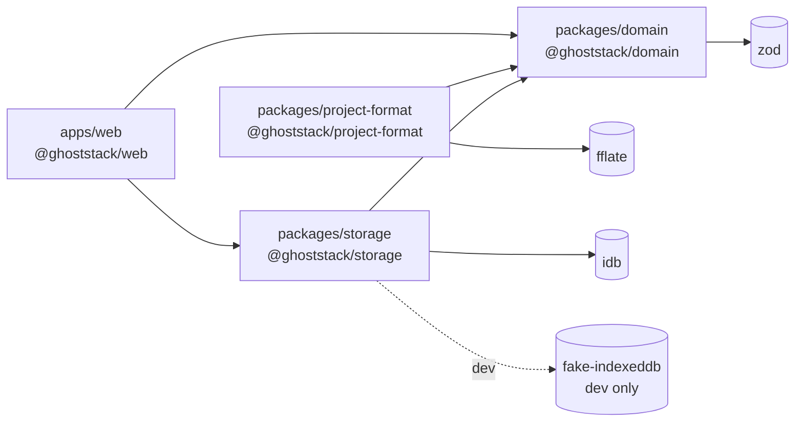
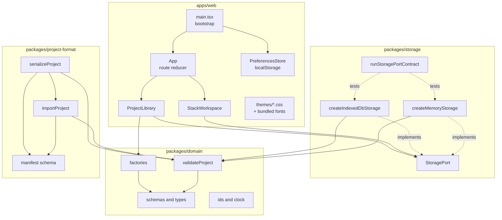
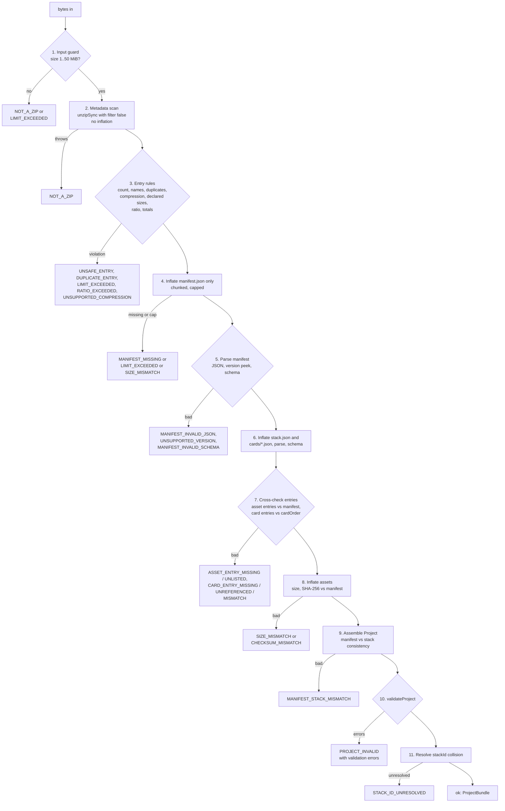
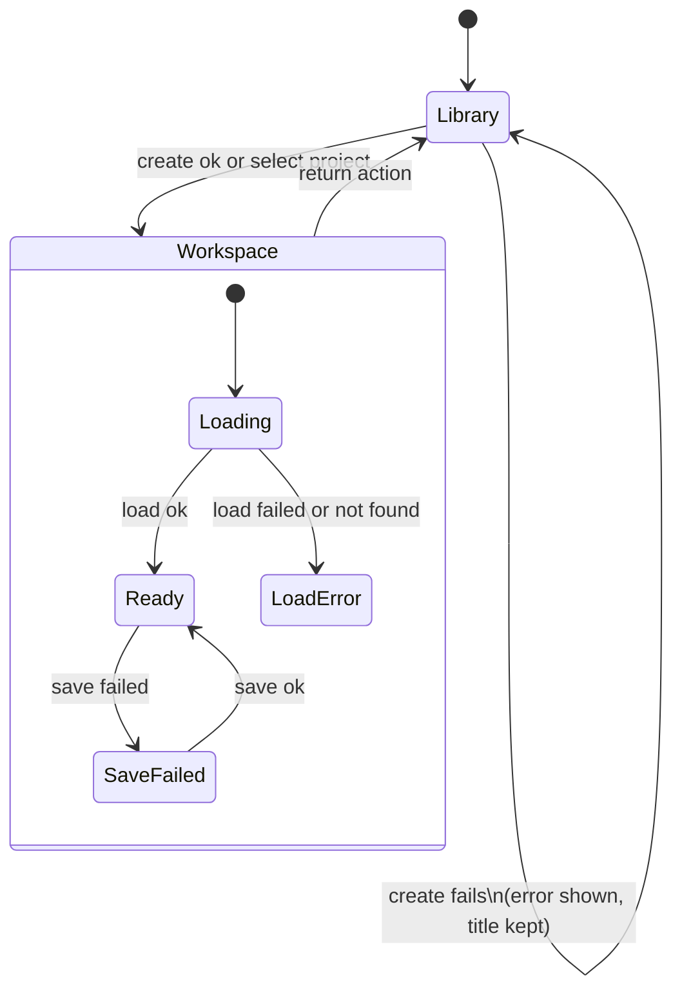

# Design Document

## Overview

This document is the technical design for GhostStack milestone M1, Foundation (vertical slice VS-00). It implements `requirements.md` in the same directory. Scope is limited to what that file lists: a Vite + React + TypeScript web app, three framework-independent packages (domain, project format, storage), a Spectral Workstation themed shell, and a verified quality toolchain. AI, MCP, behavior runtime, canvas editing, preview and standalone export are out of scope.

### Design summary

| Area | Decision |
|---|---|
| Workspace | npm workspaces: `apps/web`, `packages/domain`, `packages/project-format`, `packages/storage`. No other packages. |
| Source of types | Zod 4 schemas in `domain`; TypeScript types are `z.infer` of those schemas, so schema and type cannot drift. |
| ZIP library | `fflate` 0.8.3 (MIT). Metadata is read first, then entries are inflated in 16 KiB input chunks with running size checks. |
| Checksum | SHA-256 through Web Crypto (`crypto.subtle.digest`), asynchronous, stored as `sha256:<64 hex>`. |
| Identifiers | `<prefix>_<uuid-v4>`, generated from `crypto.getRandomValues`. |
| Format version | Integer `formatVersion`. Version `1` is the only supported version in M1. |
| Persistence | `idb` 8.0.4 behind a `StoragePort`. An in-memory implementation runs the same contract suite. IndexedDB adapter tests use `fake-indexeddb` in Node. |
| UI state | React `useReducer` plus context. No router and no state library. |
| Quality tools | ESLint 10 flat config, typescript-eslint, Prettier 3, Vitest 5 with `projects`, fast-check 4, Testing Library with jsdom (web project only). |

### Verification of facts used in this design

Versions and licenses below were read from the npm registry with `npm view` on the design date. Behavior claims about `fflate`, TypeScript `lib` handling and Vitest `projects` were checked with small throwaway experiments in `/tmp`, not in the repository.

| Fact | Evidence |
|---|---|
| Latest `typescript` is 7.0.2, but `typescript-eslint` 8.72.2 declares peer `typescript >=4.8.4 <6.1.0`. | `npm view typescript-eslint peerDependencies` |
| TypeScript `6.0.3` is the newest 6.0.x release. It satisfies that peer range and is the pinned choice. | `npm view typescript versions` |
| `fflate` `unzipSync(bytes, { filter })` reports `name`, `size`, `originalSize` and `compression` for every entry from the central directory. A filter that returns `false` inflates nothing. | Experiment; output listed both entries with declared sizes. |
| `fflate` throws `invalid zip data` for empty, 5-byte and truncated input. | Experiment. |
| When the declared size in a doctored archive is smaller than the real size, `unzipSync` silently returns a buffer truncated to the declared size and raises no error. The size mismatch must therefore be detected separately. | Experiment: a 20 MiB entry with declared size 100 returned 100 bytes. |
| Streaming `Unzip` plus `UnzipInflate`, fed 16 KiB chunks, reports real output sizes. `terminate()` after exceeding a cap stopped a 20 MiB entry in about 42 ms. | Experiment. |
| `zipSync` is byte-deterministic for identical input when `mtime` is supplied. The `mtime` must be built with the local-time constructor `new Date(1980, 0, 1)`. `new Date(Date.UTC(1980, 0, 1))` throws `date not in range 1980-2099` in time zones west of UTC. | Experiment under `TZ=America/Los_Angeles`, `UTC` and `Pacific/Auckland`. |
| With `lib: ["ES2023", "WebWorker"]` and `types: []`, `crypto.subtle` and `crypto.getRandomValues` type-check and `window` is an error. | Experiment with `tsc` 6.0.3. |
| Vitest 5.1.0 `test.projects` can run one project in `node` and another in `jsdom`. | Experiment: 2 files, 2 tests passed. |
| `jsdom` 31.0.1 requires Node `^22.22.2 \|\| ^24.15.0 \|\| >=26`. The installed Node `v24.22.1` qualifies. | `npm view jsdom engines` |

### Values that need owner approval

These values come from `requirements.md` or are chosen here. They are proposals until the Product Owner approves them in `docs/ARCHITECTURE.md` (Requirement 15.5, Requirement 10.6, Requirement 10.7).

| Value | Proposed | Note |
|---|---|---|
| Stack, Card title length | 1 to 100 code points after trim | Counted in Unicode code points, not UTF-16 units. |
| Per-asset size | 26,214,400 bytes (25 MiB) | Confirmed. |
| Archive size (compressed) | 52,428,800 bytes (50 MiB) | Confirmed. |
| Per-entry uncompressed size | 26,214,400 bytes (25 MiB) | Confirmed. |
| Total uncompressed size | 104,857,600 bytes (100 MiB) | Confirmed. |
| Entry count | 1000 | Confirmed. |
| Compression ratio | 100:1, applied only to entries whose declared uncompressed size is 1,048,576 bytes (1 MiB) or more | Adjusted. A bare 100:1 rule would reject small, legitimately repetitive JSON. A zip bomb below 1 MiB per entry does no harm, because the per-entry and total caps already bound memory. |
| Importer inflate chunk | 16,384 bytes of compressed input per push | Design choice. Bounds transient output per chunk, since DEFLATE can expand about 1000:1. |
| Manifest/stack/card JSON entry size | Covered by the 25 MiB per-entry cap | No separate cap. |

## Architecture

### Package dependency graph



Rules enforced by configuration, not by convention:

- `domain`, `project-format` and the `port` and `memory` folders of `storage` import no React, no `idb`, no ZIP library (except `project-format` with `fflate`) and use no browser global. This is enforced by ESLint `no-restricted-imports` and `no-restricted-globals` (Requirement 3.3, 5.4, 1.12) and by the TypeScript `lib` setting below, which has no DOM types.
- `apps/web` is the only package that imports React.
- `apps/web` does not depend on `project-format` in M1. The Project Library shows import and export as disabled (Requirement 12.10), so the app has no caller for it. Adding the dependency is a one-line change in the slice that wires import. This differs from the "web depends on all" wording in the task brief and is called out for owner confirmation.

### Why `storage` is one package

`docs/ARCHITECTURE.md` section 5 says `storage` defines persistence interfaces and browser adapters. Requirement 5.4 only forbids the Storage_Port definition from importing browser globals. One package with three entry points satisfies both:

| Entry point | Contents | Allowed imports |
|---|---|---|
| `@ghoststack/storage` | `StoragePort`, `Result`, error codes, in-memory implementation | `@ghoststack/domain` only |
| `@ghoststack/storage/indexeddb` | `createIndexedDbStorage` | `idb`, browser globals through injected `IDBFactory` |
| `@ghoststack/storage/testing` | `runStoragePortContract` | `vitest`, the other two entry points |

ESLint overrides apply the strict restrictions per folder (`src/port`, `src/memory`), so the in-memory path cannot start importing `idb`.

### Workspace layout

```text
GhostStack/
├── package.json                  # private, workspaces, scripts, license Apache-2.0
├── package-lock.json
├── tsconfig.base.json
├── eslint.config.js
├── .prettierrc.json   .prettierignore
├── vitest.config.ts              # test.projects
├── LICENSE                       # unmodified Apache License 2.0
├── apps/web/
│   ├── package.json  tsconfig.json  vite.config.ts  index.html
│   └── src/ main.tsx, app/, features/, components/, themes/
└── packages/
    ├── domain/          package.json tsconfig.json src/
    ├── project-format/  package.json tsconfig.json src/
    └── storage/         package.json tsconfig.json src/{port,memory,indexeddb,testing}
```

No `apps/mcp-server`, `packages/behavior`, `packages/ai-*` or `apps/desktop` directories are created.

### TypeScript strategy

Packages are consumed as source. Each package's `exports` points to `./src/index.ts`; there is no build step for packages and no project references. Vite and Vitest transpile workspace sources directly. Each package runs its own `tsc --noEmit -p`, so every source file is type-checked in the package that owns it. The root script `typecheck` runs all of them (Requirement 2.2).

`tsconfig.base.json` (common to every project):

```jsonc
{
  "compilerOptions": {
    "target": "ES2023",
    "module": "ESNext",
    "moduleResolution": "Bundler",
    "strict": true,
    "noUncheckedIndexedAccess": true,
    "exactOptionalPropertyTypes": true,
    "noImplicitOverride": true,
    "verbatimModuleSyntax": true,
    "isolatedModules": true,
    "skipLibCheck": true,
    "noEmit": true,
    "types": []
  }
}
```

| Project | `lib` | Reason |
|---|---|---|
| `packages/*` | `["ES2023", "WebWorker"]` | Provides `crypto`, `TextEncoder`, `structuredClone` and IndexedDB types but no `window`, `document` or `localStorage`. A DOM reference becomes a compile error, which backs up Requirement 3.3. |
| `apps/web` | `["ES2023", "DOM", "DOM.Iterable"]`, `jsx: "react-jsx"`, `types: ["vite/client"]` | Browser application. |

If `WebWorker` types conflict with another type package at scaffold time, the fallback is `lib: ["ES2023"]` with a small ambient declaration for `crypto`. The conflict check is part of the scaffold task, not assumed.

### Root scripts

All names are planned. They become Verified_Commands only after they are run (Requirement 15.3, 15.4).

| Script | Command | Purpose |
|---|---|---|
| install | `npm ci` | Clean install from the lockfile. Not an npm script, documented as the install command. |
| `dev` | `npm run dev -w @ghoststack/web` → `vite` | Dev server (manual start only). |
| `build` | `npm run build -w @ghoststack/web` → `tsc --noEmit -p . && vite build` | Type check then static build into `apps/web/dist`. |
| `preview` | `npm run preview -w @ghoststack/web` → `vite preview` | Serve the build output. |
| `lint` | `eslint .` | Flat config, zero warnings allowed (`--max-warnings=0`). |
| `format` | `prettier --write .` | Format. |
| `format:check` | `prettier --check .` | Format gate. |
| `typecheck` | `npm run typecheck --workspaces --if-present` | `tsc --noEmit -p .` in each workspace. |
| `test` | `vitest --run` | Single run. Root `vitest.config.ts` defines projects. |

No `test:e2e` script is defined (Requirement 2.9). Documentation lists end-to-end tests as not available.

### Vitest configuration

Root `vitest.config.ts`:

```ts
import { defineConfig } from 'vitest/config';

export default defineConfig({
  test: {
    projects: [
      { test: { name: 'domain',         root: 'packages/domain',         environment: 'node', include: ['src/**/*.test.ts'] } },
      { test: { name: 'project-format', root: 'packages/project-format', environment: 'node', include: ['src/**/*.test.ts'] } },
      { test: { name: 'storage',        root: 'packages/storage',        environment: 'node', include: ['src/**/*.test.ts'] } },
      'apps/web/vite.config.ts',
    ],
  },
});
```

`apps/web/vite.config.ts` contains `test: { name: 'web', environment: 'jsdom', setupFiles: ['./src/test/setup.ts'], include: ['src/**/*.test.{ts,tsx}'] }`. The root `package.json` has `"type": "module"` so config files load as ESM (the experiment printed a warning without it).

Node-environment projects never load jsdom, so `window` and `document` are undefined there (Requirement 3.4). A test in `domain` asserts `typeof window === 'undefined'`. A fast-check default of 100 runs is already the library default, but every property test sets `{ numRuns: 100 }` explicitly or a larger value, so Requirement 2.3 does not depend on a default.

### ESLint and Prettier

- `eslint.config.js` (flat): `@eslint/js` recommended, `typescript-eslint` `recommendedTypeChecked` for `.ts` and `.tsx`, `eslint-plugin-react-hooks` for `apps/web`, `globals` for per-folder environments.
- `no-restricted-globals` for `window`, `document`, `localStorage`, `sessionStorage`, `navigator` in `packages/**` (except `packages/storage/src/indexeddb/**`, which is also forbidden from using those globals except via an injected `IDBFactory`).
- `no-restricted-imports` for `react`, `react-dom`, `idb`, `fflate` and `@ghoststack/web` in `packages/domain/**`; `react`, `react-dom`, `idb` in `packages/project-format/**`; `react`, `react-dom`, `idb` in `packages/storage/src/{port,memory}/**`.
- `no-eval` and `no-new-func` are enabled repo-wide (Security, below).
- Prettier: single quotes, semicolons, `printWidth: 100`, `trailingComma: all`. `eslint-config-prettier` is not added because the enabled ESLint rule sets have no formatting rules; this avoids a dependency.
- Resolved in task 10.1: `eslint-plugin-react-hooks` 7.1.1 exposes the flat preset as `reactHooks.configs.flat.recommended` (README, confirmed at runtime). `eslint.config.js` applies it through `extends` on `apps/web/**/*.{ts,tsx}`.

### Dependency list

| Package | Version (verified) | Where | License | Reason | Cost |
|---|---|---|---|---|---|
| `react`, `react-dom` | 19.3.1 | web | MIT | UI (T-001). | Core runtime; about the usual React size. |
| `vite` | 8.3.8 | web (dev) | MIT | Build and dev server (T-002). | Dev only. |
| `@vitejs/plugin-react` | 6.3.0 | web (dev) | MIT | JSX transform; peer `vite ^8`. | Dev only. |
| `typescript` | 6.0.3 | root (dev) | Apache-2.0 | Type checking. 6.0.x because typescript-eslint caps at `<6.1.0`. | Dev only. |
| `@types/react`, `@types/react-dom` | 19.3.0 | web (dev) | MIT | React types. | Dev only. |
| `@types/node` | 24.19.2 | root (dev) | MIT | Peer of Vite and Vitest; config file typing. | Dev only. |
| `zod` | 4.6.7 | domain | MIT | Runtime validation and inferred types (approved in ARCHITECTURE section 2). | Moderate bundle size in the app because `domain` ships to the browser. Measure at build and record. |
| `fflate` | 0.8.3 | project-format | MIT | ZIP read/write (see selection). | Measured: 15,354 bytes minified, 7,132 bytes gzip for `zipSync`, `unzipSync`, `Unzip`, `UnzipInflate`. Not in the web bundle in M1. |
| `idb` | 8.0.4 | storage | ISC | IndexedDB wrapper (T-005). | Small promise wrapper; in the web bundle. |
| `fake-indexeddb` | 6.2.8 | storage (dev) | Apache-2.0 | IndexedDB in Node tests. | Dev only. |
| `vitest` | 5.1.0 | root (dev) | MIT | Test runner (T-015). | Dev only. |
| `fast-check` | 4.10.2 | root (dev) | MIT | Property tests (T-016). | Dev only. |
| `jsdom` | 31.0.1 | web (dev) | MIT | DOM for component tests only. | Dev only. |
| `@testing-library/react` | 16.3.3 | web (dev) | MIT | Component tests. Peer `@testing-library/dom ^10`. | Dev only. |
| `@testing-library/dom` | 10.4.2 | web (dev) | MIT | Required peer of the line above. | Dev only. |
| `@testing-library/jest-dom` | 7.0.1 | web (dev) | MIT | Matchers such as `toHaveAccessibleName` and `toBeVisible`. | Dev only. |
| `@testing-library/user-event` | 14.6.10 | web (dev) | MIT | Realistic typing and Tab navigation in tests. | Dev only. |
| `eslint` | 10.15.0 | root (dev) | MIT | Lint. | Dev only. |
| `@eslint/js` | 10.0.1 | root (dev) | MIT | Base rules. | Dev only. |
| `typescript-eslint` | 8.72.2 | root (dev) | MIT | TS parser and rules. | Dev only. |
| `eslint-plugin-react-hooks` | 7.1.1 | root (dev) | MIT | Hook rule checks. | Dev only. |
| `globals` | 17.14.0 | root (dev) | MIT | Environment globals for ESLint. | Dev only. |
| `prettier` | 3.10.1 | root (dev) | MIT | Formatting. | Dev only. |
| `@fontsource/inter` | 5.3.0 | web | OFL-1.1 | Bundled Inter (Requirement 14.3). | Latin 400 and 600 woff2 only; see theme. |
| `@fontsource/jetbrains-mono` | 5.3.0 | web | OFL-1.1 | Bundled JetBrains Mono. | Latin 400 woff2 only. |

Not added: any router, state library, CSS framework, UI kit, `eslint-config-prettier`, `eslint-plugin-react-refresh`, Playwright, `happy-dom`, `uuid`, `jszip`, `@zip.js/zip.js`, `@testing-library/dom` beyond the required peer.

All versions go into `package-lock.json` at install time. Install ranges in `package.json` use `~` for `typescript` and `^` for the rest; the lockfile fixes exact versions (Requirement 1.4). The root `engines.node` is `^22.22.2 || ^24.15.0`, the intersection of the jsdom and Vitest ranges.

### ZIP library selection (Requirement 8.7)

Candidates were evaluated for Apache-2.0 compatibility, browser and Node support, bundle cost, maintenance and the ability to refuse oversized data before it is fully inflated.

| Criterion | `fflate` 0.8.3 | `JSZip` 3.10.2 | `@zip.js/zip.js` 2.25.0 |
|---|---|---|---|
| License | MIT | `MIT OR GPL-3.0-or-later` (MIT elected) | BSD-3-Clause |
| Apache-2.0 compatibility | Compatible | Compatible only by electing MIT | Compatible |
| Last publish (registry) | 2026-05-16 | 2026-09-08. The previous release, 3.10.1, was 2022-08-02. | 2026-11-12 |
| Bundle, minified (esbuild, relevant API only) | 15,354 B (7,132 B gzip) | 98,766 B (30,346 B gzip) | 168,000 B (71,973 B gzip) |
| Browser and Node | Yes, pure JS, no Node-only imports | Yes | Yes. Optional web workers, larger surface. |
| Deterministic output | Yes with fixed `mtime` (tested) | Possible, needs care with dates | Possible |
| Pre-inflate metadata | `filter` receives declared sizes with no inflation (tested) | Loads entries lazily, but metadata API is object-oriented | Entry metadata available |
| Streaming cap during inflate | `Unzip` + `UnzipInflate`, `terminate()` (tested) | Whole-entry `async()` only; no mid-inflate cap | Streaming writers available |
| Dependencies | None | Several | None |

Selected: `fflate` 0.8.3. It is the smallest, has no dependencies, is MIT, and exposes both the metadata scan and chunked inflation the importer needs.

Known weaknesses that the design compensates for:

1. `unzipSync` trusts declared sizes and truncates silently when they are wrong. The importer therefore does not use `unzipSync` for content. It uses `unzipSync` with an always-`false` filter only to read metadata, then streams.
2. `fflate` does not verify ZIP CRC-32 values. Integrity for assets comes from the manifest SHA-256. JSON entries fail through JSON and schema validation. A flipped byte in a JSON entry that still parses is still a structurally valid project or a structured error, which is what Requirement 11.6 asks for.
3. Streaming `Unzip` relies on local headers. The importer cross-checks the set of names and sizes against the central directory and rejects any archive where they disagree. Entries written with data descriptors are not produced by the serializer and, if `fflate` cannot read them, produce a structured error.

### Component diagram



The arrow from `SER` to `IMP` is the serializer's reopen check (Requirement 9.7). Both modules live in `project-format`, and the dependency is one-way.

## Components and Interfaces

### 1. `@ghoststack/domain`

Public exports: schemas, inferred types, `createStack`, `createCard`, `generateId`, `defaultClock`, `validateProject`, `Result` helpers, limit constants, `ID_PATTERNS`.

#### Identifiers (Requirement 3.7, 4.12)

```ts
export type IdPrefix = 'stk' | 'crd' | 'elm' | 'ast';
export type IdGenerator = (prefix: IdPrefix) => string;

export const UUID_V4_SOURCE =
  '[0-9a-f]{8}-[0-9a-f]{4}-4[0-9a-f]{3}-[89ab][0-9a-f]{3}-[0-9a-f]{12}';
export const ID_PATTERNS = {
  stk: new RegExp(`^stk_${UUID_V4_SOURCE}$`),
  crd: new RegExp(`^crd_${UUID_V4_SOURCE}$`),
  elm: new RegExp(`^elm_${UUID_V4_SOURCE}$`),
  ast: new RegExp(`^ast_${UUID_V4_SOURCE}$`),
} as const;
```

Pattern: `<prefix>_<lowercase UUID v4>`. The prefix makes a wrong-kind ID detectable and keeps file names safe (`cards/crd_<uuid>.json`). The default generator fills 16 bytes with `crypto.getRandomValues`, sets the version and variant bits, and formats lowercase hex. It does not call `crypto.randomUUID`, which exists only in secure contexts and would fail on a plain-HTTP LAN origin; `getRandomValues` is available everywhere that Web Crypto is. 122 random bits make 1,000 consecutive duplicates practically impossible; the test asserts it over 1,000 generations (Requirement 3.7).

#### Clock

```ts
export type Clock = () => string;            // ISO 8601 UTC, e.g. 2026-11-15T10:00:00.000Z
export const defaultClock: Clock = () => new Date().toISOString();
export const ISO_TIMESTAMP = /^\d{4}-\d{2}-\d{2}T\d{2}:\d{2}:\d{2}\.\d{3}Z$/;
```

A string clock keeps all values JSON-native (Requirement 3.9).

#### Types and schemas

Schemas use `z.strictObject` everywhere, so unknown fields are errors. This blocks smuggled data such as credentials in an imported file (Requirement 8.5). Identifier fields are plain strings in the schema; the pattern check lives in the semantic validator phase so that errors can name exact paths, including record keys.

```ts
export const FORMAT_VERSION = 1 as const;

export const ViewportDefaultsSchema = z.strictObject({
  width: z.number().int().min(1).max(16384),
  height: z.number().int().min(1).max(16384),
});   // default 1280 x 720, matching DESIGN section 13

export const StateEntrySchema = z.strictObject({
  type: z.enum(['string', 'number', 'boolean']),
  initial: z.union([z.string(), z.number(), z.boolean()]),
});   // stateSchema: Record<string, StateEntry>. Empty in M1 and not otherwise interpreted.

export const LayoutSchema = z.strictObject({
  x: z.number().finite(), y: z.number().finite(),
  width: z.number().finite().min(0), height: z.number().finite().min(0),
});

const base = { elementId: z.string(), name: z.string().max(100), layout: LayoutSchema };
export const ElementSchema = z.discriminatedUnion('type', [
  z.strictObject({ ...base, type: z.literal('text'),   properties: z.strictObject({ text: z.string().max(10000) }) }),
  z.strictObject({ ...base, type: z.literal('button'), properties: z.strictObject({ label: z.string().max(200) }) }),
  z.strictObject({ ...base, type: z.literal('input'),  properties: z.strictObject({ placeholder: z.string().max(200) }) }),
  z.strictObject({ ...base, type: z.literal('image'),  properties: z.strictObject({ assetId: z.string().nullable(), alt: z.string().max(500) }) }),
  z.strictObject({ ...base, type: z.literal('shape'),  properties: z.strictObject({ shape: z.enum(['rectangle', 'ellipse']), fill: z.string().max(64) }) }),
  z.strictObject({ ...base, type: z.literal('line'),   properties: z.strictObject({ stroke: z.string().max(64), strokeWidth: z.number().finite().min(0) }) }),
]);

export const CardSchema = z.strictObject({
  cardId: z.string(), title: z.string().max(100), elements: z.array(ElementSchema),
});

export const AssetSchema = z.strictObject({
  assetId: z.string(), relativePath: z.string(), mimeType: z.string().max(127),
  byteSize: z.number(),                 // integer and range checked in the semantic phase
  checksum: z.string(),                 // 'sha256:' + 64 lowercase hex, checked in the semantic phase
});

export const StackSchema = z.strictObject({
  stackId: z.string(),
  title: z.string(),                    // code-point length 0..100, checked in the semantic phase
  formatVersion: z.literal(FORMAT_VERSION),
  createdAt: z.string(), updatedAt: z.string(),
  entryCardId: z.string(),
  cardOrder: z.array(z.string()),
  cards: z.record(z.string(), CardSchema),
  assetRegistry: z.record(z.string(), AssetSchema),
  stateSchema: z.record(z.string(), StateEntrySchema),
  viewportDefaults: ViewportDefaultsSchema,
});

export type Stack = z.infer<typeof StackSchema>;
export type Project = Stack;            // a Project is a Stack with its cards, elements and asset registry
export type Card = z.infer<typeof CardSchema>;
export type Element = z.infer<typeof ElementSchema>;
export type Asset = z.infer<typeof AssetSchema>;
export type ElementType = Element['type'];

export type AssetBytes = Readonly<Record<string, Uint8Array>>;   // keyed by assetId
export interface ProjectBundle { readonly stack: Stack; readonly assets: AssetBytes }
```

Decisions inside the schema:

- Collections are keyed objects (`cards`, `assetRegistry`) so lookups are O(1) and deep equality ignores key order. The key must equal the entity ID (`CARD_KEY_MISMATCH`, `ASSET_KEY_MISMATCH`). A "duplicate `cardId`" (Requirement 4.7) is two keys whose `card.cardId` are equal.
- `Card.elements` is an ordered array; array order is z-order. `elementId` duplicates are detectable (Requirement 4.8).
- The image element references its asset through `properties.assetId`, which is `string | null`. `null` replaces `undefined`, so no value contains `undefined` (Requirement 3.9).
- `Stack.title` is allowed to be empty at the schema level because Requirement 13.2 requires the workspace to open a Stack whose title is empty. The factory enforces the 1 to 100 rule for new Stacks. A title longer than 100 code points is a validation error.
- `behaviors`, `backgrounds` and `backgroundId` from `docs/ARCHITECTURE.md` section 6.1 are omitted until their slices. Adding optional fields later does not need a version bump. Removing or retyping a field does.
- `viewportDefaults` defaults to `{ width: 1280, height: 720 }`.
- `stateSchema` defaults to `{}`.

Type-level test (Requirement 3.1): `expectTypeOf<Stack>().toEqualTypeOf<{...}>()` for every listed field, in a `*.test-d.ts`-style assertion inside a normal `.test.ts` file so `tsc` fails if a field changes.

#### Factories (Requirement 3.5, 3.6, 3.8)

```ts
export interface FactoryDeps { readonly clock: Clock; readonly newId: IdGenerator }
export const defaultDeps: FactoryDeps = { clock: defaultClock, newId: generateId };

export type DomainError =
  | { code: 'INVALID_TITLE'; message: string; reason: 'empty' | 'too-long' };

export function createStack(title: string, deps?: Partial<FactoryDeps>): Result<Stack, DomainError>;
export function createCard(title: string, deps?: Partial<FactoryDeps>): Result<Card, DomainError>;
```

`createStack`:

1. `trimmed = title.trim()`; length is `Array.from(trimmed).length` (code points).
2. Length 0 returns `err({ code: 'INVALID_TITLE', reason: 'empty' })`; above 100 returns `reason: 'too-long'`. Nothing is created.
3. Otherwise it calls `clock()` exactly once and uses the value for both `createdAt` and `updatedAt`. It calls `newId('stk')` once and builds one initial card titled `"Card 1"` with `newId('crd')`. `entryCardId` equals that card's ID, `cardOrder` is `[cardId]`.
4. With the same injected `clock` and `newId` results, two runs produce deeply equal values (Requirement 3.8). The order of `newId` calls is fixed: stack, card.

The factory calls only injected functions, so there is no hidden randomness.

#### Result type

```ts
export type Result<T, E> = { readonly ok: true; readonly value: T } | { readonly ok: false; readonly error: E };
export const ok = <T>(value: T): Result<T, never> => ({ ok: true, value });
export const err = <E>(error: E): Result<never, E> => ({ ok: false, error });
```

#### Validation (Requirement 4)

```ts
export type ValidationErrorCode =
  | 'MISSING_FIELD' | 'INVALID_TYPE' | 'INVALID_VALUE' | 'UNKNOWN_FIELD'
  | 'INVALID_ID'
  | 'ENTRY_CARD_NOT_FOUND' | 'CARD_ORDER_REFERENCE_NOT_FOUND' | 'CARD_ORDER_DUPLICATE'
  | 'CARD_ORDER_OMITS_CARD' | 'CARD_ID_DUPLICATE' | 'CARD_KEY_MISMATCH'
  | 'ELEMENT_ID_DUPLICATE' | 'ELEMENT_ASSET_NOT_FOUND'
  | 'ASSET_KEY_MISMATCH' | 'ASSET_PATH_INVALID' | 'ASSET_SIZE_INVALID' | 'ASSET_CHECKSUM_INVALID'
  | 'TITLE_TOO_LONG' | 'TIMESTAMP_INVALID'
  | 'VALIDATOR_INTERNAL_ERROR';

export type PathSegment = string | number;
export interface ValidationError {
  readonly code: ValidationErrorCode;
  readonly message: string;                 // human readable, never contains input values
  readonly path: readonly PathSegment[];    // location of the field
  readonly details: Readonly<Record<string, string | number>>;  // cardId, elementId, assetId, rule, ...
}
export interface ValidationResult { readonly errors: readonly ValidationError[] }

export function validateProject(input: unknown): ValidationResult;
export const isValid = (r: ValidationResult): boolean => r.errors.length === 0;
```

Messages never echo input values. This keeps secrets that might sit in a malformed file out of logs and error dialogs.

##### Algorithm

`validateProject(input)` is a pure function wrapped in `try`/`catch`. Any unexpected exception becomes a single `VALIDATOR_INTERNAL_ERROR`, so the function never throws (Requirement 4.16). It never mutates its input (Requirement 4.15) because it only reads, and it builds new arrays for results.

Phase 1, structural. `StackSchema.safeParse(input)`. Each Zod issue maps to one error:

| Zod issue | Code |
|---|---|
| `invalid_type` where the value at the path is absent or `undefined` | `MISSING_FIELD` |
| `invalid_type` otherwise | `INVALID_TYPE` |
| `unrecognized_keys` (one error per key, path extended with the key) | `UNKNOWN_FIELD` |
| any other issue (range, enum, union) | `INVALID_VALUE` |

Absent-versus-wrong-type is decided by looking up the issue path in the original input with `Object.hasOwn`, because Zod 4 issues do not carry the input value by default. The mapping from Zod 4 issue codes is confirmed against the installed version at implementation time and covered by tests.

Zod recurses only to the depth of the schema (at most about 7 levels) and never walks arbitrary user data, because the schema contains no unknown-JSON fields. A 1,000-level nested value placed anywhere is just a type or unknown-key error at its first level. The semantic phase below never recurses into user data either, so deep nesting cannot overflow the stack (Requirement 4.16).

Phase 2, semantic. It runs even when phase 1 reported errors, so Requirement 4.13 holds (all errors in one result). It reads the input through tolerant accessors (`asRecord`, `asArray`, `asString`) that return `undefined` when a value has the wrong shape, and it skips any check whose operands are missing. All checks:

1. Every identifier field matches `ID_PATTERNS[prefix]`: `stackId`, `entryCardId`, each `cardOrder[i]`, each `cards` key and `card.cardId`, each `elementId`, each `assetRegistry` key and `assetId`, each image `properties.assetId` that is not `null`. Failure: `INVALID_ID` with `details.field` and the path.
2. `title` code-point length ≤ 100 for the Stack and each Card (`TITLE_TOO_LONG`).
3. `createdAt` and `updatedAt` match `ISO_TIMESTAMP` and parse to a valid date (`TIMESTAMP_INVALID`).
4. `cards[key].cardId === key` (`CARD_KEY_MISMATCH`). Two entries with equal `card.cardId` produce `CARD_ID_DUPLICATE` once per duplicated ID.
5. `entryCardId` exists in `cards` (`ENTRY_CARD_NOT_FOUND`, `details.cardId`).
6. Every `cardOrder[i]` exists (`CARD_ORDER_REFERENCE_NOT_FOUND`, `details.cardId`, path `['cardOrder', i]`).
7. Duplicates in `cardOrder` (`CARD_ORDER_DUPLICATE`, one error per repeated ID, at the second and later occurrences).
8. Each card not named in `cardOrder` (`CARD_ORDER_OMITS_CARD`, `details.cardId`).
9. Per card, `elementId` duplicates (`ELEMENT_ID_DUPLICATE`, `details.elementId`, `details.cardId`).
10. Per image element with non-null `assetId` absent from `assetRegistry` (`ELEMENT_ASSET_NOT_FOUND`, `details.elementId`, `cardId`, `assetId`).
11. `assetRegistry[key].assetId === key` (`ASSET_KEY_MISMATCH`).
12. Asset `relativePath`, rules checked in this order and reported as the first failing rule (`ASSET_PATH_INVALID`, `details.assetId`, `details.rule`): `null-char` (contains `\u0000`), `backslash`, `absolute` (starts with `/`, or matches `^[A-Za-z]:`), `dot-dot` (any `/`-separated segment equals `..`), `prefix` (does not start with `assets/`), `charset` (after `assets/` is not 1 to 128 characters of `[A-Za-z0-9._-]`, which also forbids nested folders and empty names).
13. Asset `byteSize` (`ASSET_SIZE_INVALID`, `details.rule`): `non-integer` (not a safe integer), `negative`, `too-large` (above 26,214,400).
14. Asset `checksum` matches `^sha256:[0-9a-f]{64}$` (`ASSET_CHECKSUM_INVALID`).

Phase 3, ordering. All errors are sorted with a total order and returned:

1. Compare `path` element by element. Segments compare by type first (numbers before strings), then numerically or by UTF-16 code-unit order. This is not `localeCompare`, so the result does not depend on the runtime locale. A shorter path sorts before a longer path with the same prefix.
2. Tie: compare `code` by code-unit order.
3. Tie: compare `message`.

Validating the same input twice therefore returns equal results (Requirement 4.14). The sort is stable and the tie-break fields are fully specified, so order does not depend on input property enumeration order.

Performance: all checks are linear in the size of the project, with one `Set` per scope. Nothing re-parses.

### 2. `@ghoststack/storage`

#### Port (Requirement 5)

```ts
export type StorageErrorCode =
  | 'not-found' | 'validation-failed' | 'quota-exceeded'
  | 'storage-unavailable' | 'unsupported-version' | 'write-failed';

export interface StorageError {
  readonly code: StorageErrorCode;
  readonly message: string;
  readonly stackId?: string;
  readonly assetId?: string;
  readonly validationErrors?: readonly ValidationError[];   // for validation-failed
  readonly storedVersion?: number;  readonly supportedVersion?: number;  // for unsupported-version
}

export interface ProjectSummary { readonly stackId: string; readonly title: string; readonly updatedAt: string }
export interface UnreadableProject { readonly stackId: string; readonly message: string }
export interface ProjectListing { readonly summaries: readonly ProjectSummary[]; readonly unreadable: readonly UnreadableProject[] }

export interface StoragePort {
  saveProject(bundle: ProjectBundle): Promise<Result<void, StorageError>>;
  loadProject(stackId: string): Promise<Result<ProjectBundle, StorageError>>;
  listProjects(): Promise<Result<ProjectListing, StorageError>>;
  deleteProject(stackId: string): Promise<Result<void, StorageError>>;

  saveAsset(stackId: string, assetId: string, bytes: Uint8Array): Promise<Result<void, StorageError>>;
  loadAsset(stackId: string, assetId: string): Promise<Result<Uint8Array, StorageError>>;
  deleteAsset(stackId: string, assetId: string): Promise<Result<void, StorageError>>;
}
```

All methods return a `Result` and do not throw. Adapters catch every exception and map it to a `StorageError`.

Notes on interpretation:

- Requirement 5.1 says a summary has exactly three fields. `ProjectSummary` has exactly those. `ProjectListing.unreadable` is an addition so that Requirement 12.6 can show a damaged record as unavailable without losing the other Projects. This is the only departure from the literal wording and is flagged for owner approval.
- `saveProject` replaces the whole stored project. In one operation it writes the stack record, writes every asset in `bundle.assets` and removes stored assets of that `stackId` that are not in the bundle. It validates first with `validateProject`, and also checks that the bundle holds bytes for each registry entry and that `bytes.length === byteSize`. Failure returns `validation-failed` before anything is written.
- `saveAsset`, `loadAsset` and `deleteAsset` are independent operations scoped by `(stackId, assetId)`. They do not consult the registry.
- `loadProject` validates the stored stack with `validateProject`. Invalid data gives `validation-failed` with the validator errors and leaves storage untouched. A registry entry with no stored bytes gives `not-found` with `assetId`. It checks `bytes.length === byteSize` and does not recompute SHA-256 on load; checksum verification is part of import and export.
- `deleteProject` removes the stack and every asset with that `stackId`, then later `loadAsset` returns `not-found` (Requirement 5.8). Deleting a missing project returns `not-found`.
- Loading a missing `stackId` returns `not-found` with `stackId` and creates nothing (Requirement 5.6, 6.8).

#### In-memory implementation

`createMemoryStorage(options?: { faults?: FaultController })` keeps `Map<stackId, Stack>` and `Map<stackId, Map<assetId, Uint8Array>>`. It stores deep copies (`structuredClone` for the stack, `Uint8Array.slice()` for bytes) both on write and on read, so callers cannot mutate stored state. `saveProject` builds the new state completely, then swaps it in with a single assignment, so a fault before the swap leaves the old state intact. `FaultController` is a small test seam (`failNextWrite(code)`), used only by the contract suite.

#### IndexedDB adapter (Requirement 6)

```ts
export interface IndexedDbStorageOptions {
  readonly factory?: IDBFactory;                       // default: globalThis.indexedDB; tests inject fake-indexeddb
  readonly databaseName?: string;                      // default 'ghoststack'
  readonly faultInjection?: (stage: 'after-stack-put' | 'after-asset-put') => void;  // tests only
}
export function createIndexedDbStorage(options?: IndexedDbStorageOptions): StoragePort;
```

| Item | Value |
|---|---|
| Database name | `ghoststack` |
| Current version | `1` (`DB_VERSION` constant) |
| Store `stacks` | `keyPath: 'stackId'`. Value is the `Stack` JSON object. |
| Store `assets` | `keyPath: ['stackId', 'assetId']`. Value is `{ stackId, assetId, bytes: Uint8Array }`. |
| Other stores | None. `checkpoints` and `operations` arrive with their slices through a version 2 upgrade. |
| Scoped queries | `IDBKeyRange.bound([stackId, ''], [stackId, '\uffff'])` over the compound primary key, so no extra index is needed. |

Opening:

```ts
openDB(name, DB_VERSION, {
  upgrade(db, oldVersion) {
    if (oldVersion < 1) {
      db.createObjectStore('stacks', { keyPath: 'stackId' });
      db.createObjectStore('assets', { keyPath: ['stackId', 'assetId'] });
    }
    // future: if (oldVersion < 2) { ... } each step additive
  },
  blocking() { /* another tab wants to upgrade */ closeConnection(); },
  terminated() { /* browser closed the connection */ dropCachedConnection(); },
});
```

The adapter opens lazily on first use and caches the promise. If the open attempt fails, the cached promise is cleared so a later call retries.

Save flow (Requirement 6.3 to 6.6):

1. Validate the bundle with `validateProject`, check bytes. Failure returns `validation-failed` and no transaction starts.
2. Open one transaction: `db.transaction(['stacks', 'assets'], 'readwrite')`.
3. Queue, without awaiting anything that is not an IndexedDB request: `stacks.put(stack)`; call `faultInjection?.('after-stack-put')`; delete asset records for the `stackId` whose `assetId` is not in the bundle; `assets.put(...)` for each asset; call `faultInjection?.('after-asset-put')`. Awaiting a non-IndexedDB promise inside the transaction would let it auto-commit early, so the code only queues requests and awaits the `Promise.all` of those requests.
4. `await tx.done`. Success is reported only after this resolves.
5. If anything throws before commit, call `tx.abort()` (swallowing the secondary `AbortError`), and map the error. IndexedDB rolls back the whole transaction, so the previous stack and its assets are unchanged.

Error mapping (a pure function `mapIdbError(error, context)`, unit-tested with constructed `DOMException` values):

| Condition | Result |
|---|---|
| `error.name === 'QuotaExceededError'` (on a request, on `tx.error` or `tx.abort` cause) | `quota-exceeded` |
| `error.name === 'VersionError'` on open | `unsupported-version` with `supportedVersion = DB_VERSION`. The stored version is read from the error message when the engine provides it. The adapter does not retry, downgrade or delete. |
| `indexedDB` undefined, `SecurityError`, `InvalidStateError`, `UnknownError` on open, or `blocked` for longer than the open call allows | `storage-unavailable` |
| `NotFoundError` from a missing store, any other `DOMException` or `Error` | `write-failed` (for writes) or `storage-unavailable` (for open) |

A newer stored database is handled by the browser itself: opening a database with a version lower than the stored one fails with `VersionError` and changes nothing. The adapter only maps that failure.

Load flow: one read-only transaction over both stores; `stacks.get(stackId)` missing gives `not-found`; present data is validated; assets are read with the key range. A validation failure returns `validation-failed` with the errors and writes nothing (Requirement 6.7).

List flow: `stacks.getAll()`. For each record, read `stackId`, `title` and `updatedAt` through type guards. A record that lacks usable values goes to `unreadable`. Summaries are not sorted by the adapter; the UI sorts them (Requirement 12.4). This reads full stack records, which is acceptable at M1 scale. A separate summary store or index is a later optimization and is not needed now.

Persistence of credentials: the stored records contain only the schema above. The strict schema rejects extra fields at save time, so a credential cannot be added to a stored project by accident (Requirement 6.13).

Persistent storage request (Requirement 6.12): after the first successful save in a session, the app calls `navigator.storage?.persist?.()` inside `try`/`catch` and ignores the result. It is called in `apps/web`, not in the adapter, so the adapter stays free of `navigator`.

#### Shared contract suite

`runStoragePortContract(name, makePort)` is exported from `@ghoststack/storage/testing`. `makePort()` returns `{ port, faults? }` for a fresh, isolated store. The suite covers:

| Group | Cases |
|---|---|
| Round trip | Save then load returns a deeply equal `Stack` and byte-identical assets, including a zero-byte asset, for generated projects (property). |
| List | Summaries have exactly `stackId`, `title`, `updatedAt` and reflect the latest save. |
| Missing | Load, delete, `loadAsset` for unknown IDs return `not-found` and do not throw. |
| Delete cascade | After `deleteProject`, `loadProject` and `loadAsset` return `not-found`. |
| Invalid save | An invalid project returns `validation-failed` with validator errors; previous data is unchanged. |
| Fault during save | With a fault injected, save returns `write-failed` or `quota-exceeded`; previous stack and assets are unchanged. |
| Replace semantics | Saving a second version with fewer assets removes the dropped assets. |
| Isolation | Mutating a returned project does not change stored state. |

Adapter-specific tests (in `packages/storage/src/indexeddb`, Node, `fake-indexeddb`):

- Fresh database creates both stores at version 1.
- A database pre-created at version 99 gives `unsupported-version`, and the version and records are still 99 and unchanged afterward.
- `mapIdbError` table tests, including `QuotaExceededError`.
- `faultInjection` after the stack put and after the asset puts leaves the old project and assets intact.
- Reopening a new adapter on the same `IDBFactory` instance returns saved data, which models a page reload at the API level. The real browser reload is a manual check.

Why `fake-indexeddb` 6.2.8: it implements the IndexedDB API in pure JavaScript, runs in Node without a DOM, supports injecting an `IDBFactory` instance per test for isolation, and is Apache-2.0. Alternatives considered: `happy-dom` or `jsdom` (neither implements IndexedDB), and browser-mode tests with Playwright (heavier, not approved for M1). Limits: it does not reproduce real quota behavior or browser-specific failures, so those paths are covered by the injected faults and the manual browser check.

### 3. `@ghoststack/project-format`

Public exports: `serializeProject`, `importProject`, `canonicalJson`, `ManifestSchema`, `SUPPORTED_FORMAT_VERSIONS`, `GSP_LIMITS`, `sha256Checksum`.

#### Constants

```ts
export const SUPPORTED_FORMAT_VERSIONS = [1] as const;
export const GSP_LIMITS = {
  maxArchiveBytes: 52_428_800,        // 50 MiB, compressed archive size
  maxEntryBytes: 26_214_400,          // 25 MiB per uncompressed entry
  maxTotalBytes: 104_857_600,         // 100 MiB total uncompressed
  maxEntries: 1000,
  maxRatio: 100,                      // uncompressed : compressed
  ratioMinEntryBytes: 1_048_576,      // ratio rule applies from 1 MiB declared size
  inflateChunkBytes: 16_384,
} as const;
export const FIXED_ZIP_TIME = new Date(1980, 0, 1, 0, 0, 0);   // local-time constructor: see verification table
```

#### Format version scheme (Requirement 8.3)

`formatVersion` is a single positive integer. It increases only for a change an older importer cannot read (removed or retyped field, changed layout). Additive optional fields do not change it. M1 writes and accepts exactly `1`. A lower or higher value, or a non-integer, is `UNSUPPORTED_VERSION` with the archive's value and the list `[1]` in the error. `Stack.formatVersion` is the same integer and must equal `manifest.formatVersion`.

#### Layout (Requirement 8.1)

```text
<project>.gsp  (ZIP)
├── manifest.json
├── stack.json                      # Stack without the `cards` field
├── cards/<cardId>.json             # one per card; the entry name matches the card's own cardId
└── assets/<assetId>.<ext>          # one per registered asset; entry name equals asset.relativePath
```

Allowed names are exactly `manifest.json`, `stack.json`, `cards/<crd id>.json`, and `assets/<safe name>` (the same `relativePath` rule as the validator, rule 12). Directory entries (names ending in `/`) are not allowed.

#### Manifest schema (Requirement 8.2)

```ts
export const ManifestSchema = z.strictObject({
  formatVersion: z.literal(1),
  producer: z.string().min(1).max(100),        // 'ghoststack-web'
  stackId: z.string(),
  assets: z.array(z.strictObject({
    assetId: z.string(),
    relativePath: z.string(),
    mimeType: z.string().max(127),
    byteSize: z.number().int().min(0).max(26_214_400),
    checksum: z.string().regex(/^sha256:[0-9a-f]{64}$/),   // algorithm name and value in one string
  })),
});
```

The manifest has no export timestamp. This keeps archives deterministic (Requirement 9.6, 11.5). The `checksum` string pairs the algorithm name with the hex digest, so a future algorithm is a new prefix. The manifest contains no credentials, provider settings or preferences. Strict schemas reject any extra field anywhere in the archive (Requirement 8.5).

#### Checksum (Requirement 9.4)

```ts
export async function sha256Checksum(bytes: Uint8Array): Promise<string>;   // 'sha256:' + hex
```

Implementation: `crypto.subtle.digest('SHA-256', bytes)` then hex encoding. It is asynchronous, available as a global in Node 24 and in browsers on secure contexts (HTTPS and `localhost`). Importer and serializer are therefore `async`. A pure-JavaScript SHA-256 would avoid the secure-context limit but adds code to maintain and is slower for 25 MiB assets; it is not adopted in M1. If `crypto.subtle` is missing, the call returns the structured error `CRYPTO_UNAVAILABLE` (reason in `PROJECT_EXPORT_FAILED` or `PROJECT_IMPORT_FAILED`), not an exception. The editor itself needs no checksum, so a plain-HTTP origin only loses import and export.

#### Canonical JSON

`canonicalJson(value)` returns `JSON.stringify` output with object keys sorted by UTF-16 code-unit order at every level, no whitespace, encoded as UTF-8. It is used for every JSON entry. Because validated projects are shallow (schema depth is bounded), the recursive implementation cannot overflow. This makes serialize → import → serialize byte-identical even though the importer builds objects in a different key order (Requirement 11.5).

#### Serializer (Requirement 9)

```ts
export type ExportError = {
  code: 'PROJECT_EXPORT_FAILED';
  reason: 'VALIDATION_FAILED' | 'ASSET_BYTES_MISSING' | 'ASSET_INCONSISTENT'
        | 'LIMIT_EXCEEDED' | 'CRYPTO_UNAVAILABLE' | 'REOPEN_FAILED';
  message: string;
  assetId?: string;
  validationErrors?: readonly ValidationError[];
  importErrors?: readonly ImportError[];
};
export function serializeProject(bundle: ProjectBundle): Promise<Result<Uint8Array, ExportError>>;
```

Steps, in order:

1. `validateProject(bundle.stack)`. Errors give `VALIDATION_FAILED` with the errors and no archive (Requirement 9.1, 9.2).
2. For every registered asset, bytes must exist in `bundle.assets` (`ASSET_BYTES_MISSING`, `assetId`), `bytes.length === byteSize` and the computed `sha256Checksum` must equal `asset.checksum` (`ASSET_INCONSISTENT`). Bytes for unregistered assets are ignored. The input is not mutated.
3. Check the output will respect `GSP_LIMITS` for entry count and per-entry sizes (`LIMIT_EXCEEDED`), so every exported archive can be re-imported.
4. Build the entry list in a fixed order: `manifest.json`, `stack.json`, then `cards/<id>.json` sorted by card ID, then assets sorted by `relativePath`. Each JSON entry uses `canonicalJson`. Manifest asset entries are sorted by `assetId`.
5. Call `zipSync` with one options pair per entry: `{ mtime: FIXED_ZIP_TIME, level: 6 }` for JSON entries and `{ mtime: FIXED_ZIP_TIME, level: 0 }` for assets. `fflate` writes entries in object insertion order, which the builder controls. Two calls with equal input produce equal bytes (Requirement 9.6). No clock is read.
6. Reopen the produced bytes with `importProject` using an empty `existingStackIds` set and compare the result to the input (`stack` deep equality and each asset's bytes). Any importer error gives `REOPEN_FAILED` with `importErrors` and no archive is returned (Requirement 9.7, 9.8). A mismatch also gives `REOPEN_FAILED`.

#### Importer (Requirement 10)

```ts
export type ImportReason =
  | 'NOT_A_ZIP' | 'MANIFEST_MISSING' | 'MANIFEST_INVALID_JSON' | 'MANIFEST_INVALID_SCHEMA'
  | 'UNSUPPORTED_VERSION' | 'UNSAFE_ENTRY' | 'DUPLICATE_ENTRY' | 'ENTRY_SET_MISMATCH'
  | 'UNSUPPORTED_COMPRESSION' | 'LIMIT_EXCEEDED' | 'SIZE_MISMATCH' | 'RATIO_EXCEEDED'
  | 'ENTRY_INVALID_JSON' | 'ENTRY_INVALID_SCHEMA'
  | 'CHECKSUM_MISMATCH' | 'ASSET_ENTRY_MISSING' | 'ASSET_ENTRY_UNLISTED'
  | 'CARD_ENTRY_MISSING' | 'CARD_ENTRY_UNREFERENCED' | 'CARD_ENTRY_MISMATCH'
  | 'MANIFEST_STACK_MISMATCH' | 'PROJECT_INVALID' | 'STACK_ID_UNRESOLVED' | 'CRYPTO_UNAVAILABLE';

export interface ImportError {
  readonly code: 'PROJECT_IMPORT_FAILED';
  readonly reason: ImportReason;
  readonly message: string;
  readonly entry?: string;                       // offending entry name
  readonly assetId?: string;
  readonly limit?: 'archive-size' | 'entry-size' | 'total-size' | 'entry-count';
  readonly supportedVersions?: readonly number[];
  readonly archiveVersion?: number;
  readonly validationErrors?: readonly ValidationError[];
}

export interface ImportOptions {
  readonly existingStackIds?: ReadonlySet<string>;
  readonly newId?: IdGenerator;
}
export function importProject(bytes: Uint8Array, options?: ImportOptions): Promise<Result<ProjectBundle, ImportError>>;
```

Every failure has code `PROJECT_IMPORT_FAILED` (ARCHITECTURE section 7.8) and a `reason` that names the cause. The importer is a pure function over bytes: it touches no storage and no UI state, so a failed import cannot change an active project or stored data (Requirement 8.8 to 8.10, 10.15). The entire body sits in `try`/`catch`; an unexpected exception becomes `NOT_A_ZIP` with a generic message, never a thrown error (Requirement 10.16).

Pipeline (the numbers are the order of execution):



Step details:

1. Input guard. `bytes` must be a `Uint8Array`; empty input gives `NOT_A_ZIP`; length above 52,428,800 gives `LIMIT_EXCEEDED` with `limit: 'archive-size'`.
2. Metadata scan. `unzipSync(bytes, { filter })`, where `filter` records `{ name, size, originalSize, compression }` and returns `false`. Nothing is inflated. A throw (empty, truncated, corrupt central directory) is `NOT_A_ZIP`.
3. Entry rules, applied to the full list before any content is read:
   1. Count above 1000: `LIMIT_EXCEEDED`, `limit: 'entry-count'`.
   2. Names: reject if absolute, containing a `..` segment, a backslash or a null character, ending in `/`, or not one of the allowed forms (`UNSAFE_ENTRY`, `entry` set to the name). A duplicate name is `DUPLICATE_ENTRY`.
   3. Compression method must be 0 or 8 (`UNSUPPORTED_COMPRESSION`).
   4. Declared `originalSize` above 25 MiB: `LIMIT_EXCEEDED`, `limit: 'entry-size'`. Sum of declared sizes above 100 MiB: `limit: 'total-size'`.
   5. Ratio: for entries with `originalSize >= 1 MiB`, `originalSize / max(size, 1) > 100` gives `RATIO_EXCEEDED` with the entry name.
   6. `manifest.json` and `stack.json` must be present, each once. A missing manifest is `MANIFEST_MISSING`.
4. Manifest inflate. A helper `inflateEntries(bytes, wanted: Map<name, { declaredSize, compressedSize }>, budget)` runs a streaming `Unzip` with `UnzipInflate` registered. For each local file whose name is in `wanted`, it calls `file.start()`; other files are skipped without inflation. Input is pushed in 16 KiB slices. In `ondata` the helper adds `chunk.length` to a per-entry counter and to a shared total. It calls `file.terminate()` and returns `LIMIT_EXCEEDED` when the entry counter exceeds `min(declaredSize, 25 MiB)` or the total exceeds 100 MiB, and returns `SIZE_MISMATCH` when an entry finishes with a count different from its declared size. It also rejects names present in local headers but absent from the central directory (`ENTRY_SET_MISMATCH`). Steady-state memory is bounded by the caps plus one chunk's expansion (at most about 17 MiB for a 16 KiB DEFLATE input slice).
5. Manifest parse, in this order: decode with `new TextDecoder('utf-8', { fatal: true })`; `JSON.parse` (`MANIFEST_INVALID_JSON` on failure); peek `formatVersion` on the parsed object. If it is not `1`, return `UNSUPPORTED_VERSION` with `archiveVersion` (when it is a number) and `supportedVersions: [1]` before schema validation, because a future format may have a different schema; then `ManifestSchema.safeParse` (`MANIFEST_INVALID_SCHEMA`).
6. Inflate `stack.json` and all `cards/*.json` with the same helper, parse with `TextDecoder` and `JSON.parse` (`ENTRY_INVALID_JSON`), validate `stack.json` with `StackSchema.omit({ cards: true })` and each card with `CardSchema` (`ENTRY_INVALID_SCHEMA`). Only entries read here are decoded, so asset bytes are never decoded as text, and nothing is evaluated as code or HTML (Requirement 10.13).
7. Cross-checks: each manifest asset's `relativePath` must exist as an entry (`ASSET_ENTRY_MISSING`); each `assets/` entry must be listed (`ASSET_ENTRY_UNLISTED`); each `cardOrder` ID must have a `cards/<id>.json` (`CARD_ENTRY_MISSING`); each `cards/` entry must be referenced by `cardOrder` (`CARD_ENTRY_UNREFERENCED`); each card entry's name must equal `cards/<its own cardId>.json` (`CARD_ENTRY_MISMATCH`).
8. Asset inflate and verification: for each asset, actual size must equal manifest `byteSize` (`SIZE_MISMATCH`) and `sha256Checksum(bytes)` must equal the manifest checksum (`CHECKSUM_MISMATCH`, `assetId`).
9. Assemble `stack = { ...stackFile, cards }`. `manifest.stackId` must equal `stack.stackId`, and `manifest.assets` must equal the Stack's `assetRegistry` entries (same IDs, paths, MIME types, sizes and checksums); otherwise `MANIFEST_STACK_MISMATCH`.
10. `validateProject(stack)`. Any error gives `PROJECT_INVALID` with the full error list (Requirement 10.11, 10.12).
11. Stack ID collision: if `options.existingStackIds` contains `stack.stackId`, call `newId('stk')` until the ID is not in the set (at most 10 attempts, then `STACK_ID_UNRESOLVED`). Only `stackId` changes. The `manifest.stackId` is not rewritten because the manifest is not part of the returned value. When there is no collision, the original `stackId` is kept, which gives the round-trip equality in Requirement 11.1. The caller then saves the bundle as a new Project and never overwrites an existing one (Requirement 10.14).

Failure ordering follows Requirements 10.1 to 10.12: manifest handling comes before any other content read; path and limit checks come from metadata before any inflation; asset and card cross-checks come before assembly and validation.

### 4. `apps/web`

#### Bootstrap

`main.tsx` runs, in order and synchronously until the first render:

1. `import '@fontsource/inter/latin-400.css'`, `latin-600.css`, `@fontsource/jetbrains-mono/latin-400.css`, and `themes/spectral-workstation.css` (static imports).
2. `createPreferencesStore(safeLocalStorage())` reads all preferences (Requirement 7.3).
3. `createIndexedDbStorage()` is created but not opened yet.
4. `createRoot(...).render(<ServicesProvider ...><App/></ServicesProvider>)`.

Preferences are read before render, and the theme attribute and panel-size CSS variables are set on the editor root element during the first render, so the first paint already has them.

#### Preferences store (Requirement 7)

```ts
export interface Preferences {
  theme: 'spectral-workstation';
  panelSizes: { navigator: number; inspector: number };       // px
  panelVisibility: { navigator: boolean; toolbox: boolean; inspector: boolean };
  lastProjectId: string | null;
}
export const DEFAULT_PREFERENCES: Preferences = {
  theme: 'spectral-workstation',
  panelSizes: { navigator: 240, inspector: 320 },
  panelVisibility: { navigator: true, toolbox: true, inspector: true },
  lastProjectId: null,
};
export interface PreferencesStore {
  get<K extends keyof Preferences>(key: K): Preferences[K];
  set<K extends keyof Preferences>(key: K, value: Preferences[K]): void;
  subscribe(listener: () => void): () => void;
}
export function createPreferencesStore(storage: Pick<Storage, 'getItem' | 'setItem' | 'removeItem'> | null): PreferencesStore;
```

| Preference | `localStorage` key | Stored form | Validation (on read and write) |
|---|---|---|---|
| theme | `ghoststack.pref.theme` | string | must equal `'spectral-workstation'` |
| panelSizes | `ghoststack.pref.panelSizes` | JSON | object; `navigator` integer 160 to 480; `inspector` integer 200 to 520 |
| panelVisibility | `ghoststack.pref.panelVisibility` | JSON | object of three booleans |
| lastProjectId | `ghoststack.pref.lastProjectId` | string | matches `ID_PATTERNS.stk`; absent means `null` |

Each key is read and validated independently with its own Zod schema in `apps/web`, so one malformed value resets only that preference to its default (Requirement 7.5). Reads and writes are wrapped in `try`/`catch`. If `localStorage` is null or throws (including quota errors), reads return defaults and `set` keeps the value in an in-memory copy for the session without throwing (Requirement 7.6). `set` writes immediately, which is within the 500 ms bound (Requirement 7.4). Nothing about Projects, bytes or credentials has a key (Requirement 7.2). M1 has no UI for changing theme or panel sizes. Panel sizes and visibility are applied as CSS variables and `hidden` state, and the setters exist and are tested.

`lastProjectId` is written when a Project is opened and when the Project Library clears it. On startup the app shows the Project Library. If `lastProjectId` is set, the library calls `loadProject` once in the background only to learn whether it exists; on `not-found` it resets the preference to `null` (Requirement 7.7). If it exists, that row gets a "Last opened" marker. Reload therefore lands in the library, which matches the manual check in Requirement 16.4. Auto-opening the last project on startup is a plausible reading of Requirement 7.7 but conflicts with that manual step, so it is not done. This interpretation needs owner confirmation.

#### State and routing

```ts
type Route = { name: 'library' } | { name: 'workspace'; stackId: string };
type AppAction = { type: 'open'; stackId: string } | { type: 'close' };
function reducer(state: Route, action: AppAction): Route { ... }
```

There is no URL routing, so no router dependency. Consequences: the browser back button does not navigate between screens and reload always returns to the library. Both are acceptable for M1 and noted as a known limitation.

Services (storage, preferences, clock, id generator) come from a React context `ServicesProvider`. Tests provide `createMemoryStorage()` and a fake preferences store. No other state container is introduced.



#### Project Library (UI-01, Requirement 12)

| Part | Behavior |
|---|---|
| `useProjectLibrary()` | Calls `listProjects` on mount. States: `loading`, `ready { summaries, unreadable }`, `unavailable` (code `storage-unavailable` or `unsupported-version`), `error`. |
| Empty state | `summaries` and `unreadable` empty: show the "Create Project" form and no list (Requirement 12.1). |
| Sort | Pure function `sortSummaries`: `updatedAt` descending, then `title` ascending by code-unit order, then `stackId` (for a total order). |
| Row | Button with title and `updatedAt` rendered with `Intl.DateTimeFormat`. Selecting calls `loadProject`; on success, dispatch `open`. On failure the row becomes "Unavailable: this project could not be loaded", is disabled, and stored data is untouched (Requirement 12.6). Other rows stay active. |
| Unreadable records | Listed as unavailable rows, disabled. |
| Create form | One text input with a visible label and a submit button. The submit handler trims and runs `createStack(title)`. A domain error shows a message in an element linked with `aria-describedby`, keeps the typed text and does not save (Requirement 12.3). Success calls `saveProject({ stack, assets: {} })`; on `ok` it sets `lastProjectId`, requests persistent storage once, and dispatches `open`. On a save error it shows "The stack was not saved" with the reason, keeps the title, does not open the workspace and does not add the Stack to the list (Requirement 12.8). |
| Storage unavailable | A banner with `role="alert"`: "Projects cannot be saved in this browser session." The shell stays usable; no save is reported as successful (Requirement 6.10). |
| Disabled actions | "Import .gsp", "Rename", "Delete" and "Export" render as `<button disabled>` with the suffix "not available in this slice" (Requirement 12.10). |
| Accounts | None (Requirement 12.9). |

Opening a Stack must happen within 2 seconds (Requirement 12.2, 12.5). One IndexedDB write or read of a small project is far below that; the manual check records it, and no timer-based assertion is added to automated tests because wall-clock thresholds make tests flaky.

#### Stack Workspace (UI-02, Requirement 13)

`useProjectSession(stackId)` returns:

```ts
type Session =
  | { phase: 'loading' }
  | { phase: 'error'; message: string }
  | { phase: 'ready'; stack: Stack; persistence: 'saved' | 'save-failed'; saveError: string | null;
      save(next: Stack): Promise<void>; retrySave(): Promise<void> };
```

- While `loading`, the view renders a loading indicator (`role="status"`) and none of the title, Card list or persistence status (Requirement 13.7).
- On `error` (load failed, validation failed, not found) it shows "This project could not be opened" and the return button (Requirement 13.8).
- On `ready` it renders:
  - Header: return button, Stack title (or the placeholder label "Untitled stack" in a distinct style when the title is empty, without changing stored data), and `PersistenceStatus`.
  - `nav` "Cards": an ordered list of card titles in `cardOrder` order (Requirement 13.1). The list is not interactive in M1 because there is no canvas to select into.
  - Labeled placeholder regions: "Elements toolbox", "Card canvas", "Inspector". They contain only static text and no controls (Requirement 13.6).
- `PersistenceStatus` shows exactly "Saved" or "Save failed" (Requirement 13.3). The initial state after a successful load is "Saved", because the loaded data is the stored data. A failed `save` or `retrySave` sets "Save failed" synchronously in the same state update as the failed result and shows an alert with "The project was not saved". The in-memory Stack is not replaced on failure (Requirement 13.4). A "Retry save" button appears only in the failed state.
- M1 has no editing operation that triggers a save from the workspace, so the failed state has no user-driven path in the running app. The state, the `save` function and the retry are implemented and tested through the hook and component tests with a failing fake `StoragePort`. This limitation is disclosed in the verification report.
- Return action: a header button dispatching `close`.

The Workspace is a CSS Grid with four zones matching DESIGN section 13: Stack/Card navigator (left top), Elements toolbox (left bottom), central canvas, inspector (right). `AI Assistant` and `Console` zones from the full design are not created.

#### Accessibility (Requirement 13.9)

- Landmarks: `header`, `nav` with `aria-label="Cards"`, `main` (canvas region), `aside` with an `aria-label` for the inspector, `section` with `aria-label` for the toolbox.
- Native `<button>` and `<input>` with visible `<label>`; every interactive control has a non-empty accessible name. A component test iterates `getAllByRole('button')` and `getAllByRole('textbox')` and asserts `toHaveAccessibleName()`.
- Tab order follows DOM order. A test with `user-event` presses Tab and verifies focus reaches each control in order.
- Focus indicator: `:focus-visible { outline: 2px solid var(--gs-color-accent-primary); outline-offset: 2px; }` on all controls. jsdom cannot render CSS, so the test asserts the rule exists in the CSS source, and the visible indicator is a manual check.
- Errors use `role="alert"`, status uses `role="status"` with `aria-live="polite"`.
- Disabled placeholder buttons carry `aria-disabled` through the native `disabled` attribute and a visible suffix.

#### Theme (Requirement 14)

`apps/web/src/themes/spectral-workstation.css` defines properties under the class `.gs-editor` only, with the `--gs-` prefix:

```css
.gs-editor {
  --gs-color-base: #111017;
  --gs-color-panel: #191724;
  --gs-color-text: #f4f3f8;
  --gs-color-accent-primary: #ff6b2b;
  --gs-color-accent-secondary: #9d6bff;
  --gs-font-ui: 'Inter', system-ui, -apple-system, 'Segoe UI', sans-serif;
  --gs-font-mono: 'JetBrains Mono', ui-monospace, 'SFMono-Regular', Menlo, Consolas, monospace;
  font-family: var(--gs-font-ui);
  background: var(--gs-color-base);
  color: var(--gs-color-text);
}
.gs-editor code, .gs-editor pre, .gs-editor .gs-mono { font-family: var(--gs-font-mono); }
```

Scoping to `.gs-editor` and the `--gs-` prefix keeps the theme from reaching authored-application content, which will later render in a separate container (Requirement 14.7). No Studio Paper or Midnight Terminal theme and no switcher is created (Requirement 14.6).

Fonts: `@fontsource/inter` 5.3.0 and `@fontsource/jetbrains-mono` 5.3.0 are both SIL OFL 1.1 (registry license field). The files `latin-400.css` and `latin-600.css` for Inter and `latin-400.css` for JetBrains Mono were confirmed to exist in the installed packages, with woff2 files such as `inter-latin-400-normal.woff2`. Vite copies them into `dist/assets`, so no runtime request goes to an external host (Requirement 14.3). Their `@font-face` rules use `font-display: swap`, so text renders in the system fallback stack immediately and stays in it if a font file never arrives, which satisfies Requirement 14.5 without a timer. Only the Latin subset is bundled; characters outside it use the system font. The three woff2 files are expected to be a small number of tens of KiB each; actual sizes are measured at build and recorded in `docs/ARCHITECTURE.md`.

Layout resilience (Requirement 13.10, 14.5): the grid uses `grid-template-columns: var(--gs-nav-width) minmax(0, 1fr) var(--gs-inspector-width)`, `min-width: 0` on grid children, `overflow-wrap: anywhere` on titles, and `overflow: auto` inside regions, so no region can widen the page. A component-level test cannot measure layout in jsdom. The no-horizontal-scroll check at 1024 px, 1280 px and 3840 px is a manual step in the verification report, and a CSS source test asserts the root has `min-width: 0` and `overflow-x: hidden` is not used to hide overflow.

Contrast test (Requirement 14.4): a test in `apps/web` imports the CSS with Vite's `?raw` suffix, extracts `--gs-color-text`, `--gs-color-base` and `--gs-color-panel` with a regular expression, computes the WCAG 2.x relative luminance ratio and asserts both ratios are at least 4.5. The helper `contrastRatio(a, b)` is a pure function with its own example tests (black on white is 21).

Network check (Requirement 1.10): a test (Node, after build) scans `apps/web/dist` for `http://` or `https://` URLs in CSS and HTML files other than XML namespace strings, and the manual check uses the browser's offline mode.

## Data Models

### Stored and archived shapes

| Model | Where | Shape |
|---|---|---|
| `Stack` | `stacks` store; `stack.json` (minus `cards`) | `StackSchema` above |
| `Card` | inside `Stack.cards`; `cards/<cardId>.json` | `CardSchema` |
| `Asset` registry entry | inside `Stack.assetRegistry`; manifest `assets[]` | `AssetSchema` |
| Asset bytes | `assets` store; `assets/<file>` | `Uint8Array` |
| `Manifest` | `manifest.json` | `ManifestSchema` |
| Preferences | `localStorage` keys listed above | per-key JSON or string |

### Example `stack.json` (canonical form is compact; shown pretty for reading)

```json
{
  "assetRegistry": {},
  "cardOrder": ["crd_5b1f6a0e-3c1d-4f2a-9a55-0d3b8f7c1e22"],
  "createdAt": "2026-11-15T10:00:00.000Z",
  "entryCardId": "crd_5b1f6a0e-3c1d-4f2a-9a55-0d3b8f7c1e22",
  "formatVersion": 1,
  "stackId": "stk_0f6e2d1a-7b8c-4d9e-8f10-2a3b4c5d6e7f",
  "stateSchema": {},
  "title": "Quiz",
  "updatedAt": "2026-11-15T10:00:00.000Z",
  "viewportDefaults": { "height": 720, "width": 1280 }
}
```

### Example `manifest.json`

```json
{
  "assets": [],
  "formatVersion": 1,
  "producer": "ghoststack-web",
  "stackId": "stk_0f6e2d1a-7b8c-4d9e-8f10-2a3b4c5d6e7f"
}
```

### Test data

- `fast-check` arbitraries live in `packages/domain/src/testing/arbitraries.ts`, exported from `@ghoststack/domain/testing` (not from the main entry), and are used by every package's tests: `arbId(prefix)`, `arbElement`, `arbCard`, `arbAsset`, `arbBundle` (valid project plus matching bytes and checksums), and `arbJsonValue`.
- Fixture archive (Requirement 11.2): three cards, two assets, one zero-byte, built in code by `buildFixtureBundle()` and serialized in the test, not committed as a binary.
- Corrupt fixtures (Requirement 11.3) are built by a test helper `buildArchive(parts)` that writes arbitrary entries with `zipSync`, plus byte-level patching helpers for declared sizes. Fixtures: path traversal (`../evil.json`, `/abs`, `a\\b`), unsupported version, checksum mismatch, missing card entry, unreferenced card entry, truncated archive, oversized entry (declared and real), ratio bomb, duplicate entry name, unlisted asset, missing asset entry.
- Oversized-entry fixtures do not allocate 25 MiB per test run in a loop: one test creates a single archive just above the per-entry cap using a zero-filled buffer, since DEFLATE compresses zeros to a few tens of KiB. This also exercises the ratio rule; a separate case lies about the declared size to exercise `SIZE_MISMATCH`.

## Correctness Properties

*A property is a characteristic or behavior that should hold true across all valid executions of a system-essentially, a formal statement about what the system should do. Properties serve as the bridge between human-readable specifications and machine-verifiable correctness guarantees.*

Reflection on the prework: the prework produced about 30 testable criteria. These were merged where one property implies another. Factory validity (3.5), JSON-serializability (3.9) and "factory output validates" (4.17) became Property 1. The valid-project check (4.2) is Property 5 because generated projects reach shapes the factory never produces. Fault detection for 4.3 to 4.13 is split into structural (Property 6), referential (Property 7) and asset rules (Property 8) because they use different generators. The storage failure properties 5.7, 6.5 and 6.6 are one property. Import tampering for 8.9, 10.8, 10.9 and 10.10 is one property over a catalogue of mutations. Criteria that are configuration, documentation or real-browser layout checks have no property.

### Property 1: Factory output is a valid, serializable, deterministic Stack

*For any* title whose trimmed code-point length is 1 to 100, and any injected clock and identifier generator, `createStack` returns a Stack whose `title` equals the trimmed title, whose `createdAt` equals `updatedAt` equals the clock value, with exactly one Card, `entryCardId` equal to that Card's ID and `cardOrder` equal to `[entryCardId]`. The Stack has zero validation errors, `JSON.parse(JSON.stringify(stack))` is deeply equal to it, and two calls with the same injected inputs return deeply equal values.

**Validates: Requirements 3.5, 3.8, 3.9, 4.17**

### Property 2: Invalid titles are rejected

*For any* string whose trimmed value is empty (including any mix of whitespace characters) or has more than 100 code points (including strings of astral characters such as emoji), `createStack` returns an `INVALID_TITLE` error and no Stack, and calls neither `clock` nor `newId` in a way that leaks a Stack.

**Validates: Requirements 3.6, 12.3**

### Property 3: Generated identifiers match their pattern

*For any* identifier prefix and any run of generated identifiers, each identifier matches `ID_PATTERNS[prefix]`, and a run of 1,000 identifiers from the default generator contains no duplicate.

**Validates: Requirements 3.7, 4.12**

### Property 4: The validator is total, pure and deterministic

*For any* JSON-shaped value, including `null`, primitives, arrays, objects, and values nested up to 1,000 levels deep at any position, `validateProject` returns a `ValidationResult` without throwing, does not change a deep-frozen input, and returns results that are deeply equal when called twice and when called on a copy whose object keys were inserted in a different order. Every returned error has a `code`, a non-empty `message` and a `path`.

**Validates: Requirements 4.3, 4.14, 4.15, 4.16**

### Property 5: Valid projects have no validation errors

*For any* project produced by the shared `arbBundle` generator (valid cards of all six element types, valid assets, image elements that reference registered assets), `validateProject` returns zero errors.

**Validates: Requirements 4.1, 4.2, 4.17**

### Property 6: Structural faults are reported with their location

*For any* valid project and any single structural fault chosen from {delete a required field, replace a field with a value of the wrong type, add an unknown field}, the result contains exactly one error whose `path` is the faulted location and whose code is `MISSING_FIELD`, `INVALID_TYPE` or `UNKNOWN_FIELD` respectively.

**Validates: Requirements 4.3, 6.13, 8.5**

### Property 7: Referential and identifier faults are all reported with their identifiers

*For any* valid project and any non-empty set of independent faults chosen from {dangling `entryCardId`, dangling `cardOrder` entry, duplicated `cardOrder` entry, card missing from `cardOrder`, two cards with equal `cardId`, duplicate `elementId` on one card, image element referencing an unregistered `assetId`, identifier not matching its pattern}, a single `validateProject` call returns, for every injected fault, an error with the matching code and `details` naming the affected `cardId`, `elementId` or `assetId` (or the field path for identifier faults).

**Validates: Requirements 4.4, 4.5, 4.6, 4.7, 4.8, 4.9, 4.12, 4.13**

### Property 8: Asset path and size rules are enforced

*For any* valid project and any registered asset, replacing `relativePath` with a path that is absolute, contains a `..` segment, contains a backslash, contains a null character or lacks the `assets/` prefix yields `ASSET_PATH_INVALID` with the matching `rule` and `assetId`, and replacing `byteSize` with a negative number, a non-integer or a value above 26,214,400 yields `ASSET_SIZE_INVALID` with the matching `rule` and `assetId`.

**Validates: Requirements 4.10, 4.11**

### Property 9: Storage round trip preserves projects and asset bytes

*For any* valid bundle, saving it to a `StoragePort` and then loading its `stackId` returns a Stack deeply equal to the saved Stack and asset bytes identical to the saved bytes (including zero-byte assets), `listProjects` contains a summary with exactly `stackId`, `title` and `updatedAt` matching the saved Stack, and a second port instance opened on the same underlying store returns the same data. This holds for the in-memory implementation and the IndexedDB adapter.

**Validates: Requirements 5.1, 5.2, 5.5, 6.9, 12.7**

### Property 10: A failed save leaves stored data unchanged

*For any* stored bundle A and any save of a bundle B that fails, where failure is chosen from {B is invalid, B lacks bytes for a registered asset, an injected write fault, an injected quota fault}, the save returns a structured error with a code from the closed set, and loading A's `stackId` afterward returns A's Stack and A's asset bytes unchanged.

**Validates: Requirements 5.3, 5.7, 6.5, 6.6**

### Property 11: Missing and deleted data return not-found, and deletion cascades

*For any* `stackId` that was never saved, `loadProject` and `loadAsset` return `not-found` without throwing and without creating a record. *For any* saved bundle, after `deleteProject` the same calls return `not-found` for the Stack and for every one of its assets, and the Projects of other `stackId` values are unchanged.

**Validates: Requirements 5.6, 5.8, 6.8**

### Property 12: Project Library ordering

*For any* list of project summaries, `sortSummaries` returns a permutation of the list in which each summary has an `updatedAt` greater than or equal to the next one, and summaries with equal `updatedAt` are in ascending `title` order.

**Validates: Requirements 12.4**

### Property 13: Card navigator follows `cardOrder`

*For any* valid Stack whose `cardOrder` is any permutation of its cards, the rendered Card navigation list contains one item per Card and the item titles appear in `cardOrder` order.

**Validates: Requirements 13.1**

### Property 14: Preferences are always valid and never interrupt the app

*For any* raw string stored under any preference key, `createPreferencesStore(...).get(key)` returns a value that satisfies that preference's schema (the default when the raw value is invalid) and leaves every other preference unchanged. *For any* valid preference value, `set` followed by a new store over the same storage returns that value. *For any* storage whose reads or writes throw, `get` returns the default or the in-session value and `set` does not throw.

**Validates: Requirements 7.4, 7.5, 7.6**

### Property 15: `.gsp` round trip preserves the project

*For any* valid bundle, `importProject(serializeProject(bundle))` succeeds and returns a Stack deeply equal to the original and byte-identical assets. The archive contains exactly `manifest.json`, `stack.json`, one `cards/<cardId>.json` per Card and one asset entry per registered asset, and each manifest checksum equals an independently computed SHA-256 of the corresponding bytes.

**Validates: Requirements 8.1, 8.2, 9.3, 9.4, 11.1**

### Property 16: Serialization is deterministic and idempotent

*For any* valid bundle, two calls to `serializeProject` return byte-identical archives, including when the second call receives an equal bundle built with a different property insertion order. Serializing, importing and serializing again returns a `manifest.json` entry and a `stack.json` entry byte-equal to the first serialization.

**Validates: Requirements 9.6, 11.5**

### Property 17: Invalid exports are refused without side effects

*For any* bundle that is invalid, or that lacks bytes for a registered asset, or whose bytes disagree with the registered size or checksum, `serializeProject` returns a structured `PROJECT_EXPORT_FAILED` error naming the cause (and `assetId` where relevant), returns no archive, and leaves the input deeply equal to a copy taken before the call.

**Validates: Requirements 9.1, 9.2, 9.5**

### Property 18: The importer never throws and corruption never yields an invalid project

*For any* byte sequence, including empty input, random bytes and truncations of valid archives, `importProject` returns a `Result` without throwing, and a failure has code `PROJECT_IMPORT_FAILED` with a `reason` and a message. *For any* valid archive with exactly one byte flipped at any offset, the result is either a project for which `validateProject` returns zero errors or a structured error.

**Validates: Requirements 10.4, 10.16, 11.6**

### Property 19: Unsafe or unrecognized entry names are rejected

*For any* valid archive to which an entry is added whose name is absolute, contains a `..` segment, contains a backslash or a null character, ends in `/`, or lies outside `manifest.json`, `stack.json`, `cards/` and `assets/`, `importProject` returns `UNSAFE_ENTRY` naming that entry and produces no project.

**Validates: Requirements 8.8, 10.5**

### Property 20: Archive tampering is detected with the right reason

*For any* valid archive and any single mutation chosen from {change an asset's bytes, remove an asset entry, add an unlisted asset entry, remove a card entry, add an unreferenced card entry, rename a card entry so it differs from its card's ID, change a manifest checksum, change a manifest `byteSize`}, `importProject` returns the matching reason (`CHECKSUM_MISMATCH`, `ASSET_ENTRY_MISSING`, `ASSET_ENTRY_UNLISTED`, `CARD_ENTRY_MISSING`, `CARD_ENTRY_UNREFERENCED`, `CARD_ENTRY_MISMATCH`, `CHECKSUM_MISMATCH`, `SIZE_MISMATCH`) identifying the entry or `assetId`, and produces no project.

**Validates: Requirements 8.9, 10.8, 10.9, 10.10**

### Property 21: Unsupported format versions are rejected

*For any* archive whose manifest `formatVersion` is an integer other than 1, `importProject` returns `UNSUPPORTED_VERSION` with `archiveVersion` equal to that integer and `supportedVersions` equal to `[1]`; *for any* non-integer or non-number `formatVersion`, it returns `UNSUPPORTED_VERSION` or `MANIFEST_INVALID_SCHEMA` and no project.

**Validates: Requirements 8.3, 8.10, 10.3**

### Property 22: Imported stack IDs never collide with existing projects

*For any* valid bundle and any set of existing stack IDs, importing its archive with that set returns a project whose `stackId` is not in the set. When the original `stackId` is not in the set, the imported project equals the original in every field. When it is in the set, the imported project equals the original except for `stackId`, which is a newly generated valid identifier.

**Validates: Requirements 10.14, 11.1**

### Property 23: Invalid projects inside an archive are rejected

*For any* archive assembled from entries that are individually well-formed but whose combined project has a validation error (for example a dangling `entryCardId` or a duplicate `elementId`), `importProject` returns `PROJECT_INVALID` with a non-empty `validationErrors` list and produces no project.

**Validates: Requirements 10.11, 10.12**

### Property 24: Failed imports leave stored data unchanged

*For any* storage state and any archive that `importProject` rejects, the storage contents (listing and each project's stack and asset bytes) after the attempted import are equal to the contents before it.

**Validates: Requirements 10.15, 8.8**

## Error Handling

### Error model

- Domain, storage and format code return `Result` values for expected failures and never throw for them. Programmer errors and unexpected exceptions are caught at the module boundary (`validateProject`, `importProject`, `serializeProject`, every `StoragePort` method) and turned into structured errors.
- Error codes follow `docs/ARCHITECTURE.md` section 7.8 where a name exists there: `PROJECT_IMPORT_FAILED`, `PROJECT_EXPORT_FAILED`, `PROJECT_VALIDATION_FAILED` (used by the UI as the user-facing label for `validation-failed`). Storage codes use the lowercase set required by Requirement 5.3. Each family has a `reason` or `code` that machine code can switch on and a `message` for people.
- Messages never contain input values (file contents, titles from archives, preference text). They may contain entry names, IDs and limits, which are needed to locate a fault. This keeps logs free of private content and credentials.
- The app logs nothing in M1 except development-time React warnings. There is no remote reporting.

### Failure behavior by area

| Area | Failure | Behavior |
|---|---|---|
| Validator | Unexpected exception | One `VALIDATOR_INTERNAL_ERROR`. No throw. |
| Factory | Invalid title | `INVALID_TITLE` with `reason`. No Stack. |
| Storage save | Invalid data | `validation-failed` with validator errors. Nothing written. |
| Storage save | Transaction abort or write error | `write-failed`; `QuotaExceededError` becomes `quota-exceeded`. Transaction rolled back. |
| Storage open | IndexedDB missing, blocked or errors | `storage-unavailable`. Cached open promise is cleared to allow retry. |
| Storage open | Stored database newer than 1 | `unsupported-version`. No downgrade, write or delete. |
| Storage load | Stored data fails validation | `validation-failed` with errors. Data untouched. |
| Importer | Any problem listed in Requirements 8 and 10 | `PROJECT_IMPORT_FAILED` with `reason`, `entry` or `assetId` and `limit` where relevant. Pure function, so no state changes. |
| Importer | Limit exceeded during inflate | `terminate()` the entry stream, return `LIMIT_EXCEEDED`. Buffers are dropped. |
| Serializer | Any pre-check or reopen failure | `PROJECT_EXPORT_FAILED` with `reason`. No archive returned. |
| Web Crypto missing | `crypto.subtle` undefined | `CRYPTO_UNAVAILABLE`. The editor works; only import and export are affected. |
| Preferences | Missing, malformed, throwing storage | Defaults and in-memory values. No UI message (Requirement 7.5, 7.6). |
| UI create | Title invalid | Inline message by the field. Title text kept. |
| UI create | Save failed | Inline alert "The stack was not saved". Workspace not opened. Title kept. |
| UI open | Load failed | Row marked unavailable (library) or error screen with return action (workspace). |
| UI | Storage unavailable | Banner "Projects cannot be saved in this browser session." Shell stays usable. |
| UI | Unexpected render exception | A top-level error boundary shows a message and a reload button. It does not touch stored data. |

### Security considerations

- **Untrusted input.** Imported `.gsp` bytes and everything inside them, stored records read back from IndexedDB, and preference strings are treated as untrusted. Every one passes a strict Zod schema (unknown fields rejected) and the semantic validator before use.
- **Archive attacks.** Path traversal, absolute paths, backslashes, null characters and unknown locations are rejected from metadata before any inflation. Entry count, per-entry size, total size and ratio are checked from central directory metadata first. Real inflated size is then counted in 16 KiB steps and compared with the declared size, which defends against archives that lie about their sizes, a case in which `fflate` would otherwise truncate silently. Files are never written to a file system, so path traversal has no file target in the browser; the path rules still apply because the same validator will protect the desktop shell later.
- **No code execution.** There is no `eval`, `new Function`, `innerHTML` or `dangerouslySetInnerHTML` in the app. ESLint enables `no-eval`, `no-new-func` and `no-implied-eval`, and `react/no-danger`-equivalent behavior is covered by a grep check in the verification report. Imported strings reach the DOM only through React text nodes, which escape them. Archive entries are decoded as JSON or kept as bytes; they are never parsed as HTML or JavaScript.
- **Secrets.** M1 has no credential fields. Strict schemas reject unknown fields in stored and archived data. No provider configuration exists. The repository check is a manual secret scan of tracked files and the build output using `git grep -nEI` with patterns for common key and token shapes (`AKIA[0-9A-Z]{16}`, `sk-[A-Za-z0-9]{20,}`, `ghp_[A-Za-z0-9]{36}`, `-----BEGIN .*PRIVATE KEY-----`, and `(api|secret)[_-]?key\s*[:=]`). No dedicated scanner is installed, so the report states that a pattern scan, not a scanner, was used.
- **Network.** The app makes no network request from application code. Fonts and all assets are same-origin. Since 2026-11-16 (T-027) a same-origin service worker answers requests for the precached shell from Cache Storage and stores nothing at runtime; see docs/ARCHITECTURE.md section 8.7. CI-free M1 relies on the offline manual check and a build-output scan for absolute `http(s)` URLs.
- **Storage scope.** `localStorage` holds only the four preference keys. IndexedDB holds only the `stacks` and `assets` stores.
- **Supply chain.** All versions come from the lockfile. `npm ci` is the only documented install command. npm 11 printed an `install-scripts` notice during the design experiments, so the scaffold task checks whether any chosen dependency runs install scripts and records the result.

## Testing Strategy

### Dual approach

Example tests cover specific scenarios, integration points and edge cases. Property tests cover the 24 properties above across generated inputs. Property-based testing applies here because most of the slice is pure data transformation: validators, factories, a parser and serializer, and a storage contract over generated projects. It is not used for UI rendering, theme CSS, configuration or documentation checks; those use example tests, source assertions and manual steps.

### Property-based testing rules

- Library: `fast-check` 4.10.2. No custom property-testing framework.
- Every property test sets `numRuns` to at least 100 (`fc.assert(prop, { numRuns: 100 })`). Properties that build ZIP archives or IndexedDB state may use 100 and keep generators small, so a full run stays within normal Vitest timeouts.
- Each property is implemented as one `fc.assert` and carries a comment in the form `Feature: m1-foundation, Property N: <title>`.
- Failures print the seed and counterexample through fast-check's default report. Seeds are not pinned, so each run explores new cases; a failing seed is added as a plain example test before the fix.
- Shared generators live in `@ghoststack/domain/testing` (`arbBundle`, `arbCard`, `arbElement`, `arbAsset`, `arbJsonValue`, `arbFault`). Generated asset bytes are small (0 to 2,048 bytes) and always include the zero-length case.
- Deep-nesting inputs for Property 4 are built by a loop, not by recursive generators, so the generator itself cannot overflow the stack.

### Test layout (co-located, per the structure rules)

| Location | Environment | Covers |
|---|---|---|
| `packages/domain/src/**/*.test.ts` | Node | Properties 1 to 8; type-level field tests; six element types; `typeof window === 'undefined'`; contrast function is in web, not here. |
| `packages/project-format/src/**/*.test.ts` | Node | Properties 15 to 24; fixture archives; limit and ratio boundaries; fixed-timezone determinism run (see below). |
| `packages/storage/src/**/*.test.ts` | Node | Contract suite on memory and IndexedDB (Properties 9 to 11); adapter tests with `fake-indexeddb`; `mapIdbError` table; Property 24 integration with memory storage. |
| `apps/web/src/**/*.test.{ts,tsx}` | jsdom | Properties 12, 13, 14; component tests for Library and Workspace; accessibility checks; theme and contrast tests; preferences. |

Dependency direction in tests follows production code: `project-format` tests may import `domain` and `storage` testing helpers; `storage` tests import `domain`; `domain` imports nothing from the others.

### Example and edge-case tests

- Domain: each of the six element types validates; `stateSchema` accepts `{}`; type-level tests for field presence.
- Validator: a 1,000-level nested array and object placed at the root, at `title`, inside `cards` and inside an element `properties` field returns a result without throwing.
- Format: round trip of the fixture project (3 cards, 2 assets, one of zero bytes); one fixture per failure category in Requirement 10 (path traversal, unsupported version, checksum mismatch, missing card entry, truncated archive, oversized entry, ratio bomb, duplicate entry name, missing manifest, non-JSON manifest, schema-invalid manifest); a doctored archive whose declared size is smaller than the real size returns `SIZE_MISMATCH` (this guards against the `fflate` truncation behavior found during design); script-like and HTML-like titles survive a round trip as plain text.
- Determinism across time zones: the serializer determinism test is run under the process time zone and, in a second test, with `process.env.TZ` set to `America/Los_Angeles` in a child run (`vitest` project option or a dedicated script). This guards the `mtime` construction decision. If child-process time zone control is awkward in Vitest, the same guard is a unit test asserting `FIXED_ZIP_TIME` is built with the local-time constructor and that `zipSync` succeeds for it; the choice is made at scaffold time and recorded.
- Storage: `fake-indexeddb` fresh open at version 1; pre-created version 99 returns `unsupported-version` and stays at 99; corrupt stored record returns `validation-failed` and is not modified; fault injection after the stack put and after the asset puts leaves old data intact; two adapters on one factory model a reload.
- Preferences: the exact set of keys written; throwing `Storage`; `null` storage.
- UI component tests with `@testing-library/react`, `user-event`, `jest-dom` and `createMemoryStorage()`:
  - Empty library shows the Create action and no list.
  - Create with a valid title opens the workspace showing the title and one card; with an empty, whitespace-only or 101-character title shows the error beside the field, keeps the text, saves nothing.
  - Create with a failing port shows the not-saved message, does not open the workspace and does not list the stack.
  - Reload simulation: render a new app instance over the same memory storage; the project is listed with its title; opening it shows the same title and card list.
  - Unreadable record shows an unavailable row; other rows remain selectable.
  - `storage-unavailable` shows the banner and no success message.
  - Workspace loading state shows only the indicator; failed load shows the error and return action; empty title shows the placeholder label; return action goes back to the library.
  - Persistence status shows exactly one of Saved or Save failed; a failing `save` through the session hook switches to Save failed and keeps the in-memory Stack.
  - Disabled Import, Rename, Delete and Export actions are `disabled` and carry the "not available in this slice" text.
  - Every button and textbox has an accessible name; Tab reaches controls in DOM order.
  - A stale `lastProjectId` is reset to `null` and the library is shown.
- Theme tests: custom property values equal Requirement 14.1; contrast ratios for text on base and on panel are at least 4.5; font imports are present; no `Studio Paper` or `Midnight Terminal` strings; selectors are scoped under `.gs-editor`; no `http(s)://` in theme CSS.
- Static checks: a Node test reads each package's `package.json` and fails if `react`, `react-dom` or a DOM library is listed in `domain`, `project-format` or `storage`; ESLint restricted-import and restricted-global rules do the source-level check.

### Commands and quality gates

All gates use the root scripts defined in the Architecture section. The verification run, from a clean checkout, is:

1. `npm ci`
2. `npm run lint`
3. `npm run format:check`
4. `npm run typecheck`
5. `npm run test`
6. `npm run build`
7. `npm run preview` (started manually; used for the browser check)

The verification report records each command's exit code. A check that was not run is recorded as Skipped or Not_Available, never Passed. End-to-end tests and CI are Not_Available in M1 and listed as such.

### Manual verification (cannot be automated in M1)

These steps are executed by a person and recorded with the browser name and version in `docs/M1-VERIFICATION.md`:

1. Start the app with the preview or dev script; open the page and confirm no console errors at error level within 5 seconds (Requirement 1.6, 1.9).
2. Create a Stack with a known title and confirm the workspace shows that title and one card.
3. Reload the page and confirm the Project Library lists the Stack with the exact title.
4. Open it and confirm the saved title and the card are shown.
5. Switch the browser to offline mode after load and repeat steps 2 to 4 without a failed application network request (Requirement 1.10).
   - Note (2026-11-16, T-027): step 3, the reload, is now supported offline through the service worker in the production build (`npm run build`, then `npm run preview`). The original design had no service worker and expected an offline reload to fail. Recorded in `docs/M1-VERIFICATION.md` section 11.4.
6. Check there is no horizontal page scroll at viewport widths 1024, 1280 and 3840 px (Requirement 13.10, 14.5).
7. Block the font files in DevTools (or throttle them) and confirm text renders in the fallback fonts without overlap (Requirement 14.5).
8. Press Tab through the Project Library and the workspace and confirm a visible focus ring on every control (Requirement 13.9).
9. Time the open action informally and confirm it feels immediate; the 2-second bound is recorded as observed, not asserted by a test (Requirement 12.2, 12.5).

### Documentation and repository updates (Requirement 15, 16)

| File | Change |
|---|---|
| `LICENSE` | Add the unmodified Apache License 2.0 text from `https://www.apache.org/licenses/LICENSE-2.0.txt`. Do not type it from memory. After download, record its SHA-256 in the verification report and compare against a second fetch. |
| `package.json` (root) | `"license": "Apache-2.0"`, `private: true`, `workspaces`, `engines`, scripts. |
| `README.md` | Add setup and run commands that were actually run (`npm ci`, `npm run dev`, `npm run build`, `npm run preview`, `npm run lint`, `npm run format:check`, `npm run typecheck`, `npm run test`) and a License section naming Apache License 2.0 and linking `LICENSE`. List end-to-end tests as not available. |
| `docs/ARCHITECTURE.md` | Update section 1 current status, section 2 (verified versions, ZIP library chosen), section 5 (actual tree: `apps/web`, `packages/domain`, `packages/project-format`, `packages/storage`, with `storage` holding the IndexedDB adapter), section 6.3 (GSP format version 1, layout, manifest, canonical JSON, deterministic ZIP), section 6.4 (database name, version, stores), section 9 (command table; mark each command Verified only if it ran with exit code 0), section 13 (T-006 library selected), plus the identifier pattern, the size limits as proposed values with units, the dependency list with reasons and costs from this document, the decision about `storage` packaging and the owner of shared domain contracts (`edgiaxel`). Limits and the ratio adjustment stay marked "Proposed, owner approval required" until the owner approves them. |
| `docs/MILESTONE.md` | Mark an M1 item complete only after its acceptance criteria are verified. Record the Apache-2.0 decision and the shared-contract owner. |
| `docs/CHANGELOG.md` | One new entry dated with the completion date listing the foundation changes. |
| `docs/M1-VERIFICATION.md` | The Verification_Report: each M1 exit criterion with status and the command or numbered manual step; exit codes of the five toolchain checks; per-package type-check and test results; package manifest check; non-DOM environment confirmation; skipped or unavailable checks; diff search for forbidden code with the exact `git grep` or `git diff` commands used; diff review result; secret scan result. |
| `.kiro/` | Remains tracked. The existing `.gitignore` does not ignore it, and the Toolchain test confirms this. |

### Implementation order (for the task list)

1. Repository scaffold, root config, `LICENSE`, lint, format, test wiring, empty-but-real first test (needs one real source file so no empty package exists).
2. `domain`: ids, clock, schemas, factories, validator, arbitraries, Properties 1 to 8.
3. `storage`: port, memory, contract suite; then IndexedDB adapter; Properties 9 to 11.
4. `project-format`: manifest, canonical JSON, checksum, serializer, importer; Properties 15 to 24 and fixtures.
5. `apps/web`: theme and fonts, preferences, services, library, workspace; component tests; Properties 12 to 14.
6. Documentation updates, build and preview, manual browser check, verification report.

### Risks and open items

| Item | Status |
|---|---|
| Limits and the 1 MiB ratio threshold | Proposed. Owner approval needed before they are marked final in `docs/ARCHITECTURE.md`. |
| `storage` package contains the IndexedDB adapter (follows ARCHITECTURE section 5) | Design choice. Owner confirmation requested. |
| `apps/web` does not depend on `project-format` in M1 | Design choice, differs from "web depends on all". |
| Startup lands in the Project Library even when `lastProjectId` is set | Interpretation of Requirement 7.7 against Requirement 16.4. Owner confirmation requested. |
| `ProjectListing.unreadable` extends the Requirement 5.1 summary list | Design choice to satisfy Requirement 12.6. |
| `Stack.title` may be empty in stored data (Requirement 13.2) while the factory requires 1 to 100 code points | Design choice. |
| Workspace "Save failed" has no user-driven trigger in M1 | Disclosed limitation. Covered by hook and component tests only. |
| Back button and reload-to-same-screen are not supported (no router) | Known limitation. |
| `fflate` does not verify ZIP CRC-32 | Mitigated by SHA-256 on assets and schema validation on JSON entries. |
| `crypto.subtle` needs a secure context | Import and export need HTTPS or localhost; the editor does not. |
| TypeScript 7.0.2 is latest but unsupported by typescript-eslint 8.72.2 | Pinned to 6.0.3. Revisit when typescript-eslint widens its peer range. |
| `eslint-plugin-react-hooks` 7.x flat-config key names, Zod 4 issue-code mapping, `WebWorker` lib conflicts, and whether any dependency runs install scripts | Not verified in this design. Each is checked in the scaffold or domain task and recorded. |

