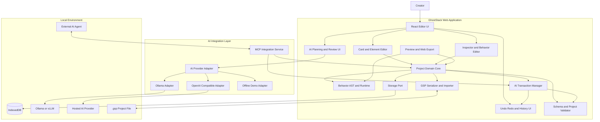
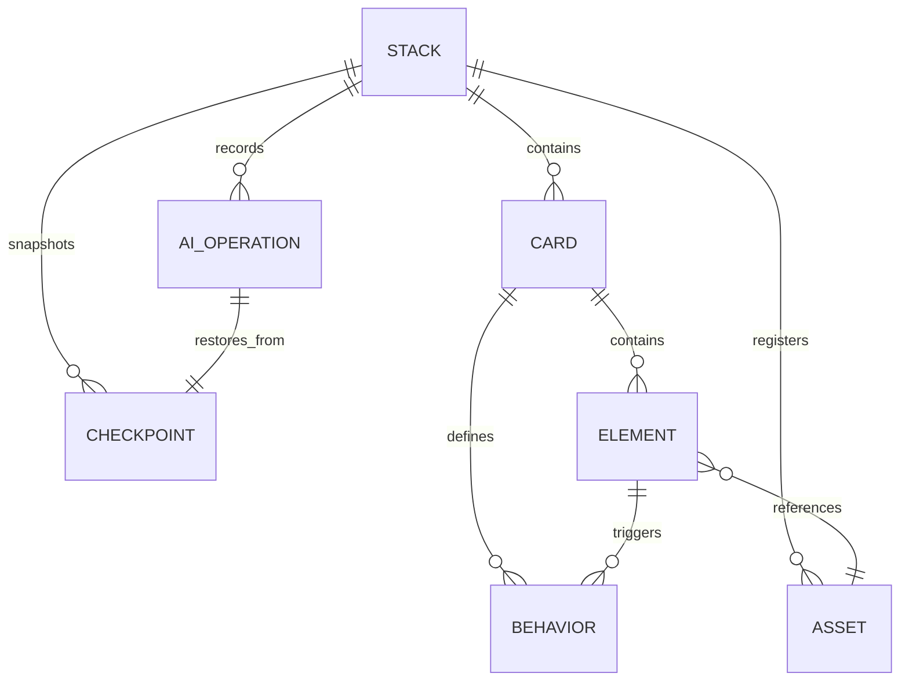

# Architecture — GhostStack

> **Status:** Approved by Product Owner (Nov 15, 2026), except T-013, which stays open until the M2 spike  
> **Last updated:** November 16, 2026 (task 14.1)  
> **Related:** `PRD.md`, `DESIGN.md`, `MILESTONE.md`  
> **Repository:** `edgiaxel/GhostStack`

## 1. Read This First

### Architecture in one paragraph

GhostStack is a local-first, browser-based application editor built with React and TypeScript. Its core project model, behavior interpreter, validation, and project serialization are independent of the UI. Browser persistence uses IndexedDB, while `.gsp` provides portable project storage. AI providers and external agents connect through separate adapter interfaces. AI-generated changes are validated structured patches that pass through an approval and transactional execution system. A future Tauri 2 desktop application reuses the same frontend and domain core while providing native file access through a controlled desktop adapter.

### Selected stack

- React + TypeScript.
- Vite.
- IndexedDB with `idb`.
- Versioned ZIP-based `.gsp` format.
- Custom JSON AST behavior runtime.
- Visual Blocks and GhostScript as editors of the same behavior AST.
- Provider-agnostic AI adapter interface.
- MCP server with controlled project tools.
- Tauri 2 as the planned desktop shell.

### Main components

1. Web Editor.
2. Project Domain Core.
3. Card and Element Editor.
4. Behavior Authoring and Runtime.
5. Project Persistence and GSP Serializer.
6. AI Provider Layer.
7. AI Planning and Transaction Engine.
8. MCP Integration Service.
9. Preview and Export Runtime.
10. Future Desktop Shell.

### Current technical risk

The highest-risk component is AI interoperability, particularly the connection between a browser-hosted project, local inference, external MCP agents, and transactional project modifications.

The second major risk is ensuring the responsive editor, project format, and exported runtime all interpret the same project data consistently.

### Current implementation status

The M1 foundation exists in the working tree: the `domain`, `project-format` and `storage` packages and the `apps/web` shell (Project Library and Stack workspace). Checked on the working tree during task 14.1: `npm run build` exits 0 and `apps/web/dist` is produced. `.github/`, `apps/mcp-server`, `apps/desktop`, `packages/behavior`, `packages/ai-core`, `packages/ai-providers`, `packages/shared-contracts` and `tests/` do not exist. There is no CodeMirror, React Flow, Playwright, behavior runtime, AI provider, MCP server or export code. The clean-copy verification (task 15.1) ran the toolchain commands, and the owner confirmed the manual browser steps on 2026-11-16 (`docs/M1-VERIFICATION.md`). The command table in section 9 marks each command by what was run. The implementation files are untracked in Git (one commit exists, `d572847`).

A service worker for offline app-shell reload was added to M1 with owner approval on 2026-11-16 (T-027, section 8.7). It is written by hand, adds no dependency, and is generated into `apps/web/dist/sw.js` by the build.
### Next technical action

Prototype the editor UI from the owner's Google Stitch output and plan VS-01 (create and persist a Stack) against it (`MILESTONE.md`). Then conduct an isolated AI feasibility spike before building the full AI integration.

---

## 2. Technology Stack

| Layer | Technology | Purpose | Status / reason |
|---|---|---|---|
| Frontend | React | Editor interface and application workspace | Approved |
| Language | TypeScript | Shared domain types and safer integration contracts | Approved |
| Build tool | Vite | Development server and production bundling | Approved |
| Styling | CSS variables, CSS Grid, custom components | Theme system and customizable editor layout | Approved |
| Editor | CodeMirror 6 | GhostScript editing | Approved in DESIGN |
| Graph | React Flow (`@xyflow/react`) | Card relationship visualization | Approved for P1 |
| Validation | Zod and TypeScript types | Runtime validation and structured input parsing | Approved |
| Domain model | Shared TypeScript modules | Stack, Card, Element, Behavior, and project operations | Approved |
| Behavior runtime | Custom JSON AST interpreter | Safe execution of authored behavior | Approved |
| Browser persistence | IndexedDB + `idb` | Projects, assets, and checkpoints | Approved |
| Project archive | ZIP format | `.gsp` import/export | Approved; library `fflate` 0.8.3 (section 2.3) |
| AI interface | `AIProviderAdapter` contract | Model provider independence | Approved |
| AI providers | OpenAI-compatible adapter and Ollama adapter | Hosted and local inference | Approved for P0 |
| Offline AI | Deterministic demo adapter | Offline testing and demonstrations | Approved |
| MCP | Official TypeScript MCP SDK | External agent integration | Approved |
| Desktop | Tauri 2 | Future native editor application | Approved for P1 |
| Desktop permissions | Tauri capabilities | Controlled filesystem and native access | Approved |
| Unit/integration testing | Vitest | Domain, runtime, and adapter tests | Approved |
| Component testing | Testing Library | Editor interaction tests | Approved |
| End-to-end testing | Playwright | Browser workflow verification | Approved |
| Property-based testing | fast-check | AST, archive, and transaction invariants | Approved |
| CI | GitHub Actions | Automated checks | Approved |
| Hosting | Static web hosting | Public browser application | Approved; provider open |

### 2.1 Runtime and package management

Recommended:
- Use the current supported Node.js LTS release at implementation time.
- Use npm with its native workspace support.
- Commit `package-lock.json`.
- Pin dependency versions through the lockfile.
- Do not use floating dependency versions in the final submission build.

Observed in the development environment during the M0 audit (Nov 15, 2026): Node.js `v24.22.1` and npm `11.19.1`. Task 14.1 observed Node.js `v24.22.1` and npm `11.19.1` again on the same machine. Exact package versions are recorded in section 2.3.

### 2.2 Dependency policy

Prefer a small dependency set.

Avoid introducing:
- A backend database without a demonstrated requirement.
- A full server framework for a static browser editor.
- Multiple overlapping state-management libraries.
- A general-purpose JavaScript execution engine for authored behavior.
- A large UI component library that dictates the editor's visual identity.

The archive library is resolved: `fflate` (section 2.3, T-006). M1 added no state-management library; the web shell uses React and local hooks. Revisit if a later milestone needs shared editor state.

### 2.3 Dependency table

Versions are the ones resolved in `package-lock.json` and confirmed against the npm registry on installation. Rows are added in the task that installs each package.

| Package | Version | Where | License | Reason | Cost |
|---|---|---|---|---|---|
| `typescript` | 6.0.3 (`~6.0.3`) | root (dev) | Apache-2.0 | Type checking. Registry latest is 7.0.2, but `typescript-eslint` 8.72.2 declares peer `typescript >=4.8.4 <6.1.0`. Revisit when that range widens. | Dev only. |
| `@types/node` | 24.19.2 (`^24.19.2`) | root (dev) | MIT | Node typings for config files and tests. Major 24 matches `engines.node` (`^22.22.2 \|\| ^24.15.0`) and the observed Node 24. Registry latest is 26.6.6, which does not match the supported runtimes. | Dev only. |
| `vitest` | 5.1.0 | root (dev) | MIT | Test runner (T-015). | Dev only. |
| `fast-check` | 4.10.2 | root (dev) | MIT | Property-based tests (T-016). | Dev only. |
| `eslint` | 10.15.0 | root (dev) | MIT | Lint with flat config. | Dev only. |
| `@eslint/js` | 10.0.1 | root (dev) | MIT | ESLint recommended rules. Peer `eslint ^10`. | Dev only. |
| `typescript-eslint` | 8.72.2 | root (dev) | MIT | TypeScript parser and type-aware rules. Peer `eslint ^8.57 \|\| ^9 \|\| ^10`. | Dev only. |
| `globals` | 17.14.0 | root (dev) | MIT | Environment globals per package folder. | Dev only. |
| `prettier` | 3.10.1 | root (dev) | MIT | Formatting. | Dev only. |
| `zod` | 4.6.7 (`^4.6.7`) | `packages/domain`, `packages/project-format`, `apps/web` | MIT | Runtime validation and `z.infer` types for Stack, Card, Element and Asset (approved in section 2). Confirmed as registry `latest` with `npm view zod version` in task 4.1. Declared directly by `domain`, `project-format` and `apps/web`; one copy is installed. | Ships to the browser through `domain`. About 90.9 kB of the 341.4 kB minified web bundle, attributed through the source map (section 2.4). Gzip cost per package not measured. |
| `idb` | 8.0.4 (`^8.0.4`) | `packages/storage` | ISC | Promise wrapper over IndexedDB (T-005). Registry `latest` and no dependencies. Its `openDB` cannot take an injected `IDBFactory`, so the adapter calls `wrap()` on `factory.open()` and runs the upgrade itself. The design called for `openDB`; the code does not use it. | In the web bundle. Unpacked size 82,588 bytes. About 2.9 kB of the minified web bundle, attributed through the source map (section 2.4). Built alone, `wrap` is 3,710 bytes minified and 1,376 bytes gzip. Needs the global `IDB*` classes. |
| `fake-indexeddb` | 6.2.8 (`^6.2.8`) | `packages/storage` (dev) | Apache-2.0 | IndexedDB in Node tests (design section 2). Fresh `IDBFactory` per test gives isolation. Tests import `fake-indexeddb/auto` because `idb` needs the global `IDB*` classes. No dependencies. | Dev only. Does not reproduce real quota behavior; quota paths use injected faults. |
| `fflate` | 0.8.3 (`^0.8.3`) | `packages/project-format` | MIT | ZIP reading and writing for `.gsp` (T-006). Selected over `JSZip` 3.10.2 (dual MIT/GPL, about 99 kB minified, whole-entry async inflate only) and `@zip.js/zip.js` 2.25.0 (about 168 kB minified). `fflate` is pure JS with no dependencies, about 15 kB minified (7 kB gzip) for the APIs used, reports declared sizes through `unzipSync` `filter` before inflating, and offers chunked `Unzip` with `terminate()`. Registry `latest`; no install scripts. | Not in the M1 web bundle: `apps/web` does not import `project-format` (T-023), and the source map of the final build lists no `fflate` source. It enters the bundle only when `apps/web` imports `project-format`. Weaknesses: `unzipSync` truncates silently when declared sizes are wrong, so the importer streams and rechecks sizes; CRC-32 is not verified, so asset integrity relies on manifest SHA-256; streaming `Unzip` reads local headers, so names and sizes are cross-checked against the central directory. |
| `react`, `react-dom` | 19.3.1 (`^19.3.1`) | `apps/web` | MIT | UI runtime (T-001). `react-dom` peer `react ^19.3.1`. | In the web bundle. Task 10.1 minimal shell: 219.65 kB minified, 68.63 kB gzip. Final M1 build: `react-dom`, `react` and `scheduler` account for about 218.6 kB of the minified bundle (section 2.4). |
| `vite` | 8.3.8 (`^8.3.8`) | `apps/web` (dev) | MIT | Dev server and build (T-002). Node `^20.19.0 \|\| >=22.12.0`; `@types/node ^24` satisfies the optional peer. Vitest 5.1.0 accepts `vite ^8`. Optional peers (`sass`, `terser`, and others) are not installed. | Dev only. |
| `@vitejs/plugin-react` | 6.3.0 (`^6.3.0`) | `apps/web` (dev) | MIT | JSX transform and fast refresh. Peer `vite ^8.0.0`. Optional peers (`babel-plugin-react-compiler` and others) are not installed. | Dev only. |
| `@types/react`, `@types/react-dom` | 19.3.0 (`^19.3.0`) | `apps/web` (dev) | MIT | React types. `@types/react-dom` peer `@types/react ^19.3.0`. | Dev only. |
| `jsdom` | 31.0.1 (`^31.0.1`) | `apps/web` (dev) | MIT | DOM for component tests; the `web` Vitest project is the only one that loads it. Node `^22.22.2 \|\| ^24.15.0 \|\| >=26` matches `engines.node`. Optional peer `@napi-rs/canvas` is not installed. Chosen over `happy-dom` because the design experiment already ran it under Vitest 5. | Dev only. |
| `@testing-library/react` | 16.3.3 (`^16.3.3`) | `apps/web` (dev) | MIT | Component rendering and queries. Peers: `react` and `@types/react` 18 or 19, `@testing-library/dom ^10`. | Dev only. |
| `@testing-library/dom` | 10.4.2 (`^10.4.2`) | `apps/web` (dev) | MIT | Required peer of `@testing-library/react` and `@testing-library/jest-dom`. | Dev only. |
| `@testing-library/jest-dom` | 7.0.1 (`^7.0.1`) | `apps/web` (dev) | MIT | DOM matchers (`toBeVisible`, `toHaveAccessibleName`) through the `/vitest` entry. Peers `vitest >= 0.32`, `@testing-library/dom >=10 <11`; Node `>=22`. | Dev only. |
| `@testing-library/user-event` | 14.6.10 (`^14.6.10`) | `apps/web` (dev) | MIT | Realistic typing and Tab navigation in tests. Peer `@testing-library/dom >=7.21.4`. | Dev only. |
| `eslint-plugin-react-hooks` | 7.1.1 (`^7.1.1`) | root (dev) | MIT | Hook rules for `apps/web`. Peer range includes `eslint ^10.0.0`. Flat-config keys: default export `reactHooks`, preset `reactHooks.configs.flat.recommended` (a flat object with `plugins` and `rules`, read from the installed README and checked at runtime). Used in `eslint.config.js` through `extends` on `apps/web/**/*.{ts,tsx}`. The `recommended` preset includes React Compiler rules at `error`. | Dev only. |
| `@fontsource/inter` | 5.3.0 (`5.3.0`) | `apps/web` | OFL-1.1 | Inter UI font, bundled locally (Requirement 14.2, 14.3). Imports `latin-400.css` and `latin-600.css`; both exist in the installed package. Registry `latest`; no install scripts. | Latin subset only. Build copies `inter-latin-400-normal.woff2` (23.66 kB) and `inter-latin-600-normal.woff2` (24.45 kB) into `dist/assets`, plus `.woff` fallbacks (about 31 kB each) that browsers with woff2 support do not request. No runtime request to a font host. |
| `@fontsource/jetbrains-mono` | 5.3.0 (`5.3.0`) | `apps/web` | OFL-1.1 | JetBrains Mono code font, bundled locally. Imports `latin-400.css`; it exists in the installed package. Registry `latest`; no install scripts. | Latin subset only. Build copies `jetbrains-mono-latin-400-normal.woff2` (21.16 kB) and a `.woff` fallback (27.49 kB). |
| Service worker (no package added) | Hand-written: `apps/web/pwa/sw.js` (61 lines) and `apps/web/pwa/precacheServiceWorkerPlugin.ts` (65 lines) | `apps/web` | Project code (Apache-2.0) | Offline reload of the built app shell (T-027). Evaluated against `vite-plugin-pwa` 2.0.0 (MIT; peer `vite` up to `^8.0.0`; depends on `workbox-build ^7.4.1` and `workbox-window ^7.4.1`, both MIT). A throwaway `npm install --package-lock-only --ignore-scripts` of `vite-plugin-pwa@2.0.0`, `workbox-build@7.4.1`, `workbox-window@7.4.1` and `vite@8.3.8` in an empty directory resolved 394 packages (this repository's lockfile has 274), and the only `hasInstallScript` entry was `fsevents`, which is already in this lockfile. `workbox-build` declares Babel, Rollup, Terser and Ajv among its dependencies. The project needs one fixed behavior (precache the shell, answer navigations with `index.html`, no runtime caching), so the plugin's strategy engine is not needed. `npm install` also printed an `npm audit` notice for that resolution, which was not investigated. | No dependency and no change to `index-*.js` beyond the registration function. Generated `sw.js` is 2,905 bytes. Maintenance cost: this project owns the worker and must follow Service Worker API changes itself. It has no Workbox features such as runtime caching, background sync or an update prompt. The Service Worker API needs a secure context (HTTPS or `localhost`). |

Install-script check (task 10.1): `npm view` shows no `preinstall`, `install` or `postinstall` script for any package in the rows above. After `npm install`, `package-lock.json` still has one `hasInstallScript` entry (`fsevents`, optional and macOS only). `npm audit` still reports the same 7 moderate `minimatch` advisories through `typescript-eslint`; the new packages add none.

Install-script check (task 6.3): `npm view` shows no `preinstall`, `install` or `postinstall` script for `idb` 8.0.4 or `fake-indexeddb` 6.2.8 (both list only build and test scripts, `prepare` and `prepack` do not run for consumers). Both declare no runtime dependencies. After install, `package-lock.json` still has one `hasInstallScript` entry (`fsevents`, see below).

Install-script check (task 2.2): `package-lock.json` marks one package with `hasInstallScript`: `fsevents` 2.3.3. It is optional, macOS-only (`os: darwin`) and a transitive dev dependency, so it does not install on Linux. No direct dependency declares an install script.

Audit finding (task 2.2): `npm audit` reports 7 moderate advisories, all from `minimatch` 7.0.0 to 11.0.0 (GHSA-g3hv-75wg-m249, denial of service) reached through `typescript-eslint` 8.72.2 packages. `npm audit fix --force` proposes `typescript-eslint@8.36.0`, a downgrade, so it was not applied. The packages are dev-only and run on repository files, not on untrusted input. Revisit when `typescript-eslint` releases a fixed dependency range.

Audit re-check (task 14.1): `npm audit` still reports 7 moderate severity vulnerabilities, all through `minimatch` 7.0.0 to 11.0.0 under `node_modules/@typescript-eslint/typescript-estree`. `npm audit fix --force` was not run. The advisory has no runtime effect on the built application because the package is a dev dependency.

### 2.4 Measured bundle sizes

Measured on the working tree with `npm run build` (exit 0, `vite v8.3.8`, 145 modules transformed). Sizes are bytes from `ls -l apps/web/dist/assets`; Vite reports them in kB (1 kB = 1,000 bytes).

| File | Bytes | Gzip (Vite) |
|---|---|---|
| `index-*.js` | 341,362 | 104.30 kB |
| `index-*.css` | 6,525 | 1.68 kB |
| `index.html` | 395 | 0.26 kB |
| Inter 400 `.woff2` / `.woff` | 23,664 / 30,696 | not reported |
| Inter 600 `.woff2` / `.woff` | 24,452 / 31,260 | not reported |
| JetBrains Mono 400 `.woff2` / `.woff` | 21,168 / 27,496 | not reported |
| `apps/web/dist` total (9 files) | 507,018 (`du -sb`) | not measured |

Per-package share of `index-*.js`. The numbers come from a build with source maps (`build.sourcemap: true`, written to a temporary directory): each mapped segment of the minified output is attributed to the package of its source file. This is an approximation of minified bytes and does not give gzip sizes.

| Source | Minified bytes (approx.) |
|---|---|
| `react-dom` | 206,937 |
| `zod` | 90,905 |
| `apps/web` source | 11,904 |
| `packages/domain` | 8,922 |
| `react` | 8,168 |
| `packages/storage` | 6,034 |
| `scheduler` | 3,507 |
| `idb` | 2,912 |

`fflate` has no entry: the web bundle does not include `project-format` (T-023). A standalone build of `idb` `wrap` gave 3,710 bytes minified and 1,376 gzip. The in-app attribution (2,912 bytes) differs from it; both are approximate. A standalone Zod build was not recorded: importing the whole `z` namespace does not match the subset the app uses.

After T-027 the build also writes `dist/sw.js` (2,905 bytes for build hash `b7274b4fe23ed6e8`). `find apps/web/dist -type f` counts 11 files and `du -sb apps/web/dist` printed 510,838. The table above predates the service worker and the registration module, so its `index-*.js` and `index.html` sizes are from the earlier build. `grep -c "https\?://" apps/web/dist/sw.js` printed 0.
Absolute URL scan of `apps/web/dist` (`grep -ohE "https?://..."` over `index.html`, `assets/*.js` and `assets/*.css`):

- XML namespaces: `http://www.w3.org/2000/svg`, `http://www.w3.org/1999/xlink`, `http://www.w3.org/1998/Math/MathML`, `http://www.w3.org/XML/1998/namespace`.
- Other URL strings, all inside `index-*.js`: `http://json-schema.org/draft-04/schema#`, `http://json-schema.org/draft-07/schema#` and `https://json-schema.org/draft/2020-12/schema` (Zod's JSON Schema output), `https://react.dev/errors/` (React's error message prefix, two copies) and the template ``http://[${e}]`` (Zod's IPv6 check builds a string to parse).
- `index.html` has no absolute URL. `index-*.css` has only relative `url(/assets/...)` references to the six font files. No font host appears.
- This is a text scan. A browser run with network inspection has not been done; the offline and blocked-font checks belong to tasks 15.1 and 15.2.

### 2.5 Deviations from the M1 design

Differences found while implementing, checked against `.kiro/specs/m1-foundation/design.md` and the code:

| Area | Design | Implemented |
|---|---|---|
| `sha256Checksum` | Returned `Promise<string>` | Returns `Promise<Result<string, CryptoUnavailableError>>` with code `CRYPTO_UNAVAILABLE` when `crypto.subtle` is missing (`packages/project-format/src/checksum.ts`). |
| IndexedDB open | `openDB(name, DB_VERSION, ...)` | `wrap(factory.open(name, DB_VERSION))` with an `upgradeneeded` listener, so a test can inject an `IDBFactory` (`packages/storage/src/indexeddb/indexedDbStorage.ts`). |
| Fault stages | `'after-stack-put' \| 'after-asset-put'` | Four stages: `'after-stack-put'`, `'after-asset-put'`, `'after-project-delete'`, `'after-asset-delete'`. `saveAsset` also reports `'after-asset-put'`. |
| Blocked open | A `blocked` open maps to `storage-unavailable` (design error table) | Not implemented. The adapter registers no `blocked` handler (`grep -n blocked` finds only a comment). It does handle `versionchange`: it closes the connection and clears the cached open promise. |
| `MISSING_FIELD` | Only an absent value at an `invalid_type` issue | Also reported for an absent value at an `invalid_union` or `invalid_value` issue (`packages/domain/src/validation/structural.ts`). The structural phase drops Zod's `too_big` issue on `cards.<id>.title`, because the schema counts UTF-16 units and the semantic phase counts code points (`TITLE_TOO_LONG`). |
| `@types/node` | Not specified | Pinned to major 24 (`^24.19.2`) to match `engines.node` and the observed Node 24. Registry latest is 26.6.6. |
| `typescript` | Registry latest | Pinned to `~6.0.3` (installed 6.0.3). `typescript-eslint` 8.72.2 declares peer `typescript >=4.8.4 <6.1.0`. Registry latest is 7.0.2. |
| Service worker | Not in the design. Requirement 1.10 covers operation after assets have loaded, and owner step 5 in `docs/M1-VERIFICATION.md` section 11.1 expected an offline reload to fail. | Added on 2026-11-16 with owner approval (T-027): `apps/web/pwa/sw.js`, `apps/web/pwa/precacheServiceWorkerPlugin.ts`, `apps/web/src/pwa/registerServiceWorker.ts`. A reload while offline works in the production build. No worker runs under `npm run dev`. |
| Registration update check | Not in the design. | After `register()`, the page calls `registration.update()`. In the browser run (`docs/M1-VERIFICATION.md` section 11.4) a plain reload did not install the new worker within 1.5 s, and the explicit call did. |
| `minimatch` advisory | Not anticipated | 7 moderate `npm audit` findings through `typescript-eslint` (dev only, not fixed; see the audit notes above). |
| Prettier scope | Not specified | `.prettierignore` lists `/AGENTS.md`, `/ARCHITECTURE.md`, `/DESIGN.md`, `/KIROWEEN-HACKATHON.md`, `/MILESTONE.md`, `/PRD.md`, `/README.md` and `/docs/`, documents that already failed Prettier at HEAD. `npm run format:check` therefore does not check this file. `CHANGELOG.md` is not ignored. |


---

## 3. System Architecture

### 3.1 High-level component diagram



The diagram represents logical responsibilities. It does not imply that every integration is already implemented or that the browser can directly launch local processes.

### 3.2 Component responsibilities

#### A. Web Editor

Responsible for:
- Application navigation.
- Project Library.
- Stack and Card workspace.
- Canvas and element manipulation.
- Inspector panels.
- Theme and layout preferences.
- AI plan review and operation status.
- Preview and export controls.

The UI must not contain the canonical project serialization or behavior execution rules.

#### B. Project Domain Core

Responsible for:
- Stack and Card models.
- Element models.
- Navigation references.
- Project operations.
- State schema.
- Domain-level invariants.
- Project change commands.

The domain core is independent of React and browser APIs.

#### C. Behavior Authoring and Runtime

Responsible for:
- Canonical behavior AST.
- Visual Blocks serialization.
- GhostScript parsing.
- Safe expression evaluation.
- Trigger dispatch.
- Registered action execution.
- Runtime state access.
- Validation of behavior definitions.

Visual Blocks and GhostScript must produce the same canonical AST.

#### D. Project Persistence and GSP

Responsible for:
- IndexedDB persistence.
- Project autosave.
- Recovery snapshots.
- Asset storage.
- `.gsp` serialization.
- `.gsp` import validation.
- Project format compatibility.

Storage implementations must be accessed through a storage interface rather than directly from UI components.

#### E. AI Provider Layer

Responsible for:
- Provider configuration.
- Connection testing.
- Prompt and context construction.
- Structured AI plan generation.
- Provider error normalization.
- Provider metadata.

The AI layer must not directly mutate the project.

#### F. AI Planning and Transaction Engine

Responsible for:
- AIPlan validation.
- Operation dependency checks.
- User approval state.
- Pre-execution snapshots.
- Patch command execution.
- Project validation.
- Atomic commit.
- Rollback.
- Operation reporting.

This component is the only authorized path for AI-generated project modifications.

#### G. MCP Integration Service

Responsible for:
- Registering the approved MCP tools.
- Reading permitted project context.
- Validating external agent requests.
- Submitting structured proposals.
- Creating recovery checkpoints.
- Returning structured validation and operation results.

MCP must use the same domain and transaction services as the editor. It must not implement an independent project mutation system.

#### H. Preview and Export Runtime

Responsible for:
- Running a Stack as an application.
- Executing the same behavior AST.
- Managing isolated runtime state.
- Packaging required assets.
- Generating standalone web output.

Preview and export must not implement separate interpretations of behavior.

#### I. Desktop Shell — P1

Responsible for:
- Native file dialogs.
- User-selected filesystem access.
- Desktop project storage.
- Native packaging.
- Desktop-specific permissions.

The desktop shell should reuse the web frontend and domain core.

---

## 4. Main Data and Request Flows

### 4.1 Manual project editing

1. Creator selects a Stack or Card.
2. Editor loads its project data through the domain layer.
3. Creator adds or modifies an element.
4. Editor submits a domain command.
5. Domain core validates the command.
6. The project state is updated.
7. Autosave schedules a local persistence write.
8. The history system records the supported operation.
9. The editor reflects the committed state.

### 4.2 AI-assisted editing

1. Creator submits a natural-language request.
2. AI layer obtains only the project context permitted for the operation.
3. Configured provider generates a structured AIPlan.
4. GhostStack validates the AIPlan schema.
5. Domain validator checks referenced Cards, elements, actions, and state keys.
6. UI displays the proposed changes.
7. Creator approves, rejects, or revises the plan.
8. Before execution, the transaction manager persists a recovery snapshot.
9. Patch commands execute against an isolated project copy.
10. The resulting project passes full validation.
11. If valid, the transaction manager commits the new state atomically.
12. The operation is recorded as one grouped history entry.
13. UI displays an operation report.
14. Creator can revert the complete operation.

If a command or validation step fails, the isolated copy is discarded and the active project remains unchanged.

### 4.3 External MCP agent workflow

1. An external agent connects to the GhostStack MCP server.
2. The agent requests Stack or Card context.
3. GhostStack returns structured project information.
4. The agent discovers supported runtime actions.
5. The agent submits a proposed patch through `propose_stack_patch`.
6. GhostStack validates the proposal and places it in the approval queue.
7. The creator reviews and approves the proposal in GhostStack.
8. The transaction manager executes the approved changes.
9. The result is returned to the MCP client.

External agents cannot bypass approval or directly write arbitrary project data.

**Important transport constraint:** A local stdio MCP process and a browser application's IndexedDB are separate execution environments. The feasibility spike must prove how both access the same active project. A local Streamable HTTP bridge is the preferred browser-pairing candidate, but it requires authentication, origin validation, and local-only binding. If live state sharing is not reliable, the initial fallback is a controlled `.gsp` patch/import workflow.

### 4.4 Project autosave and recovery

1. A valid domain command updates project state.
2. Autosave marks the project as dirty.
3. A debounced persistence operation writes the changed project data.
4. The persistence layer confirms transaction completion.
5. The UI marks the project as saved.
6. If the application closes or crashes, the next session loads the last valid persisted state.
7. If a previous AI transaction was interrupted, the recovery system restores the latest valid committed state.

Autosave is local. It does not imply cloud synchronization.

### 4.5 GSP export and import

**Export:**
1. Validate the active project.
2. Collect Stack and Card definitions.
3. Collect referenced assets.
4. Generate `manifest.json`.
5. Generate `stack.json`.
6. Generate individual Card JSON files.
7. Package binary assets.
8. Create the ZIP archive with `.gsp` extension.
9. Verify the archive can be reopened.

**Import:**
1. Read archive metadata.
2. Validate archive structure.
3. Parse and validate the manifest.
4. Check format compatibility.
5. Validate Card and asset references.
6. Verify available checksums.
7. Validate project schemas.
8. Import into a new project workspace.
9. Preserve the currently active project if import fails.

Import must not partially overwrite an existing project.

### 4.6 Standalone web export

1. Validate the project.
2. Generate an application bundle.
3. Include the approved runtime.
4. Include project data and referenced assets.
5. Initialize an independent runtime state.
6. Verify the generated output.
7. Provide the export directory or archive.

The exported application must not require the GhostStack editor, AI provider, API key, or MCP server.

---

## 5. Project Structure

### 5.1 Repository tree at the end of M1 tasks 1 to 13

Listed from `git ls-files -o --exclude-standard` and `ls` on the working tree (task 14.1). Test files sit next to the code they test.

```text
GhostStack/
├── .kiro/                         # hooks, settings, specs (m1-foundation), steering
├── apps/
│   └── web/
│       ├── index.html
│       ├── package.json           # @ghoststack/web
│       ├── tsconfig.json
│       ├── vite.config.ts         # Vitest project "web" (jsdom); loads the precache plugin
│       ├── public/favicon.svg
│       ├── pwa/                   # sw.js (service worker source), precacheServiceWorkerPlugin.ts, tests (T-027)
│       └── src/
│           ├── main.tsx
│           ├── app/               # App, ErrorBoundary, route, services, startApp, editorRoot
│           ├── library/           # ProjectLibrary, useProjectLibrary, sortSummaries, CSS
│           ├── workspace/         # StackWorkspace, PersistenceStatus, useProjectSession, CSS
│           ├── preferences/       # localStorage preference store
│           ├── pwa/               # registerServiceWorker.ts (production builds only)
│           ├── themes/            # spectral-workstation.css, contrast.ts
│           └── test/              # setup.ts, fakes.ts
├── packages/
│   ├── domain/                    # @ghoststack/domain; exports "." and "./testing"
│   │   └── src/                   # schemas, ids, clock, result, factories, validation/, testing/
│   ├── project-format/            # @ghoststack/project-format; exports "."
│   │   └── src/                   # serialize, canonicalJson, checksum, limits, manifest, import/, testing/
│   └── storage/                   # @ghoststack/storage; exports ".", "./testing", "./indexeddb"
│       └── src/                   # port/, memory/, indexeddb/, testing/
├── docs/                          # KIRO-WORKFLOW.md, PROJECT-AUDIT.md, M1-VERIFICATION.md
├── AGENTS.md  ARCHITECTURE.md  CHANGELOG.md  DESIGN.md  KIROWEEN-HACKATHON.md
├── LICENSE  MILESTONE.md  PRD.md  README.md
├── eslint.config.js  vitest.config.ts  tsconfig.base.json
├── .prettierrc.json  .prettierignore
└── package.json  package-lock.json
```

Not present: `.github/`, `apps/mcp-server`, `apps/desktop`, `packages/behavior`, `packages/ai-core`, `packages/ai-providers`, `packages/shared-contracts` and `tests/`. Shared contracts live in `packages/domain` for now (owner `edgiaxel`, section 11).

### 5.2 Intended structure

The following is the intended structure for later milestones. Directories that section 5.1 does not list do not exist.

```text
GhostStack/
├── .github/
│   └── workflows/
│       └── ci.yml
│
├── .kiro/
│   ├── steering/
│   ├── specs/
│   ├── hooks/
│   └── agents/
│
├── apps/
│   ├── web/
│   │   ├── src/
│   │   │   ├── app/
│   │   │   ├── features/
│   │   │   │   ├── project-library/
│   │   │   │   ├── workspace/
│   │   │   │   ├── card-editor/
│   │   │   │   ├── behavior-editor/
│   │   │   │   ├── ai-assistant/
│   │   │   │   ├── history/
│   │   │   │   ├── preview/
│   │   │   │   └── export/
│   │   │   ├── components/
│   │   │   ├── themes/
│   │   │   └── main.tsx
│   │   └── package.json
│   │
│   ├── mcp-server/
│   │   ├── src/
│   │   │   ├── tools/
│   │   │   ├── transports/
│   │   │   └── server.ts
│   │   └── package.json
│   │
│   └── desktop/                 # P1
│       └── src-tauri/
│
├── packages/
│   ├── domain/
│   │   ├── src/
│   │   └── package.json
│   │
│   ├── behavior/
│   │   ├── src/
│   │   │   ├── ast/
│   │   │   ├── parser/
│   │   │   ├── evaluator/
│   │   │   └── actions/
│   │   └── package.json
│   │
│   ├── project-format/
│   │   ├── src/
│   │   └── package.json
│   │
│   ├── storage/
│   │   ├── src/
│   │   └── package.json
│   │
│   ├── ai-core/
│   │   ├── src/
│   │   └── package.json
│   │
│   ├── ai-providers/
│   │   ├── src/
│   │   │   ├── openai-compatible/
│   │   │   ├── ollama/
│   │   │   └── demo/
│   │   └── package.json
│   │
│   └── shared-contracts/
│       ├── src/
│       └── package.json
│
├── tests/
│   ├── integration/
│   ├── e2e/
│   └── fixtures/
│
├── docs/
│
├── PRD.md
├── DESIGN.md
├── ARCHITECTURE.md
├── MILESTONE.md
├── LICENSE
├── README.md
├── package.json
└── package-lock.json
```

### Structure rules

- `domain` must not import React, browser storage, or provider SDKs.
- `behavior` must not execute arbitrary JavaScript.
- `project-format` must not depend on editor components.
- `ai-core` defines provider-independent contracts and AI operation workflows.
- `ai-providers` implements provider-specific communication.
- `mcp-server` uses domain and AI transaction services.
- `storage` defines persistence interfaces and browser adapters.
- `apps/desktop` is introduced only when the browser MVP is stable.
- `.kiro/` must be committed to the public repository and must not be ignored.

Do not create every directory as empty scaffolding. Introduce modules when the corresponding vertical slice begins.

---

## 6. Data Model

### 6.1 Main entities

#### Project / Stack

Contains:
- `stackId`
- `title`
- `formatVersion`
- `createdAt`
- `updatedAt`
- `entryCardId`
- `cardOrder`
- `stateSchema`
- `cards`
- `backgrounds` when shared backgrounds are implemented
- `assetRegistry`
- `viewportDefaults`

#### Card

Contains:
- `cardId`
- `title`
- `elements`
- `behaviors`
- `backgroundId` when shared backgrounds are implemented
- Card-specific metadata

#### Element

Contains:
- `elementId`
- `type`
- `name`
- `properties`
- `layout`
- `assetId` when applicable
- `behaviors`

Initial types:
- Text
- Button
- Input
- Image
- Shape
- Line

#### Behavior

Contains:
- `behaviorId`
- `trigger`
- `conditions`
- `actions`
- `enabled`
- Optional metadata

The canonical behavior representation is JSON AST.

#### Asset

Contains:
- `assetId`
- `relativePath`
- `mimeType`
- `byteSize`
- `checksum`
- Optional metadata

#### AIPlan

Contains:
- `planId`
- `requestSummary`
- `affectedCards`
- `affectedElements`
- `patchCommands`
- `validationResults`
- `providerMetadata`
- `approvalStatus`

#### AIOperationBatch

Contains:
- `batchId`
- `timestamp`
- `providerMetadata`
- `summary`
- `preSnapshotId`
- Ordered `patchCommands`
- Execution status
- Validation result

### 6.2 Project relationships



### 6.3 GSP archive layout

```text
example.gsp
├── manifest.json
├── stack.json
├── cards/
│   ├── card-001.json
│   ├── card-002.json
│   └── card-003.json
└── assets/
    ├── asset-001.png
    ├── asset-002.ogg
    └── asset-003.svg
```

The archive format is versioned. The manifest is parsed first. All references and checksums are validated before the project is made active.

The exact JSON schema will be maintained as a versioned shared contract.

### 6.3.1 GSP format version 1 as implemented in M1

Source: `packages/project-format/src` and `packages/domain/src`. Only `serializeProject` and `importProject` exist; the web app does not use them yet (T-023).

**Layout.** `manifest.json`, `stack.json`, one `cards/<cardId>.json` per Card, and one `assets/<name>` per registered asset. `stack.json` holds the Stack without its `cards` field. The importer requires `manifest.json` (`MANIFEST_MISSING`) and `stack.json` (`ENTRY_SET_MISMATCH`), rejects entry names that are not allowed (`UNSAFE_ENTRY`) and repeated names (`DUPLICATE_ENTRY`), and cross-checks the Card and asset files against the manifest and Stack.

**Manifest** (`ManifestSchema`, strict object):
- `formatVersion`: the literal `1`. `SUPPORTED_FORMAT_VERSIONS` is `[1]`.
- `producer`: string of 1 to 100 characters. The exporter writes `ghoststack-web`.
- `stackId`: string.
- `assets`: array of strict objects with `assetId`, `relativePath`, `mimeType` (up to 127 characters), `byteSize` (integer, 0 to 26,214,400) and `checksum` (`sha256:` plus 64 lowercase hex digits).

**Canonical JSON.** `canonicalJson` sorts object keys by UTF-16 code unit at every depth, keeps array order, and calls `JSON.stringify` with no indentation. No trailing newline.

**Deterministic ZIP.** The exporter validates the project, checks each asset's bytes against the registry size and SHA-256, and writes entries in this order: `manifest.json`, `stack.json`, Card files sorted by ID, then asset files sorted by `relativePath`. JSON entries use deflate level 6 and assets use level 0 (stored). Every entry has the modification time 1980-01-01 00:00:00 in local time (`FIXED_ZIP_TIME`). Before returning, it re-imports the archive and compares the project and asset bytes with the input. Any failure returns `PROJECT_EXPORT_FAILED` and no archive.

**Checksums.** `sha256Checksum` uses Web Crypto and returns `sha256:<hex>`. Without `crypto.subtle` it returns `CRYPTO_UNAVAILABLE`.

**Identifier pattern.** `<prefix>_<lowercase UUID v4>` with prefix `stk`, `crd`, `elm` or `ast` (`ID_PATTERNS`). `generateId` fills 16 bytes with `crypto.getRandomValues`.

**Asset paths.** `assets/` followed by 1 to 128 characters of `A-Z a-z 0-9 . _ -`, with no backslash, leading slash or drive letter, `..` segment, or null character.

**Size limits** (T-020, Approved; values from `GSP_LIMITS`, `MAX_ASSET_BYTES`):

| Limit | Bytes | MiB |
|---|---|---|
| Single asset | 26,214,400 | 25 |
| Archive | 52,428,800 | 50 |
| Single entry, uncompressed | 26,214,400 | 25 |
| All entries, uncompressed | 104,857,600 | 100 |
| Entry count | 1,000 | not applicable |
| Compression ratio | Rejected above 100:1, checked only for entries of 1,048,576 bytes (1 MiB) or more | not applicable |

Import reasons (`ImportReason`): `NOT_A_ZIP`, `MANIFEST_MISSING`, `MANIFEST_INVALID_JSON`, `MANIFEST_INVALID_SCHEMA`, `UNSUPPORTED_VERSION`, `UNSAFE_ENTRY`, `DUPLICATE_ENTRY`, `ENTRY_SET_MISMATCH`, `UNSUPPORTED_COMPRESSION`, `LIMIT_EXCEEDED`, `SIZE_MISMATCH`, `RATIO_EXCEEDED`, `ENTRY_INVALID_JSON`, `ENTRY_INVALID_SCHEMA`, `CHECKSUM_MISMATCH`, `ASSET_ENTRY_MISSING`, `ASSET_ENTRY_UNLISTED`, `CARD_ENTRY_MISSING`, `CARD_ENTRY_UNREFERENCED`, `CARD_ENTRY_MISMATCH`, `MANIFEST_STACK_MISMATCH`, `PROJECT_INVALID`, `STACK_ID_UNRESOLVED`, `CRYPTO_UNAVAILABLE`. Export reasons (`ExportReason`): `VALIDATION_FAILED`, `ASSET_BYTES_MISSING`, `ASSET_INCONSISTENT`, `LIMIT_EXCEEDED`, `CRYPTO_UNAVAILABLE`, `REOPEN_FAILED`.

### 6.4 IndexedDB stores

Planned stores:
- `stacks`
- `assets`
- `checkpoints`
- `operations` if needed for persistent operation history

Use stable IDs and project-scoped keys.

**Implemented in M1** (`packages/storage/src/indexeddb`): database name `ghoststack`, version `1`, two stores.

| Store | Key path | Value |
|---|---|---|
| `stacks` | `stackId` | The Stack object |
| `assets` | `[stackId, assetId]` | `{ stackId, assetId, bytes }` |

`checkpoints` and `operations` are not created in M1. A stored database with a higher version returns `unsupported-version`. The adapter is packaged as one package, `@ghoststack/storage`, with entry points `.` (port and memory adapter), `./testing` and `./indexeddb` (T-022). `apps/web` imports `./indexeddb` in `main.tsx`. Preferences use `localStorage` keys that start with `ghoststack.pref.`.

`localStorage` is reserved for small interface preferences such as:
- Theme.
- Panel sizes.
- Panel visibility.
- Last opened project ID.

IndexedDB writes must be awaited and confirmed. A checkpoint is not considered durable until its transaction completes.

---

## 7. API and Integration Contracts

### 7.1 Domain command contract

All project changes must pass through domain commands.

Conceptual contract:

```ts
type ProjectCommand =
  | AddCardCommand
  | DeleteCardCommand
  | AddElementCommand
  | UpdateElementCommand
  | DeleteElementCommand
  | UpdateBehaviorCommand
  | UpdateStateSchemaCommand;
```

Commands must:
- Have validated inputs.
- Identify the affected project and entity.
- Produce a deterministic state transition where possible.
- Return structured errors.
- Be suitable for history and transaction recording.

The exact command types will be implemented in the domain package.

### 7.2 Behavior AST contract

Conceptual structure:

```ts
interface BehaviorAST {
  trigger: BehaviorTrigger;
  conditions: ConditionNode[];
  actions: ActionNode[];
}
```

The AST is the canonical source for both Visual Blocks and GhostScript.

The runtime must:
- Validate AST structure.
- Validate registered action names.
- Validate action parameters.
- Resolve permitted state references.
- Evaluate expressions through a controlled evaluator.
- Reject unsupported syntax.
- Avoid `eval()` and `new Function()`.

### 7.3 AI provider contract

Conceptual interface:

```ts
interface AIProviderAdapter {
  id: string;
  capabilities: AIProviderCapabilities;

  testConnection(): Promise<ConnectionResult>;

  generatePlan(
    context: ProjectContext,
    prompt: string
  ): Promise<AIPlan>;
}
```

Initial adapters:
- OpenAI-compatible HTTP.
- Ollama.
- Deterministic offline demo.

The common interface must not assume every provider supports identical features. Capabilities and limitations must be represented explicitly.

### 7.4 AI plan contract

AIPlan must use a versioned schema.

It contains:
- User request summary.
- Affected Card and element IDs.
- Proposed patch commands.
- Dependencies between commands.
- Validation information.
- Optional provider metadata.

AI output is untrusted input. It must be parsed and validated before entering the approval queue.

### 7.5 Patch command contract

Initial command types:
- `ADD_CARD`
- `DELETE_CARD`
- `ADD_ELEMENT`
- `UPDATE_ELEMENT`
- `DELETE_ELEMENT`
- `UPDATE_BEHAVIOR`
- `UPDATE_STATE_SCHEMA`

Each command must validate:
- Target entity existence.
- Required fields.
- Allowed properties.
- Asset references.
- Card navigation references.
- Dependencies on other commands.

### 7.6 MCP tool contract

P0 tools:

| Tool | Access | Purpose |
|---|---|---|
| `get_stack_summary` | Read-only | Stack metadata, Card list, navigation, state schema |
| `get_card_details` | Read-only | Card elements, layout, and behaviors |
| `list_registered_actions` | Read-only | Expose supported runtime actions and schemas |
| `propose_stack_patch` | Gated | Submit a structured proposal to the approval queue |
| `validate_project` | Read-only | Validate project structure and behavior |
| `create_checkpoint` | Safe mutation | Create a named recovery snapshot |

MCP clients must not have unrestricted project write access.

### 7.7 MCP transports

- **stdio:** Intended for local MCP clients that launch the GhostStack MCP process.
- **Streamable HTTP:** Preferred candidate for browser-to-local-agent pairing.
- **Legacy HTTP + SSE:** Do not select for a new implementation.

The official MCP SDK documents stdio for local process-spawned integrations and Streamable HTTP for network-accessible servers. The current stable SDK line must be confirmed when dependencies are installed.

### 7.8 Error handling

Normalize errors into categories:
- `PROVIDER_UNAVAILABLE`
- `PROVIDER_RATE_LIMIT`
- `PROVIDER_AUTH_FAILED`
- `PROVIDER_UNSUPPORTED_CAPABILITY`
- `INVALID_AI_PLAN`
- `INVALID_PATCH_COMMAND`
- `PROJECT_VALIDATION_FAILED`
- `CHECKPOINT_FAILED`
- `TRANSACTION_FAILED`
- `MCP_CONNECTION_FAILED`
- `ASSET_MISSING`
- `PROJECT_IMPORT_FAILED`
- `PROJECT_EXPORT_FAILED`

Implemented in M1 (these are the only error codes in code):
- Validation (`@ghoststack/domain`): `MISSING_FIELD`, `INVALID_TYPE`, `INVALID_VALUE`, `UNKNOWN_FIELD`, `INVALID_ID`, `ENTRY_CARD_NOT_FOUND`, `CARD_ORDER_REFERENCE_NOT_FOUND`, `CARD_ORDER_DUPLICATE`, `CARD_ORDER_OMITS_CARD`, `CARD_ID_DUPLICATE`, `CARD_KEY_MISMATCH`, `ELEMENT_ID_DUPLICATE`, `ELEMENT_ASSET_NOT_FOUND`, `ASSET_KEY_MISMATCH`, `ASSET_PATH_INVALID`, `ASSET_SIZE_INVALID`, `ASSET_CHECKSUM_INVALID`, `TITLE_TOO_LONG`, `TIMESTAMP_INVALID`, `VALIDATOR_INTERNAL_ERROR`.
- Storage (`@ghoststack/storage`): `not-found`, `validation-failed`, `quota-exceeded`, `storage-unavailable`, `unsupported-version`, `write-failed`.
- Project format: `PROJECT_EXPORT_FAILED` with the reasons in section 6.3.1; import reasons in the same section.

Retry rules:
- Do not automatically retry project mutations.
- Provider connection tests may retry with bounded attempts.
- Read-only requests may retry where safe.
- Rate-limit responses should respect provider retry information when available.
- Failed AI operations must not be partially committed.

---

## 8. Security and Privacy

### 8.1 Trust boundaries

Treat these as untrusted:
- AI model output.
- External MCP clients.
- Imported `.gsp` files.
- Project asset metadata.
- Provider responses.
- User-supplied behavior source.

### 8.2 Project mutation security

- All mutations pass through domain commands.
- AI changes pass through the transaction manager.
- External MCP tools cannot bypass approval.
- Behavior execution uses registered actions.
- Project imports are validated before activation.
- Exported applications contain no authoring credentials.

### 8.3 Credential handling

- API keys must never be written into `.gsp`.
- API keys must never be included in exported applications.
- API keys must never appear in logs or error reports.
- For the browser MVP, credentials should remain in memory for the active session and should not be persisted by default.
- Persistent desktop credentials should use an operating-system-protected credential store, subject to implementation validation.
- Do not claim browser-stored secrets are secure against a compromised browser environment.

### 8.4 Local MCP security

Any local HTTP bridge must:
- Bind only to loopback interfaces.
- Authenticate clients with a locally generated token.
- Validate request origins and hosts.
- Avoid wildcard CORS.
- Reject unexpected network access.
- Avoid exposing the bridge to the public internet.
- Limit available tools and project permissions.

The stdio transport should be preferred when a local client can launch the MCP process directly.

### 8.5 Tauri security

The desktop application must use least-privilege capabilities.

Only explicitly required filesystem and dialog permissions should be granted. Avoid unrestricted shell or filesystem access.

### 8.6 AI provider privacy

- Local inference must be clearly identified as local.
- Hosted providers must be clearly identified as remote.
- Fallback must respect the user's privacy configuration.
- Cloud fallback must never occur silently when the user expects local-only processing.

### 8.7 Service worker (T-027)
- Scope: the worker is served from the app root (`/sw.js`, or the Vite `base` path) and controls only that path.
- It answers only same-origin `GET` requests. It does not touch cross-origin requests, non-`GET` requests, or same-origin URLs that are not in its build-time file list (navigations are the exception: any same-origin navigation gets the cached `index.html`).
- The cache holds exactly the files listed at build time: `index.html`, the hashed JS and CSS, the six font files and `favicon.svg`. Source maps and `sw.js` are excluded.
- It never writes a response to the cache while the app runs. Project data (IndexedDB) and preferences (`localStorage`) never enter Cache Storage.
- Cache names are `ghoststack-shell-<build hash>`. The hash is the first 16 hex characters of a SHA-256 over every listed file path and its content. Activation deletes every cache whose name starts with `ghoststack-shell-` and is not the current one. Other caches on the origin are left alone.
- Updates: a new build installs in the background and activates at once (`skipWaiting`). It does not reload open pages and does not call `clients.claim()`. The new shell is served on the next page load. A page that is already open keeps the JavaScript it loaded. If any listed file cannot be fetched, install fails and the previous worker stays active.
- The worker source has no `importScripts`, `eval`, `new Function`, `XMLHttpRequest` or hard-coded URL, and holds no credentials. Its one `fetch(request)` call is the network fallback for a cache miss. `apps/web/pwa/sw.test.ts` checks these properties. The ban on `fetch` in application code (`apps/web/src`, `src/boundaries.test.ts`) is unchanged.
- Registration runs only in production builds, only in a secure context, after the window `load` event, and never throws.
---

## 9. Development Environment

### Runtime
- Current supported Node.js LTS release at implementation time.
- TypeScript.
- Browser: modern desktop browser.

### Package manager
- npm.
- npm workspaces.

### Command table

Scripts below are defined in the root `package.json` (workspace scripts in each package's `package.json`). "Verified" means the command was run and exited 0 (or, for the long-running commands, started and answered HTTP requests). Evidence is in `docs/M1-VERIFICATION.md`; the commands ran on Node.js v24.22.1 and npm 11.19.1 on Linux. One clean-copy run (task 15.1) and one re-run after the service worker was added (section 11.4 of that report).

| Task | Command | Defined in `package.json` | Status |
|---|---|---|---|
| Install dependencies | `npm install` (`npm ci` for a clean install) | Not a script | `npm ci` verified (exit 0, clean copy). `npm install` not run in the verification. |
| Development server | `npm run dev` (runs `vite` in `@ghoststack/web`) | Yes | Verified on 2026-11-16: started with `npm run dev -w @ghoststack/web -- --port 5199 --strictPort`, `GET /` and `GET /src/main.tsx` returned HTTP 200 over `curl`, then stopped. No browser loaded the dev page in this check. |
| Production build | `npm run build` (runs `tsc --noEmit -p .` then `vite build` in `@ghoststack/web`; also writes `dist/sw.js`) | Yes | Verified (exit 0, clean copy and again after the service worker) |
| Lint | `npm run lint` (`eslint . --max-warnings=0`) | Yes | Verified (exit 0, both runs) |
| Format | `npm run format` (`prettier --write .`) | Yes | Not yet verified (it rewrites files, so the check variant was run instead) |
| Format check | `npm run format:check` (`prettier --check .`) | Yes | Verified (exit 0, both runs) |
| Type check | `npm run typecheck` (`typecheck` in every workspace that defines it) | Yes | Verified (exit 0, both runs) |
| Unit tests | `npm run test` (`vitest --run`; projects `domain`, `project-format`, `storage`, `web`) | Yes | Verified (exit 0: 513 tests in the clean copy, 539 tests in 62 files after the service worker) |
| Preview build | `npm run preview` (runs `vite preview` in `@ghoststack/web`) | Yes | Verified: started by the agent for the Chromium checks (sections 11.2 and 11.4) and by the owner for the manual steps. Port 4173 by default. |
| E2E tests | `npm run test:e2e` | No. Not available: Playwright is not installed and there is no `tests/e2e` | Not available |

`npm run build` now also writes `apps/web/dist/sw.js` (T-027). No script was added or changed. `npm run dev` does not register a service worker.
Workspace type checks: `npm run typecheck -w @ghoststack/domain`, `-w @ghoststack/project-format`, `-w @ghoststack/storage`, `-w @ghoststack/web`. Tests for one project: `npm run test -- packages/domain` and the same form for the other directories.

No database migration command is required for the browser MVP. IndexedDB schema changes will use explicit versioned upgrade handling.

---

## 10. Testing Strategy

### 10.1 Unit tests

Test:
- Domain commands.
- Project validation.
- Card reference integrity.
- Behavior AST parsing.
- GhostScript parser.
- Expression evaluator.
- Registered action execution.
- AI plan validation.
- Patch command validation.
- Transaction state transitions.
- GSP manifest validation.

### 10.2 Integration tests

Test:
- Domain commands with IndexedDB persistence.
- Autosave and recovery.
- GSP serialization and import.
- Asset packaging and missing asset handling.
- AI adapter response parsing.
- Provider failure handling.
- AI operation rollback.
- MCP tool invocation.
- MCP proposal approval workflow.
- Preview and exported runtime parity.

### 10.3 End-to-end tests

**Not available in M1.** No end-to-end test runner is installed, there is no `test:e2e` script and no `tests/` directory. The browser steps for M1 are manual (task 15.2).

Critical workflows for later milestones:
1. Create Stack.
2. Create multiple Cards.
3. Add and edit elements.
4. Connect Card navigation.
5. Configure a behavior.
6. Preview the application.
7. Save and reload the project.
8. Export and re-import `.gsp`.
9. Export a standalone web application.
10. Submit an AI plan.
11. Approve and execute the plan.
12. Revert the AI operation.
13. Run without an AI provider configured.

### 10.4 Property-based tests

Priority targets:
- AST serialization round-trip.
- AST parse/serialize consistency.
- GSP archive round-trip.
- Asset registry consistency.
- Random valid Card navigation graphs.
- Patch command invariants.
- Failed transactions leave active state unchanged.
- Rollback restores the pre-operation project state.

Example invariant:

```ts
restore(applyBatch(original, validBatch), checkpoint)
  === original;
```

The actual test implementation must compare normalized project data rather than relying on object identity.

### 10.5 Feature verification mapping

| PRD features | Primary verification |
|---|---|
| F-001 to F-005 | Domain and editor tests |
| F-006 to F-008 | Behavior runtime tests |
| F-009 to F-012 | AI adapter and MCP integration tests |
| F-013 | Schema and runtime validation tests |
| F-014 | Preview E2E tests |
| F-015 to F-017 | Persistence, recovery, and transaction tests |
| F-018 to F-019 | GSP and asset round-trip tests |
| F-020 | Standalone export E2E tests |
| F-021 to F-026 | P1-specific tests when implemented |

### 10.6 Offline test requirement

The full core application workflow must be testable with:
- No AI provider configured.
- No API key.
- No network connection.
- No external MCP agent.

The offline demo adapter is used only to test AI workflow behavior, not as a substitute for a real provider integration test.

---

## 11. Git and Collaboration

### Branch naming

- `main` — stable integration branch.
- `feature/vs-00-foundation`
- `feature/vs-03-visual-element-editing`
- `feature/vs-04-behavior-runtime`
- `feature/vs-08-ai-provider-feasibility`
- `fix/<short-description>`
- `chore/<short-description>` (documentation and configuration)

### Pull request process

Each completed vertical slice should:
1. Have a bounded scope.
2. Pass type checking.
3. Pass relevant unit tests.
4. Pass relevant integration tests.
5. Include manual verification evidence where applicable.
6. Be reviewed before merging into `main`.

### Parallel agent rules

Kiro is the primary implementation orchestrator.

Agents may work in parallel only when:
- Their responsibilities are independent.
- File ownership is explicit.
- Shared interfaces are agreed upon.
- They do not modify the same files concurrently.
- Integration tests exist for shared contracts.

Recommended independent lanes:
- Editor UI.
- Domain and project format.
- Behavior runtime.
- AI integration.
- Testing and quality.

Do not launch every available agent immediately. Begin with a small number of parallel tasks and increase only after interfaces are stable.

The original detailed agent roster will be defined in Part 4.

### Worktree rules

- Use separate branches or worktrees for parallel implementation.
- One designated owner controls shared contracts. The owner of the shared domain contracts (`packages/domain` types, schemas and validation rules) is `edgiaxel`.
- Do not let multiple agents independently redesign the project model.
- Merge only after tests pass.
- Keep commits small and attributable to a vertical slice.

### Review and merge gates

No slice is complete merely because an agent reports success.

The orchestrator must verify:
- Files changed.
- Build result.
- Test result.
- Runtime behavior.
- Known limitations.
- Integration with the current `main`.

---

## 12. CI/CD and Deployment

### CI checks

Recommended GitHub Actions checks:
- Dependency installation.
- Formatting check.
- Lint.
- Type check.
- Unit tests.
- Production build.
- Integration tests.
- E2E tests for critical workflows.

### Build

The web application should produce static build output suitable for static hosting.

### Deployment target

Recommendation: use a static hosting platform that supports GitHub integration and preview deployments.

Vercel is a candidate, but deployment provider selection remains open until the first working build.

### Environment configuration

- No API keys committed to Git.
- No API keys embedded in static export.
- Hosted AI credentials supplied by the user at runtime.
- Local model endpoints configured by the user.
- Production configuration must not expose development-only MCP bridges.

### Smoke tests

After deployment:
- Load the application.
- Create a Stack.
- Create and edit a Card.
- Save and reload.
- Import/export a `.gsp`.
- Preview the application.
- Export and run a standalone web application.
- Verify no AI provider is required for core functionality.

### Rollback

- Keep the last known-good deployment.
- Revert to the last verified build if a deployment breaks the application.
- Preserve project files independently from deployment artifacts.

Deployment must not be configured without explicit authorization.

---

## 13. Technical Decisions

| ID | Decision | Status | Reason | Impact |
|---|---|---|---|---|
| T-001 | React + TypeScript | Approved | Shared browser and desktop frontend | Foundation |
| T-002 | Vite | Approved | Simple frontend build and development workflow | Foundation |
| T-003 | npm workspaces | Approved | Simple package boundaries without extra package manager | Repository |
| T-004 | Shared TypeScript domain core | Approved | Prevents UI and runtime coupling | Architecture |
| T-005 | IndexedDB with `idb` | Approved | Local browser persistence | Storage |
| T-006 | ZIP-based `.gsp` | Approved | Portable project archive | Project format |
| T-007 | Canonical JSON behavior AST | Approved | Shared behavior representation | Runtime |
| T-008 | Custom constrained behavior interpreter | Approved | Prevents arbitrary code execution | Security |
| T-009 | Provider adapter interface | Approved | AI provider independence | AI |
| T-010 | OpenAI-compatible and Ollama adapters | Approved | Initial hosted/local coverage | AI |
| T-011 | Deterministic offline demo adapter | Approved | Offline workflow testing | AI |
| T-012 | MCP server with controlled tools | Approved | External agent interoperability | Integration |
| T-013 | MCP local bridge transport | Open pending spike | Browser and local agent state sharing | High risk |
| T-014 | AI transaction manager | Approved | Atomic commit and rollback | Reliability |
| T-015 | Vitest and Playwright | Approved | Unit and E2E coverage | Quality |
| T-016 | fast-check | Approved | Property-based invariants | Quality |
| T-017 | Tauri 2 | Approved for P1 | Desktop application | Platform |
| T-018 | Static web deployment | Approved | Browser MVP hosting | Release |
| T-019 | Native packaging of user-created applications | Deferred | Scope control | Future |
| T-020 | Size limits: 25 MiB per asset, 50 MiB archive, 25 MiB per entry, 100 MiB total uncompressed, 1000 entries; compression ratio 100:1 applied only to entries of 1 MiB or more | Approved | Bounds memory on import; avoids rejecting small repetitive JSON | M1 project-format importer (task 8.1) |
| T-021 | Stack and Card titles are 1 to 100 Unicode code points after trim | Approved | Predictable UI and storage bounds | M1 domain (task 4.2) |
| T-022 | `storage` is one package with `port`, `memory`, `indexeddb` and `testing` entry points | Approved | One contract with swappable adapters, no extra packages | M1 storage (task 6.1) |
| T-023 | `apps/web` does not depend on `project-format` in M1 | Approved | Import/export UI is out of M1 scope | M1 web (tasks 10.5, 11.1) |
| T-024 | Startup always lands in the Project Library even when `lastProjectId` is set | Approved | Predictable entry point; no silent reopen | M1 web (tasks 10.5, 11.1) |
| T-025 | `ProjectListing.unreadable` extends the summary list | Approved | Unreadable records stay visible instead of vanishing | M1 storage (task 6.1) |
| T-026 | `Stack.title` may be empty in stored data; the factory requires 1 to 100 code points | Approved | Stored data must stay loadable; new data stays valid | M1 domain (task 4.2) |
| T-027 | Service worker for offline app shell: hand-written `apps/web/pwa/sw.js` with a build-time precache list, no Workbox or `vite-plugin-pwa`; no runtime caching; a new version activates in the background and is served on the next load; registered only in production builds | Approved by owner, 2026-11-16 | Reload while offline works for the built app, and IndexedDB stays the only data store; no new dependency | M1 web (task 15.2); scope addition beyond the original M1 spec |
| T-028 | M2 spike layout: framework-independent core in `packages/ai-core` (AIPlan schema, patch commands, transaction manager, checkpoint store, provider contract, offline demo adapter; depends only on `domain` and the `storage` port; no DOM); provider adapters, MCP bridge and browser probe live in `spikes/` and are marked throwaway until promoted in M4. `apps/web` is not touched | Approved for the M2 spike, owner, 2026-11-16 | Keeps the reusable transaction logic and discards probe code | M2 |
| T-029 | M2 live provider targets: OpenRouter with one free Nemotron model and local Ollama `gemma3:4b`. OpenRouter budget: at most 15 live requests in the whole spike, sequential, live runs only with `GHOSTSTACK_LIVE=1`, quota read from `GET /api/v1/key` before and after, at most one retry of a 429 after `Retry-After`. Failure paths are tested against local mock servers. The key is read only from `OPENROUTER_API_KEY` and never written to a file, log, fixture or config | Approved for the M2 spike, owner, 2026-11-16 | Free tier allows 20 requests per minute and 50 per day below $10 of purchased credits; protects the key | M2 |
| T-030 | MCP client for the spike is Kiro. SDK: `@modelcontextprotocol/sdk` 1.32.2 (MIT, registry-verified 2026-11-16), peer `zod` ^3.25 or ^4. The spike tests one long-running loopback bridge process serving a Streamable HTTP MCP endpoint to Kiro and an authenticated endpoint to the browser, plus a stdio variant. Fallback if neither is reliable: `.gsp` patch import. T-013 stays open until the spike report is approved | Approved for the M2 spike, owner, 2026-11-16 | A Kiro-spawned stdio process is separate from the browser's IndexedDB; the bridge tests a shared project path | M2 |
| T-031 | Durable AI checkpoints: a `checkpoints` IndexedDB store added by a storage database version bump with an explicit v1 to v2 upgrade and the existing newer-version refusal kept | Proposed, confirm with the spike report | `ARCHITECTURE.md` section 6.4 requires durable checkpoints; the version bump must not regress M1 data | M2 task 5 |

---

## 14. Risks and Validation

| Risk / unknown | Impact | Smallest validation | Result / status |
|---|---|---|---|
| Hosted API calls from browser | Provider CORS and credential handling | Test one hosted provider from target browser | Pending |
| Ollama browser connectivity | Local CORS and endpoint behavior | Connect browser to local Ollama and generate structured output | Pending |
| vLLM compatibility | Provider-specific behavior | Test only after common adapter works | Deferred |
| MCP browser/local bridge | Browser cannot spawn stdio process directly | Prove a local MCP process can access the active project and submit a proposal | Pending — critical |
| MCP SDK integration | SDK version and transport changes | Build a six-tool minimal server with current stable SDK | Pending |
| AI structured output | Models may return malformed plans | Test schema-constrained output and invalid responses | Pending |
| AI transaction rollback | Partial updates may corrupt project state | Inject failures between patch commands and verify unchanged active state | Pending |
| GSP archive portability | Import/export inconsistencies | Round-trip project with multiple Cards and assets | Pending |
| Responsive canvas | Pinning and scaling may be insufficient | Prototype several elements across desktop, tablet, and mobile viewport presets | Pending |
| Behavior editor parity | Visual and code modes may produce different behavior | Compare both editors against the same AST fixtures | Pending |
| Static export runtime | Export may behave differently from preview | Run exported output independently and compare behavior | Pending |
| Scope and deadline | Too many P0 features for available time | Prioritize end-to-end slices and enforce scope gates | Active risk |

### 14.1 AI feasibility spike acceptance criteria

The spike is successful when it proves:

1. At least one hosted provider can generate a valid AIPlan.
2. Local Ollama can generate a valid AIPlan.
3. The offline demo adapter can produce a deterministic AIPlan.
4. An MCP client can inspect project information.
5. An MCP client can submit a proposal without directly mutating the project.
6. The creator can approve a proposal.
7. The transaction manager can apply a valid proposal.
8. A deliberately failed operation leaves the active project unchanged.
9. A committed operation can be reverted.
10. All of the above work without making AI a dependency of the normal editor.

The browser-to-local MCP connection and shared project-state model are mandatory spike investigations. Do not claim that they work until demonstrated.

### 14.2 Scope fallback rules

If the AI spike fails:
- Keep the editor fully independent of AI.
- Preserve the provider adapter contract.
- Preserve the structured AIPlan and transaction model.
- Limit external agent integration to the transport and project workflow that can be demonstrated safely.
- Do not fake successful external-agent connectivity.

If hosted AI integration is blocked:
- Keep Ollama and the offline demo path.
- Reassess hosted browser requests and local bridge architecture.

If responsive canvas work becomes too expensive:
- Preserve responsive output and a small, tested set of layout rules.
- Defer advanced breakpoint controls.

If time becomes critical:
- Preserve create/edit/save/preview/export.
- Preserve a working behavior runtime.
- Preserve at least one demonstrated AI workflow.
- Defer P1 capabilities rather than shipping broken P0 workflows.

---

## 15. Change Rules

### PRD.md

Update when:
- Product scope changes.
- A feature is added, removed, or reprioritized.
- Acceptance criteria change.
- An MVP commitment changes.

### DESIGN.md

Update when:
- Screen behavior changes.
- Navigation or layout decisions change.
- A new interaction model is approved.
- Visual design decisions change.

### ARCHITECTURE.md

Update when:
- Technology stack changes.
- Component boundaries change.
- Data or integration contracts change.
- Security assumptions change.
- A technical risk is resolved or a new one appears.

### MILESTONE.md

Update when:
- A milestone is completed.
- A vertical slice changes.
- A blocker appears or is resolved.
- The next implementation priority changes.
- A deadline or delivery commitment changes.

All changes to approved architecture or scope must be recorded in the relevant document and reviewed before implementation continues.
