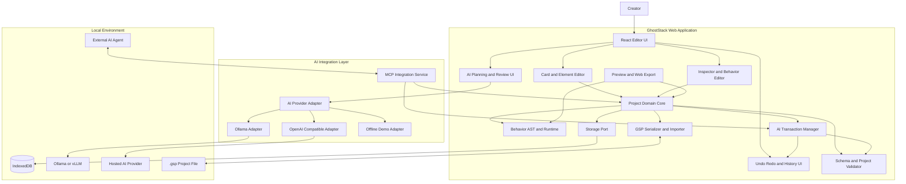
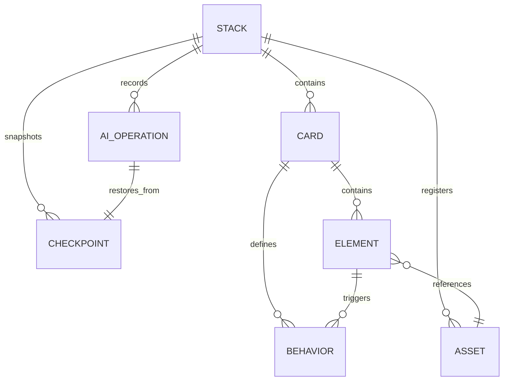

# Architecture — GhostStack

> **Status:** Approved by Product Owner (Nov 15, 2026), except T-013, which stays open until AI integration (M3)  
> **Last updated:** November 25, 2026 (clean-slate reset)  
> **Related:** `PRD.md`, `DESIGN.md`, `MILESTONE.md`  
> **Repository:** `edgiaxel/GhostStack`

## 1. Read This First

### Architecture in one paragraph

GhostStack is a local-first, browser-based application editor built with React and TypeScript. Its core project model, behavior interpreter, validation, and project serialization are independent of the UI. Browser persistence uses IndexedDB, while `.gsp` provides portable project storage. AI providers and external agents connect through separate adapter interfaces. AI-generated changes are validated structured patches that pass through an approval and transactional execution system. A future Tauri 2 desktop application reuses the same frontend and domain core while providing native file access through a controlled desktop adapter.

### Selected stack

- React + TypeScript.
- Vite.
- IndexedDB with `idb`.
- Versioned ZIP-based `.gsp` format.
- Custom JSON AST behavior runtime.
- Visual Blocks and GhostScript as editors of the same behavior AST.
- Provider-agnostic AI adapter interface.
- MCP server with controlled project tools.
- Tauri 2 as the planned desktop shell.

### Main components

1. Web Editor.
2. Project Domain Core.
3. Card and Element Editor.
4. Behavior Authoring and Runtime.
5. Project Persistence and GSP Serializer.
6. AI Provider Layer.
7. AI Planning and Transaction Engine.
8. MCP Integration Service.
9. Preview and Export Runtime.
10. Future Desktop Shell.

### Current technical risk

The highest-risk component is AI interoperability, particularly the connection between a browser-hosted project, local inference, external MCP agents, and transactional project modifications.

The second major risk is ensuring the responsive editor, project format, and exported runtime all interpret the same project data consistently.

### Current implementation status

M2 is on `main` (Nov 26, 2026): card editor, behavior AST and runtime (`@ghoststack/behavior`), GhostScript, editing session with undo and autosave, IndexedDB v2 (stacks, assets, checkpoints), preview and standalone export through `@ghoststack/player`, and .gsp import and export with integrity checks. No CI, AI or MCP code yet. `behavior` and `player` exist as packages; `ai-*`, `mcp-server` and `desktop` are not created.

### Next technical action

Create the minimum application foundation, then build the core creation workflow before the AI integration.

---

## 2. Technology Stack

| Layer | Technology | Purpose | Status / reason |
|---|---|---|---|
| Frontend | React | Editor interface and application workspace | Approved |
| Language | TypeScript | Shared domain types and safer integration contracts | Approved |
| Build tool | Vite | Development server and production bundling | Approved |
| Styling | CSS variables, CSS Grid, custom components | Theme system and customizable editor layout | Approved |
| Editor | CodeMirror 6 | GhostScript editing | Approved in DESIGN |
| Graph | React Flow (`@xyflow/react`) | Card relationship visualization | Approved for P1 |
| Validation | Zod and TypeScript types | Runtime validation and structured input parsing | Approved |
| Domain model | Shared TypeScript modules | Stack, Card, Element, Behavior, and project operations | Approved |
| Behavior runtime | Custom JSON AST interpreter | Safe execution of authored behavior | Approved |
| Browser persistence | IndexedDB + `idb` | Projects, assets, and checkpoints | Approved |
| Project archive | ZIP format | `.gsp` import/export | Approved; library open |
| AI interface | `AIProviderAdapter` contract | Model provider independence | Approved |
| AI providers | OpenAI-compatible adapter and Ollama adapter | Hosted and local inference | Approved for P0 |
| Offline AI | Deterministic demo adapter | Offline testing and demonstrations | Approved |
| MCP | Official TypeScript MCP SDK | External agent integration | Approved |
| Desktop | Tauri 2 | Future native editor application | Approved for P1 |
| Desktop permissions | Tauri capabilities | Controlled filesystem and native access | Approved |
| Unit/integration testing | Vitest | Domain, runtime, and adapter tests | Approved |
| Component testing | Testing Library | Editor interaction tests | Approved |
| End-to-end testing | Playwright | Browser workflow verification | Approved |
| Property-based testing | fast-check | AST, archive, and transaction invariants | Approved |
| CI | GitHub Actions | Automated checks | Approved |
| Hosting | Static web hosting | Public browser application | Approved; provider open |

### 2.1 Runtime and package management

Recommended:
- Use the current supported Node.js LTS release at implementation time.
- Use npm with its native workspace support.
- Commit `package-lock.json`.
- Pin dependency versions through the lockfile.
- Do not use floating dependency versions in the final submission build.

Observed on an earlier machine check (Nov 15, 2026), to be re-verified in the M0 audit: Node.js `v24.22.1` and npm `11.19.1`. Exact package versions are selected and recorded during M1 after compatibility checks against official documentation.

### 2.2 Dependency policy

Prefer a small dependency set.

Avoid introducing:
- A backend database without a demonstrated requirement.
- A full server framework for a static browser editor.
- Multiple overlapping state-management libraries.
- A general-purpose JavaScript execution engine for authored behavior.
- A large UI component library that dictates the editor's visual identity.

The archive library and final state-management implementation remain implementation choices to verify during M1.

---

## 3. System Architecture

### 3.1 High-level component diagram



The diagram represents logical responsibilities. It does not imply that every integration is already implemented or that the browser can directly launch local processes.

### 3.2 Component responsibilities

#### A. Web Editor

Responsible for:
- Application navigation.
- Project Library.
- Stack and Card workspace.
- Canvas and element manipulation.
- Inspector panels.
- Theme and layout preferences.
- AI plan review and operation status.
- Preview and export controls.

The UI must not contain the canonical project serialization or behavior execution rules.

#### B. Project Domain Core

Responsible for:
- Stack and Card models.
- Element models.
- Navigation references.
- Project operations.
- State schema.
- Domain-level invariants.
- Project change commands.

The domain core is independent of React and browser APIs.

#### C. Behavior Authoring and Runtime

Responsible for:
- Canonical behavior AST.
- Visual Blocks serialization.
- GhostScript parsing.
- Safe expression evaluation.
- Trigger dispatch.
- Registered action execution.
- Runtime state access.
- Validation of behavior definitions.

Visual Blocks and GhostScript must produce the same canonical AST.

#### D. Project Persistence and GSP

Responsible for:
- IndexedDB persistence.
- Project autosave.
- Recovery snapshots.
- Asset storage.
- `.gsp` serialization.
- `.gsp` import validation.
- Project format compatibility.

Storage implementations must be accessed through a storage interface rather than directly from UI components.

#### E. AI Provider Layer

Responsible for:
- Provider configuration.
- Connection testing.
- Prompt and context construction.
- Structured AI plan generation.
- Provider error normalization.
- Provider metadata.

The AI layer must not directly mutate the project.

#### F. AI Planning and Transaction Engine

Responsible for:
- AIPlan validation.
- Operation dependency checks.
- User approval state.
- Pre-execution snapshots.
- Patch command execution.
- Project validation.
- Atomic commit.
- Rollback.
- Operation reporting.

This component is the only authorized path for AI-generated project modifications.

#### G. MCP Integration Service

Responsible for:
- Registering the approved MCP tools.
- Reading permitted project context.
- Validating external agent requests.
- Submitting structured proposals.
- Creating recovery checkpoints.
- Returning structured validation and operation results.

MCP must use the same domain and transaction services as the editor. It must not implement an independent project mutation system.

#### H. Preview and Export Runtime

Responsible for:
- Running a Stack as an application.
- Executing the same behavior AST.
- Managing isolated runtime state.
- Packaging required assets.
- Generating standalone web output.

Preview and export must not implement separate interpretations of behavior.

#### I. Desktop Shell — P1

Responsible for:
- Native file dialogs.
- User-selected filesystem access.
- Desktop project storage.
- Native packaging.
- Desktop-specific permissions.

The desktop shell should reuse the web frontend and domain core.

---

## 4. Main Data and Request Flows

### 4.1 Manual project editing

1. Creator selects a Stack or Card.
2. Editor loads its project data through the domain layer.
3. Creator adds or modifies an element.
4. Editor submits a domain command.
5. Domain core validates the command.
6. The project state is updated.
7. Autosave schedules a local persistence write.
8. The history system records the supported operation.
9. The editor reflects the committed state.

### 4.2 AI-assisted editing

1. Creator submits a natural-language request.
2. AI layer obtains only the project context permitted for the operation.
3. Configured provider generates a structured AIPlan.
4. GhostStack validates the AIPlan schema.
5. Domain validator checks referenced Cards, elements, actions, and state keys.
6. UI displays the proposed changes.
7. Creator approves, rejects, or revises the plan.
8. Before execution, the transaction manager persists a recovery snapshot.
9. Patch commands execute against an isolated project copy.
10. The resulting project passes full validation.
11. If valid, the transaction manager commits the new state atomically.
12. The operation is recorded as one grouped history entry.
13. UI displays an operation report.
14. Creator can revert the complete operation.

If a command or validation step fails, the isolated copy is discarded and the active project remains unchanged.

### 4.3 External MCP agent workflow

1. An external agent connects to the GhostStack MCP server.
2. The agent requests Stack or Card context.
3. GhostStack returns structured project information.
4. The agent discovers supported runtime actions.
5. The agent submits a proposed patch through `propose_stack_patch`.
6. GhostStack validates the proposal and places it in the approval queue.
7. The creator reviews and approves the proposal in GhostStack.
8. The transaction manager executes the approved changes.
9. The result is returned to the MCP client.

External agents cannot bypass approval or directly write arbitrary project data.

**Important transport constraint:** A local stdio MCP process and a browser application's IndexedDB are separate execution environments. The M3 validation must prove how both access the same active project. A local Streamable HTTP bridge is the preferred browser-pairing candidate, but it requires authentication, origin validation, and local-only binding. If live state sharing is not reliable, the initial fallback is a controlled `.gsp` patch/import workflow.

### 4.4 Project autosave and recovery

1. A valid domain command updates project state.
2. Autosave marks the project as dirty.
3. A debounced persistence operation writes the changed project data.
4. The persistence layer confirms transaction completion.
5. The UI marks the project as saved.
6. If the application closes or crashes, the next session loads the last valid persisted state.
7. If a previous AI transaction was interrupted, the recovery system restores the latest valid committed state.

Autosave is local. It does not imply cloud synchronization.

### 4.5 GSP export and import

**Export:**
1. Validate the active project.
2. Collect Stack and Card definitions.
3. Collect referenced assets.
4. Generate `manifest.json`.
5. Generate `stack.json`.
6. Generate individual Card JSON files.
7. Package binary assets.
8. Create the ZIP archive with `.gsp` extension.
9. Verify the archive can be reopened.

**Import:**
1. Read archive metadata.
2. Validate archive structure.
3. Parse and validate the manifest.
4. Check format compatibility.
5. Validate Card and asset references.
6. Verify available checksums.
7. Validate project schemas.
8. Import into a new project workspace.
9. Preserve the currently active project if import fails.

Import must not partially overwrite an existing project.

### 4.6 Standalone web export

1. Validate the project.
2. Generate an application bundle.
3. Include the approved runtime.
4. Include project data and referenced assets.
5. Initialize an independent runtime state.
6. Verify the generated output.
7. Provide the export directory or archive.

The exported application must not require the GhostStack editor, AI provider, API key, or MCP server.

---

## 5. Project Structure

The following is the intended structure. It is not an existing repository tree.

M3 note (locked 2026-11-27): the AI code lives in `packages/ai-core`, `packages/ai-providers` and `packages/mcp-server` (not `apps/mcp-server`), and the web feature is `apps/web/src/features/ai` (not `ai-assistant`). See `docs/UI_CONTRACT.md` section 9.

```text
GhostStack/
├── .github/
│   └── workflows/
│       └── ci.yml
│
├── .kiro/
│   ├── steering/
│   ├── specs/
│   ├── hooks/
│   └── agents/
│
├── apps/
│   ├── web/
│   │   ├── src/
│   │   │   ├── app/
│   │   │   ├── features/
│   │   │   │   ├── project-library/
│   │   │   │   ├── workspace/
│   │   │   │   ├── card-editor/
│   │   │   │   ├── behavior-editor/
│   │   │   │   ├── ai-assistant/
│   │   │   │   ├── history/
│   │   │   │   ├── preview/
│   │   │   │   └── export/
│   │   │   ├── components/
│   │   │   ├── themes/
│   │   │   └── main.tsx
│   │   └── package.json
│   │
│   ├── mcp-server/
│   │   ├── src/
│   │   │   ├── tools/
│   │   │   ├── transports/
│   │   │   └── server.ts
│   │   └── package.json
│   │
│   └── desktop/                 # P1
│       └── src-tauri/
│
├── packages/
│   ├── domain/
│   │   ├── src/
│   │   └── package.json
│   │
│   ├── behavior/
│   │   ├── src/
│   │   │   ├── ast/
│   │   │   ├── parser/
│   │   │   ├── evaluator/
│   │   │   └── actions/
│   │   └── package.json
│   │
│   ├── project-format/
│   │   ├── src/
│   │   └── package.json
│   │
│   ├── storage/
│   │   ├── src/
│   │   └── package.json
│   │
│   ├── ai-core/
│   │   ├── src/
│   │   └── package.json
│   │
│   ├── ai-providers/
│   │   ├── src/
│   │   │   ├── openai-compatible/
│   │   │   ├── ollama/
│   │   │   └── demo/
│   │   └── package.json
│   │
│   └── shared-contracts/
│       ├── src/
│       └── package.json
│
├── tests/
│   ├── integration/
│   ├── e2e/
│   └── fixtures/
│
├── docs/
│   ├── PRD.md
│   ├── DESIGN.md
│   ├── ARCHITECTURE.md
│   ├── MILESTONE.md
│   ├── CHANGELOG.md
│   ├── KIROWEEN-HACKATHON.md
│   └── design/prototypes/
│
├── LICENSE
├── README.md
├── package.json
└── package-lock.json
```

### Structure rules

- `domain` must not import React, browser storage, or provider SDKs.
- `behavior` must not execute arbitrary JavaScript.
- `project-format` must not depend on editor components.
- `ai-core` defines provider-independent contracts and AI operation workflows.
- `ai-providers` implements provider-specific communication.
- `mcp-server` uses domain and AI transaction services.
- `storage` defines persistence interfaces and browser adapters.
- `apps/desktop` is introduced only when the browser MVP is stable.
- `.kiro/` must be committed to the public repository and must not be ignored.

Do not create every directory as empty scaffolding. Introduce modules when the corresponding vertical slice begins.

---

## 6. Data Model

### 6.1 Main entities

#### Project / Stack

Contains:
- `stackId`
- `title`
- `formatVersion`
- `createdAt`
- `updatedAt`
- `entryCardId`
- `cardOrder`
- `stateSchema`
- `cards`
- `backgrounds` when shared backgrounds are implemented
- `assetRegistry`
- `viewportDefaults`

#### Card

Contains:
- `cardId`
- `title`
- `elements`
- `behaviors`
- `backgroundId` when shared backgrounds are implemented
- Card-specific metadata

#### Element

Contains:
- `elementId`
- `type`
- `name`
- `properties`
- `layout`
- `assetId` when applicable
- `behaviors`

Initial types:
- Text
- Button
- Input
- Image
- Shape
- Line

#### Behavior

Contains:
- `behaviorId`
- `trigger`
- `conditions`
- `actions`
- `enabled`
- Optional metadata

The canonical behavior representation is JSON AST.

#### Asset

Contains:
- `assetId`
- `relativePath`
- `mimeType`
- `byteSize`
- `checksum`
- Optional metadata

#### AIPlan

Contains:
- `planId`
- `requestSummary`
- `affectedCards`
- `affectedElements`
- `patchCommands`
- `validationResults`
- `providerMetadata`
- `approvalStatus`

#### AIOperationBatch

Contains:
- `batchId`
- `timestamp`
- `providerMetadata`
- `summary`
- `preSnapshotId`
- Ordered `patchCommands`
- Execution status
- Validation result

### 6.2 Project relationships



### 6.3 GSP archive layout

```text
example.gsp
├── manifest.json
├── stack.json
├── cards/
│   ├── card-001.json
│   ├── card-002.json
│   └── card-003.json
└── assets/
    ├── asset-001.png
    ├── asset-002.ogg
    └── asset-003.svg
```

The archive format is versioned. The manifest is parsed first. All references and checksums are validated before the project is made active.

The exact JSON schema will be maintained as a versioned shared contract.

### 6.4 IndexedDB stores

Initial stores:
- `stacks`
- `assets`
- `checkpoints`
- `operations` if needed for persistent operation history

Use stable IDs and project-scoped keys.

`localStorage` is reserved for small interface preferences such as:
- Theme.
- Panel sizes.
- Panel visibility.
- Last opened project ID.

IndexedDB writes must be awaited and confirmed. A checkpoint is not considered durable until its transaction completes.

---

## 7. API and Integration Contracts

### 7.1 Domain command contract

All project changes must pass through domain commands.

Conceptual contract:

```ts
type ProjectCommand =
  | AddCardCommand
  | DeleteCardCommand
  | AddElementCommand
  | UpdateElementCommand
  | DeleteElementCommand
  | UpdateBehaviorCommand
  | UpdateStateSchemaCommand;
```

Commands must:
- Have validated inputs.
- Identify the affected project and entity.
- Produce a deterministic state transition where possible.
- Return structured errors.
- Be suitable for history and transaction recording.

The exact command types will be implemented in the domain package.

### 7.2 Behavior AST contract

Conceptual structure:

```ts
interface BehaviorAST {
  trigger: BehaviorTrigger;
  conditions: ConditionNode[];
  actions: ActionNode[];
}
```

The AST is the canonical source for both Visual Blocks and GhostScript.

The runtime must:
- Validate AST structure.
- Validate registered action names.
- Validate action parameters.
- Resolve permitted state references.
- Evaluate expressions through a controlled evaluator.
- Reject unsupported syntax.
- Avoid `eval()` and `new Function()`.

### 7.3 AI provider contract

Conceptual interface:

```ts
interface AIProviderAdapter {
  id: string;
  capabilities: AIProviderCapabilities;

  testConnection(): Promise<ConnectionResult>;

  generatePlan(
    context: ProjectContext,
    prompt: string
  ): Promise<AIPlan>;
}
```

Initial adapters:
- OpenAI-compatible HTTP.
- Ollama.
- Deterministic offline demo.

The common interface must not assume every provider supports identical features. Capabilities and limitations must be represented explicitly.

### 7.4 AI plan contract

AIPlan must use a versioned schema.

It contains:
- User request summary.
- Affected Card and element IDs.
- Proposed patch commands.
- Dependencies between commands.
- Validation information.
- Optional provider metadata.

AI output is untrusted input. It must be parsed and validated before entering the approval queue.

### 7.5 Patch command contract

Initial command types:
- `ADD_CARD`
- `DELETE_CARD`
- `ADD_ELEMENT`
- `UPDATE_ELEMENT`
- `DELETE_ELEMENT`
- `UPDATE_BEHAVIOR`
- `UPDATE_STATE_SCHEMA`

Each command must validate:
- Target entity existence.
- Required fields.
- Allowed properties.
- Asset references.
- Card navigation references.
- Dependencies on other commands.

### 7.6 MCP tool contract

P0 tools:

| Tool | Access | Purpose |
|---|---|---|
| `get_stack_summary` | Read-only | Stack metadata, Card list, navigation, state schema |
| `get_card_details` | Read-only | Card elements, layout, and behaviors |
| `list_registered_actions` | Read-only | Expose supported runtime actions and schemas |
| `propose_stack_patch` | Gated | Submit a structured proposal to the approval queue |
| `validate_project` | Read-only | Validate project structure and behavior |
| `create_checkpoint` | Safe mutation | Create a named recovery snapshot |

MCP clients must not have unrestricted project write access.

### 7.7 MCP transports

- **stdio:** Intended for local MCP clients that launch the GhostStack MCP process.
- **Streamable HTTP:** Preferred candidate for browser-to-local-agent pairing.
- **Legacy HTTP + SSE:** Do not select for a new implementation.

The official MCP SDK documents stdio for local process-spawned integrations and Streamable HTTP for network-accessible servers. The current stable SDK line must be confirmed when dependencies are installed.

### 7.8 Error handling

Normalize errors into categories:
- `PROVIDER_UNAVAILABLE`
- `PROVIDER_RATE_LIMIT`
- `PROVIDER_AUTH_FAILED`
- `PROVIDER_UNSUPPORTED_CAPABILITY`
- `INVALID_AI_PLAN`
- `INVALID_PATCH_COMMAND`
- `PROJECT_VALIDATION_FAILED`
- `CHECKPOINT_FAILED`
- `TRANSACTION_FAILED`
- `MCP_CONNECTION_FAILED`
- `ASSET_MISSING`
- `PROJECT_IMPORT_FAILED`
- `PROJECT_EXPORT_FAILED`

Retry rules:
- Do not automatically retry project mutations.
- Provider connection tests may retry with bounded attempts.
- Read-only requests may retry where safe.
- Rate-limit responses should respect provider retry information when available.
- Failed AI operations must not be partially committed.

---

## 8. Security and Privacy

### 8.1 Trust boundaries

Treat these as untrusted:
- AI model output.
- External MCP clients.
- Imported `.gsp` files.
- Project asset metadata.
- Provider responses.
- User-supplied behavior source.

### 8.2 Project mutation security

- All mutations pass through domain commands.
- AI changes pass through the transaction manager.
- External MCP tools cannot bypass approval.
- Behavior execution uses registered actions.
- Project imports are validated before activation.
- Exported applications contain no authoring credentials.

### 8.3 Credential handling

- API keys must never be written into `.gsp`.
- API keys must never be included in exported applications.
- API keys must never appear in logs or error reports.
- For the browser MVP, credentials should remain in memory for the active session and should not be persisted by default.
- Persistent desktop credentials should use an operating-system-protected credential store, subject to implementation validation.
- Do not claim browser-stored secrets are secure against a compromised browser environment.

### 8.4 Local MCP security

Any local HTTP bridge must:
- Bind only to loopback interfaces.
- Authenticate clients with a locally generated token.
- Validate request origins and hosts.
- Avoid wildcard CORS.
- Reject unexpected network access.
- Avoid exposing the bridge to the public internet.
- Limit available tools and project permissions.

The stdio transport should be preferred when a local client can launch the MCP process directly.

### 8.5 Tauri security

The desktop application must use least-privilege capabilities.

Only explicitly required filesystem and dialog permissions should be granted. Avoid unrestricted shell or filesystem access.

### 8.6 AI provider privacy

- Local inference must be clearly identified as local.
- Hosted providers must be clearly identified as remote.
- Fallback must respect the user's privacy configuration.
- Cloud fallback must never occur silently when the user expects local-only processing.

---

## 9. Development Environment

### Runtime
- Current supported Node.js LTS release at implementation time.
- TypeScript.
- Browser: modern desktop browser.

### Package manager
- npm.
- npm workspaces.

### Initial command plan

Verified on the M1 foundation (Node 24.22.1, npm 11.19.1). `npm run test:e2e` starts the dev server on `127.0.0.1:5173` and needs Playwright browsers installed.

| Task | Planned command | Status |
|---|---|---|
| Install dependencies | `npm install` | Verified 2026-11-25 |
| Development server | `npm run dev` | Verified 2026-11-25 |
| Production build | `npm run build` | Verified 2026-11-25 |
| Lint | `npm run lint` | Verified 2026-11-25 |
| Format check | `npm run format:check` | Verified 2026-11-25 |
| Type check | `npm run typecheck` | Verified 2026-11-25 |
| Unit tests | `npm run test` | Verified 2026-11-25 |
| E2E tests | `npm run test:e2e` | Verified 2026-11-25 |
| Preview build | `npm run preview` | Verified 2026-11-25 |
| Hook script tests | `npm run test:hooks` | Verified 2026-11-26 |
| Kiro evidence report | `npm run evidence` (writes `docs/KIRO-EVIDENCE.md`) | Verified 2026-11-26 |
| Standalone player bundle | `npm run build:player` (run by dev and build) | Verified 2026-11-26 |

No database migration command is required for the browser MVP. IndexedDB schema changes will use explicit versioned upgrade handling.

---

## 10. Testing Strategy

### 10.1 Unit tests

Test:
- Domain commands.
- Project validation.
- Card reference integrity.
- Behavior AST parsing.
- GhostScript parser.
- Expression evaluator.
- Registered action execution.
- AI plan validation.
- Patch command validation.
- Transaction state transitions.
- GSP manifest validation.

### 10.2 Integration tests

Test:
- Domain commands with IndexedDB persistence.
- Autosave and recovery.
- GSP serialization and import.
- Asset packaging and missing asset handling.
- AI adapter response parsing.
- Provider failure handling.
- AI operation rollback.
- MCP tool invocation.
- MCP proposal approval workflow.
- Preview and exported runtime parity.

### 10.3 End-to-end tests

Critical workflows:
1. Create Stack.
2. Create multiple Cards.
3. Add and edit elements.
4. Connect Card navigation.
5. Configure a behavior.
6. Preview the application.
7. Save and reload the project.
8. Export and re-import `.gsp`.
9. Export a standalone web application.
10. Submit an AI plan.
11. Approve and execute the plan.
12. Revert the AI operation.
13. Run without an AI provider configured.

### 10.4 Property-based tests

Priority targets:
- AST serialization round-trip.
- AST parse/serialize consistency.
- GSP archive round-trip.
- Asset registry consistency.
- Random valid Card navigation graphs.
- Patch command invariants.
- Failed transactions leave active state unchanged.
- Rollback restores the pre-operation project state.

Example invariant:

```ts
restore(applyBatch(original, validBatch), checkpoint)
  === original;
```

The actual test implementation must compare normalized project data rather than relying on object identity.

### 10.5 Feature verification mapping

| PRD features | Primary verification |
|---|---|
| F-001 to F-005 | Domain and editor tests |
| F-006 to F-008 | Behavior runtime tests |
| F-009 to F-012 | AI adapter and MCP integration tests |
| F-013 | Schema and runtime validation tests |
| F-014 | Preview E2E tests |
| F-015 to F-017 | Persistence, recovery, and transaction tests |
| F-018 to F-019 | GSP and asset round-trip tests |
| F-020 | Standalone export E2E tests |
| F-021 to F-026 | P1-specific tests when implemented |

### 10.6 Offline test requirement

The full core application workflow must be testable with:
- No AI provider configured.
- No API key.
- No network connection.
- No external MCP agent.

The offline demo adapter is used only to test AI workflow behavior, not as a substitute for a real provider integration test.

---

## 11. Git and Collaboration

### Branch naming

- `main` — stable integration branch.
- `feature/vs-00-foundation`
- `feature/vs-03-visual-element-editing`
- `feature/vs-04-behavior-runtime`
- `feature/vs-09-ai-transactions`
- `fix/<short-description>`
- `chore/<short-description>` (documentation and configuration)

### Pull request process

Each completed vertical slice should:
1. Have a bounded scope.
2. Pass type checking.
3. Pass relevant unit tests.
4. Pass relevant integration tests.
5. Include manual verification evidence where applicable.
6. Be reviewed before merging into `main`.

### Parallel agent rules

Kiro is the primary implementation orchestrator.

Agents may work in parallel only when:
- Their responsibilities are independent.
- File ownership is explicit.
- Shared interfaces are agreed upon.
- They do not modify the same files concurrently.
- Integration tests exist for shared contracts.

Recommended independent lanes:
- Editor UI.
- Domain and project format.
- Behavior runtime.
- AI integration.
- Testing and quality.

Do not launch every available agent immediately. Begin with a small number of parallel tasks and increase only after interfaces are stable.

The original detailed agent roster will be defined in Part 4.

### Worktree rules

- Use separate branches or worktrees for parallel implementation.
- One designated owner controls shared contracts.
- Do not let multiple agents independently redesign the project model.
- Merge only after tests pass.
- Keep commits small and attributable to a vertical slice.

### Review and merge gates

No slice is complete merely because an agent reports success.

The orchestrator must verify:
- Files changed.
- Build result.
- Test result.
- Runtime behavior.
- Known limitations.
- Integration with the current `main`.

---

## 12. CI/CD and Deployment

### CI checks

Recommended GitHub Actions checks:
- Dependency installation.
- Formatting check.
- Lint.
- Type check.
- Unit tests.
- Production build.
- Integration tests.
- E2E tests for critical workflows.

### Build

The web application should produce static build output suitable for static hosting.

### Deployment target

Recommendation: use a static hosting platform that supports GitHub integration and preview deployments.

Vercel is a candidate, but deployment provider selection remains open until the first working build.

### Environment configuration

- No API keys committed to Git.
- No API keys embedded in static export.
- Hosted AI credentials supplied by the user at runtime.
- Local model endpoints configured by the user.
- Production configuration must not expose development-only MCP bridges.

### Smoke tests

After deployment:
- Load the application.
- Create a Stack.
- Create and edit a Card.
- Save and reload.
- Import/export a `.gsp`.
- Preview the application.
- Export and run a standalone web application.
- Verify no AI provider is required for core functionality.

### Rollback

- Keep the last known-good deployment.
- Revert to the last verified build if a deployment breaks the application.
- Preserve project files independently from deployment artifacts.

Deployment must not be configured without explicit authorization.

---

## 13. Technical Decisions

| ID | Decision | Status | Reason | Impact |
|---|---|---|---|---|
| T-001 | React + TypeScript | Approved | Shared browser and desktop frontend | Foundation |
| T-002 | Vite | Approved | Simple frontend build and development workflow | Foundation |
| T-003 | npm workspaces | Approved | Simple package boundaries without extra package manager | Repository |
| T-004 | Shared TypeScript domain core | Approved | Prevents UI and runtime coupling | Architecture |
| T-005 | IndexedDB with `idb` | Approved | Local browser persistence | Storage |
| T-006 | ZIP-based `.gsp` | Approved | Portable project archive | Project format |
| T-007 | Canonical JSON behavior AST | Approved | Shared behavior representation | Runtime |
| T-008 | Custom constrained behavior interpreter | Approved | Prevents arbitrary code execution | Security |
| T-009 | Provider adapter interface | Approved | AI provider independence | AI |
| T-010 | OpenAI-compatible and Ollama adapters | Approved | Initial hosted/local coverage | AI |
| T-011 | Deterministic offline demo adapter | Approved | Offline workflow testing | AI |
| T-012 | MCP server with controlled tools | Approved | External agent interoperability | Integration |
| T-013 | MCP local bridge transport | Validated 2026-11-27 for the SDK stdio client: stdio MCP server plus loopback WebSocket, the browser tab is the client, per-launch token, Origin and Host checks. No third-party MCP client run yet | Browser and local agent state sharing | Medium risk |
| T-014 | AI transaction manager | Approved | Atomic commit and rollback | Reliability |
| T-015 | Vitest and Playwright | Approved | Unit and E2E coverage | Quality |
| T-016 | fast-check | Approved | Property-based invariants | Quality |
| T-017 | Tauri 2 | Approved for P1 | Desktop application | Platform |
| T-018 | Static web deployment | Approved | Browser MVP hosting | Release |
| T-019 | Native packaging of user-created applications | Deferred | Scope control | Future |

---

## 14. Risks and Validation

| Risk / unknown | Impact | Smallest validation | Result / status |
|---|---|---|---|
| Hosted API calls from browser | Provider CORS and credential handling | Test one hosted provider from target browser | Pending |
| Ollama browser connectivity | Local CORS and endpoint behavior | Connect browser to local Ollama and generate structured output | Pending |
| vLLM compatibility | Provider-specific behavior | Test only after common adapter works | Deferred |
| MCP browser/local bridge | Browser cannot spawn stdio process directly | Prove a local MCP process can access the active project and submit a proposal | Pending — critical |
| MCP SDK integration | SDK version and transport changes | Build a six-tool minimal server with current stable SDK | Pending |
| AI structured output | Models may return malformed plans | Test schema-constrained output and invalid responses | Pending |
| AI transaction rollback | Partial updates may corrupt project state | Inject failures between patch commands and verify unchanged active state | Pending |
| GSP archive portability | Import/export inconsistencies | Round-trip project with multiple Cards and assets | Pending |
| Responsive canvas | Pinning and scaling may be insufficient | Prototype several elements across desktop, tablet, and mobile viewport presets | Pending |
| Behavior editor parity | Visual and code modes may produce different behavior | Compare both editors against the same AST fixtures | Pending |
| Static export runtime | Export may behave differently from preview | Run exported output independently and compare behavior | Pending |
| Scope and deadline | Too many P0 features for available time | Prioritize end-to-end slices and enforce scope gates | Active risk |

### 14.1 AI integration validation criteria (start of M3)

The validation passes when it proves:

1. At least one hosted provider can generate a valid AIPlan.
2. Local Ollama can generate a valid AIPlan.
3. The offline demo adapter can produce a deterministic AIPlan.
4. An MCP client can inspect project information.
5. An MCP client can submit a proposal without directly mutating the project.
6. The creator can approve a proposal.
7. The transaction manager can apply a valid proposal.
8. A deliberately failed operation leaves the active project unchanged.
9. A committed operation can be reverted.
10. All of the above work without making AI a dependency of the normal editor.

The browser-to-local MCP connection and shared project-state model are mandatory M3 validation items. Do not claim that they work until demonstrated.

### 14.2 Scope fallback rules

If the M3 AI validation fails:
- Keep the editor fully independent of AI.
- Preserve the provider adapter contract.
- Preserve the structured AIPlan and transaction model.
- Limit external agent integration to the transport and project workflow that can be demonstrated safely.
- Do not fake successful external-agent connectivity.

If hosted AI integration is blocked:
- Keep Ollama and the offline demo path.
- Reassess hosted browser requests and local bridge architecture.

If responsive canvas work becomes too expensive:
- Preserve responsive output and a small, tested set of layout rules.
- Defer advanced breakpoint controls.

If time becomes critical:
- Preserve create/edit/save/preview/export.
- Preserve a working behavior runtime.
- Preserve at least one demonstrated AI workflow.
- Defer P1 capabilities rather than shipping broken P0 workflows.

---

## 15. Change Rules

### PRD.md

Update when:
- Product scope changes.
- A feature is added, removed, or reprioritized.
- Acceptance criteria change.
- An MVP commitment changes.

### DESIGN.md

Update when:
- Screen behavior changes.
- Navigation or layout decisions change.
- A new interaction model is approved.
- Visual design decisions change.

### ARCHITECTURE.md

Update when:
- Technology stack changes.
- Component boundaries change.
- Data or integration contracts change.
- Security assumptions change.
- A technical risk is resolved or a new one appears.

### MILESTONE.md

Update when:
- A milestone is completed.
- A vertical slice changes.
- A blocker appears or is resolved.
- The next implementation priority changes.
- A deadline or delivery commitment changes.

All changes to approved architecture or scope must be recorded in the relevant document and reviewed before implementation continues.
